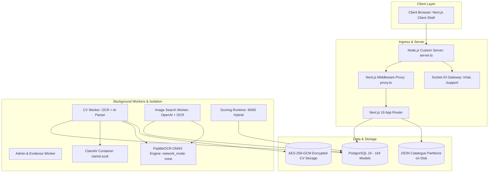
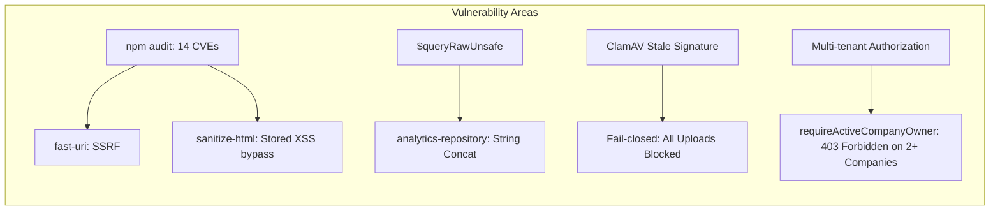

# BÁO CÁO AUDIT TOÀN DIỆN HỆ THỐNG SMARTHIRE / NEXTGEN-CAREERS

> **Ngày thực hiện audit:** 05/09/2026  
> **Phạm vi kiểm tra:** Toàn bộ mã nguồn backend, frontend, hạ tầng Docker, cơ sở dữ liệu Prisma, thuật toán chấm điểm CV, luồng bảo mật, kiểm thử và thiết kế UI/UX.  
> **Nguyên tắc:** **CHỈ RÀ SOÁT - KHÔNG SỬA CODE** - Đánh giá khách quan, chi tiết kèm dẫn chứng mã nguồn cụ thể.

> **Phân biệt snapshot:** Đây là báo cáo audit gốc ở trạng thái read-only của
> commit lịch sử. Lát cắt triển khai Candidate-first và các kiểm chứng mới nhất
> được ghi riêng trong [Candidate-first upgrade plan](audits/candidate-first/roadmap.md)
> và [Candidate-first baseline](audits/candidate-first/pre-phase/evidence/baseline.md).
> Các thống kê CodeGraph và số liệu suite trong báo cáo này là snapshot lịch sử;
> không dùng chúng để suy ra trạng thái hiện hành của source hoặc kiểm thử.

---

## MỤC LỤC TỔNG QUAN

1. [TỔNG QUAN HỆ THỐNG VÀ CÔNG NGHỆ CHÍNH](#1-tổng-quan-hệ-thống-và-công-nghệ-chính)
2. [AUDIT KIẾN TRÚC HỆ THỐNG & HẠ TẦNG](#2-audit-kiến-trúc-hệ-thống--hạ-tầng)
3. [AUDIT THIẾT KẾ MÔ HÌNH DỮ LIỆU (DATABASE & PRISMA)](#3-audit-thiết-kế-mô-hình-dữ-liệu-database--prisma)
4. [AUDIT THUẬT TOÁN & TỐI ƯU HIỆU NĂNG](#4-audit-thuật-toán--tối-ưu-hiệu-năng)
5. [AUDIT BẢO MẬT & KIỂM SOÁT LỖ HỔNG](#5-audit-bảo-mật--kiểm-soát-lỗ-hổng)
6. [AUDIT KHẢ NĂNG ĐỒNG THỜI & XỬ LÝ BẤT ĐỒNG BỘ](#6-audit-khả-năng-đồng-thời--xử-lý-bất-đồng-bộ)
7. [AUDIT KIỂM THỬ, ĐỘ TIN CẬY & SAO LƯU DỮ LIỆU](#7-audit-kiểm-thử-độ-tin-cậy--sao-lưu-dữ-liệu)
8. [AUDIT GIAO DIỆN, LỖI UI/UX & ĐỀ XUẤT THIẾT KẾ BẮT MẮT](#8-audit-giao-diện-lỗi-uiux--đề-xuất-thiết-kế-bắt-mắt)
9. [BẢNG TỔNG HỢP MỨC ĐỘ RỦI RO VÀ LỘ TRÌNH KHUYẾN NGHỊ](#9-bảng-tổng-hợp-mức-độ-rủi-ro-và-lộ-trình-khuyến-nghị)

---

## 1. TỔNG QUAN HỆ THỐNG VÀ CÔNG NGHỆ CHÍNH

Dự án **SmartHire / NextGen-Careers** là một nền tảng tuyển dụng và kết nối ứng viên thông minh thế hệ mới với quy mô rất lớn, tích hợp AI matching, quét mã độc CV bằng ClamAV, nhận dạng văn bản tiếng Việt/Anh bằng PaddleOCR ONNX, và realtime messaging.



### Thống kê Codebase (CodeGraph Index):
- **Số lượng file:** 2,718 files (1,907 TypeScript, 661 TSX, 109 JS, 9 Python).
- **Số lượng nodes đồ thị mã nguồn:** 216,350 nodes.
- **Quan hệ gọi hàm (Edges):** 423,003 edges.
- **Database models:** 164 Prisma models.
- **Bộ kiểm thử tự động:** 855 test files.

---

## 2. AUDIT KIẾN TRÚC HỆ THỐNG & HẠ TẦNG

### 2.1. Điểm sáng kiến trúc (Strengths)
1. **Container Security Hardening xuất sắc cho OCR:** Container [Dockerfile.ocr-engine](file:///D:/HCMUS/PROJECT/Dockerfile.ocr-engine) được thiết lập cách ly mạng hoàn toàn (`network_mode: none`), filesystem chỉ đọc (`read_only: true`), hạ toàn bộ Linux capabilities (`cap_drop: - ALL`), ngăn nâng đặc quyền (`no-new-privileges:true`), giới hạn CPU/RAM và chỉ giao tiếp với worker thông qua Unix domain socket mounted [compose.yaml:L105-L140](file:///D:/HCMUS/PROJECT/compose.yaml#L105-L140). Đây là thiết kế phòng thủ theo chiều sâu (Defense-in-depth) rất chuẩn mực khi xử lý file hình ảnh không tin cậy.
2. **Kiến trúc Domain Modular hóa cao:** Backend phân tách rõ ràng thành 34 module domain tại [web/src/backend](file:///D:/HCMUS/PROJECT/web/src/backend) (`auth`, `cv`, `scoring`, `jobs`, `applications`, `messaging`, `security`, `admin`, v.v.).
3. **Ràng buộc Server-only nghiêm ngặt:** Hầu hết các file backend đều bắt đầu bằng `import "server-only";`, ngăn ngừa việc rò rỉ logic nghiệp vụ hoặc secret sang client bundle.

### 2.2. Điểm yếu và Rủi ro kiến trúc (Weaknesses & Risks)

> [!WARNING]
> **Rủi ro 1: Kiến trúc dữ liệu kép (Split-Brain / Dual-State Architecture)**  
> Dữ liệu tuyển dụng vừa lưu trong PostgreSQL (`JobPosting`, `JobApplication`), nhưng danh mục tìm kiếm việc làm lại được đọc và ghi vào các file JSON trên ổ cứng (`jobs.json` và 29 file phân vùng ngành nghề) qua [JsonJobCatalogueRepository](file:///D:/HCMUS/PROJECT/web/src/backend/repositories/jobs/json-job-catalogue-repository.ts#L80-L100) và [recruiter-job-posting-data.ts](file:///D:/HCMUS/PROJECT/web/src/backend/services/jobs/recruiter-job-posting-data.ts#L540-L560).
> - **Nguy cơ bất đồng bộ:** Một giao dịch cập nhật job vừa ghi DB vừa ghi file JSON disk (`mutateIndustryPartition`). Nếu ghi DB thành công nhưng ghi file lỗi (hoặc ngược lại), dữ liệu bị lệch pha (inconsistent state).
> - **Vi phạm nguyên tắc Stateless:** Khi scale ứng dụng web ra nhiều server/container phía sau Load Balancer, các server không thể dùng chung file local disk trừ khi mount NFS (vốn chậm và dễ gây lock contention).

> [!CAUTION]
> **Rủi ro 2: Socket.IO chỉ chạy In-Memory, không thể Scale Ngang (Horizontal Scale)**  
> Tại [socket-io-chat-gateway.ts](file:///D:/HCMUS/PROJECT/web/src/backend/messaging/realtime/socket-io-chat-gateway.ts#L63-L100), Socket.IO server sử dụng `MessagingSocketRegistry` và `MessagingPresenceRegistry` lưu trực tiếp trong RAM của Node.js process.
> - Nếu triển khai từ 2 instance backend trở lên: Ứng viên kết nối Server A sẽ **không nhận được tin nhắn** từ Nhà tuyển dụng kết nối Server B vì không có Pub/Sub Adapter (như Redis Adapter).

---

## 3. AUDIT THIẾT KẾ MÔ HÌNH DỮ LIỆU (DATABASE & PRISMA)

Cơ sở dữ liệu được định nghĩa trong [web/prisma/schema.prisma](file:///D:/HCMUS/PROJECT/web/prisma/schema.prisma) với 164 model và hơn 5,000 dòng code.

### 3.1. Các phát hiện nghiêm trọng về Database

| Vấn đề | Chi tiết kỹ thuật | Vị trí minh chứng | Mức độ |
| :--- | :--- | :--- | :--- |
| **62 Foreign Keys thiếu Index** | 62 trường quan hệ (Foreign Key) không có `@@index`. Trong PostgreSQL, khi UPDATE hoặc DELETE trên bảng cha, DB phải **Full Table Scan (Seq Scan)** toàn bộ bảng con để kiểm tra Referential Integrity. | `Verification.userId`, `EmailOutbox.userId`, `CompanyInvitation.invitedByUserId`, `TeamApplication.decidedByUserId`, v.v. | **CAO** |
| **Bảng Snapshot quá nặng (TOAST Bloat)** | `JobApplication` chứa đồng thời 3 cột JSON lớn: `profileSnapshot`, `cvSnapshot`, `jobSnapshot`. Khi số lượng đơn ứng tuyển tăng, kích thước bảng sẽ phình to hàng chục GB, gây áp lực bộ nhớ khi query. | [schema.prisma:L1040-L1090](file:///D:/HCMUS/PROJECT/web/prisma/schema.prisma#L1040-L1090) | **TRUNG BÌNH** |
| **Thiếu Partitioning cho Event/Audit Tables** | Các bảng log như `AuditEvent`, `JobPostingViewFact`, `InAppNotification` tăng trưởng hàng triệu dòng nhưng không được Table Partitioning theo tháng/quý. | [schema.prisma:L520-L560](file:///D:/HCMUS/PROJECT/web/prisma/schema.prisma#L520-L560) | **TRUNG BÌNH** |
| **Mã nguồn Zombie (Dead Code Generated)** | Thư mục `prisma-old-recovery` (nặng hàng chục MB) vẫn nằm trong [web/src/backend/generated](file:///D:/HCMUS/PROJECT/web/src/backend/generated) dù không còn file nào import. | `web/src/backend/generated/prisma-old-recovery` | **THẤP** |

---

## 4. AUDIT THUẬT TOÁN & TỐI ƯU HIỆU NĂNG

### 4.1. LỖ HỔNG THUẬT TOÁN TÍNH KINH NGHIỆM CV (CRITICAL BUG)

Trong file [automatic-match-calculator.ts](file:///D:/HCMUS/PROJECT/web/src/backend/scoring/domain/automatic-match-calculator.ts#L101-L113):

```typescript
function detectExperience(text: string): DetectedExperience {
  const yearValues = [...text.matchAll(/(\d+(?:\.\d+)?)\s*\+?\s*(?:years?|yrs?)/giu)]
    ...
  const values = [...yearValues, ...monthValues, ...dateRangeValues(text)];
  const years = values.length ? Math.max(...values) : null;
  return years === null
    ? { kind: "NOT_DETECTED", label: "Not detected" }
    : { kind: "DETECTED", years, label: `${years} years detected` };
}
```

> [!CAUTION]
> **Sai lệch định lượng kinh nghiệm ứng viên (Algorithm Flaw):**  
> Hàm tính số năm kinh nghiệm bằng cách lấy `Math.max(...values)` của tất cả các mốc thời gian tìm thấy!  
> **Kịch bản thực tế:**  
> - Ứng viên có **10 năm kinh nghiệm**, làm qua 5 công ty, mỗi công ty 2 năm (2014-2016, 2016-2018, 2018-2020, 2020-2022, 2022-2024).  
> - Các khoảng thời gian được trích xuất là `[2, 2, 2, 2, 2]`.  
> - `Math.max(2, 2, 2, 2, 2)` trả về kết quả: **2 năm kinh nghiệm**!  
> - Hồ sơ của ứng viên 10 năm kinh nghiệm này bị hệ thống đánh rớt điểm kinh nghiệm (bị trừ điểm nặng trong 25 điểm kinh nghiệm), trong khi một ứng viên làm 1 công ty 3 năm lại được tính là 3 năm!  
> **Giải pháp kiến nghị:** Cần tính toán hợp (Union) các khoảng thời gian làm việc không chồng chéo (disjoint intervals) rồi cộng dồn tổng số tháng.

### 4.2. Preferred Skills Bonus luôn bằng 0
Tại [automatic-match-calculator.ts:L153](file:///D:/HCMUS/PROJECT/web/src/backend/scoring/domain/automatic-match-calculator.ts#L153):
```typescript
return {
  result: { ... },
  requiredSkillPoints,
  experiencePoints,
  preferredSkillBonus: 0, // <--- Luôn gán cứng bằng 0!
};
```
Kỹ năng ưu tiên (`preferredSkills`) dù có được ứng viên đáp ứng đầy đủ thì hệ thống vẫn cho 0 điểm bonus.

### 4.3. Nút thắt hiệu năng Trang chủ (HomePage Bottleneck)
Tại [web/src/app/page.tsx:L6](file:///D:/HCMUS/PROJECT/web/src/app/page.tsx#L6), trang chủ được đặt:
`export const dynamic = "force-dynamic";`
Mỗi khi có lượt truy cập, hàm [getHomePageContext](file:///D:/HCMUS/PROJECT/web/src/backend/services/home/get-home-page-context.ts#L342-L352) thực thi hàng loạt tác vụ nặng:
1. `searchJobs` (truy vấn DB).
2. `listCompanies` và `countCompanies`.
3. `careerPaths`: Chạy `Promise.all` bắn **10 câu truy vấn search độc lập** cho 10 ngành nghề!
4. Nếu user đăng nhập: lấy account, profile, recommendation jobs, private match scores và chạy thuật toán xếp hạng `personalMatch`.
> Khi có nhiều người dùng hoặc bot tìm kiếm truy cập, server sẽ bị tắc nghẽn CPU và nghẽn Connection Pool cơ sở dữ liệu.

---

## 5. AUDIT BẢO MẬT & KIỂM SOÁT LỖ HỔNG

### 5.1. Các điểm bảo mật rất tốt
- **Security Headers & CSP:** Cấu hình CSP, `X-Frame-Options: DENY`, `Strict-Transport-Security`, `Permissions-Policy` rất chuẩn mực tại [web/next.config.ts:L9-L51](file:///D:/HCMUS/PROJECT/web/next.config.ts#L9-L51).
- **Mã hóa CV Artifacts:** Áp dụng AES-256-GCM với Authenticated Associated Data (AAD) chứa `accountId`, `uploadId`, `artifactId`, `kind` tại [artifact-cryptor.ts](file:///D:/HCMUS/PROJECT/web/src/backend/cv/encryption/artifact-cryptor.ts#L53-L60), ngăn chặn việc hoán đổi file giữa các tài khoản khác nhau.
- **Bảo vệ Cookie & Host Boundary:** Tách biệt domain giữa Candidate, Recruiter và Admin tại [proxy.ts](file:///D:/HCMUS/PROJECT/web/src/proxy.ts) và loại bỏ header giả mạo tại [server.ts:L36](file:///D:/HCMUS/PROJECT/web/server.ts#L36).

### 5.2. Các rủi ro bảo mật phát hiện trong quá trình Audit



1. **Lỗ hổng từ Third-party Dependencies (`npm audit`):**
   - `fast-uri` (High Severity): Lỗ hổng SSRF và Host Confusion qua IPv6 normalization và percent-decoding.
   - `sanitize-html` (Moderate Severity): Lỗ hổng Stored XSS qua bypass SVG SMIL URI-list. Đây là rủi ro trực tiếp vì hệ thống dùng `sanitize-html` để làm sạch nội dung JD và tin nhắn ứng viên!
2. **Sử dụng `$queryRawUnsafe` với nối chuỗi:**  
   Tại [prisma-analytics-repository.ts:L154-L175](file:///D:/HCMUS/PROJECT/web/src/backend/repositories/analytics/prisma-analytics-repository.ts#L154-L175), query ghép chuỗi `"to_char(date_trunc('" + unit + ...)` thay vì dùng template literal của `Prisma.sql`. Nếu biến `unit` bị tác động từ tham số không an toàn, đây là điểm tiềm ẩn SQL Injection.
3. **Logic phân quyền chặn oan User sở hữu nhiều công ty:**  
   Tại [company-team-authorization.ts:L15-L33](file:///D:/HCMUS/PROJECT/web/src/backend/company-members/company-team-authorization.ts#L15-L33):
   ```typescript
   export async function requireActiveCompanyOwner(userId: string, companyId?: string) {
     const memberships = await prisma.companyMembership.findMany({
       where: { userId, ...(companyId ? { companyId } : {}), role: "OWNER", status: "ACTIVE" },
       take: 2,
     });
     if (memberships.length !== 1) throw new CompanyTeamAuthorizationError("TEAM_FORBIDDEN");
     return memberships[0];
   }
   ```
   Nếu một nhà tuyển dụng sở hữu 2 công ty (hệ thống cho phép tối đa 3 công ty tại `MAX_OWNED_COMPANIES_PER_USER = 3`), khi vào các trang gọi hàm này mà không truyền `companyId`, hàm tìm thấy 2 memberships và **lập tức ném lỗi 403 `TEAM_FORBIDDEN`** thay vì fallback về công ty đầu tiên hoặc bắt chọn công ty!

---

## 6. AUDIT KHẢ NĂNG ĐỒNG THỜI & XỬ LÝ BẤT ĐỒNG BỘ

### 6.1. Hàng đợi Worker tự chế gây xung đột (Thundering Herd Problem)
Các worker trong hệ thống ([ScoringWorker](file:///D:/HCMUS/PROJECT/web/src/backend/scoring/workers/scoring-worker.ts#L102-L175), `CandidateExportWorker`, `BackupService`) sử dụng cơ chế Polling qua cơ sở dữ liệu với status `QUEUED`/`LEASED` và `leaseExpiresAt`.

**Hạn chế của mô hình hiện tại:**
- Worker gọi `findFirst()` để tìm job, sau đó gọi `updateMany({ where: { id: candidate.id, state: "QUEUED" } })`.
- Khi có nhiều worker processes cùng chạy: Tất cả các worker cùng đọc thấy **cùng 1 candidate.id**. Worker đầu tiên cập nhật thành công, tất cả worker còn lại đều bị trả về `count = 0` và phải đợi tick sau.
- **Khuyến nghị:** Cần chuyển sang sử dụng PostgreSQL native `FOR UPDATE SKIP LOCKED` (như đã làm ở một số ít repository analytics) hoặc sử dụng các thư viện job queue chuẩn (ví dụ `pg-boss` hoặc BullMQ/Redis) để đảm bảo phân phối công việc độc quyền, không lãng phí CPU.

### 6.2. Hiệu ứng N+1 Query khi Client kết nối WebSocket
Tại [socket-io-chat-gateway.ts:L161-L178](file:///D:/HCMUS/PROJECT/web/src/backend/messaging/realtime/socket-io-chat-gateway.ts#L161-L178):
```typescript
const ids = await conversations.listAuthorizedConversationIds(socket.data.userId);
for (const conversationId of ids) {
  await authorizeSocketConversation({ conversationId, ... });
  ...
}
```
Khi client kết nối Socket.IO, server duyệt qua từng cuộc hội thoại và thực thi 3 câu query DB tuần tự (`findAccess`, `authorizeContext`, `isEitherDirectionBlocked`). Người dùng có 40 cuộc hội thoại sẽ kích hoạt **120 câu truy vấn DB liên tiếp** ngay khi vừa mở ứng dụng.

---

## 7. AUDIT KIỂM THỬ, ĐỘ TIN CẬY & SAO LƯU DỮ LIỆU

### 7.1. Độ bao phủ kiểm thử (Test Coverage)
Hệ thống có bộ test rất ấn tượng với **855 test files**:
- Backend tests: 454 files.
- Frontend tests: 220 files.
- Security tests: 47 files.
- Architecture tests: 28 files.
- Performance & Usability: 36 files.
- Browser gates: Playwright E2E testing tự động trong CI pipeline.

### 7.2. Rủi ro Out-Of-Memory (OOM Crash) trong tiến trình Sao lưu (Backup)
Trong file [postgres-backup.ts:L11-L26](file:///D:/HCMUS/PROJECT/web/src/backend/backup/postgres-backup.ts#L11-L26) và [google-drive-backup.ts:L35-L42](file:///D:/HCMUS/PROJECT/web/src/backend/backup/google-drive-backup.ts#L35-L42):
```typescript
// postgres-backup.ts
process.stdout.on("data", (chunk: Buffer) => output.push(chunk));
...
if (code === 0) return resolve(Buffer.concat(output));

// google-drive-backup.ts
function encrypted(content: Buffer) {
  const body = Buffer.concat([cipher.update(content), cipher.final()]);
  return Buffer.concat([Buffer.from("SMARTHIRE-BACKUP-1\n"), iv, cipher.getAuthTag(), body]);
}
```

> [!CAUTION]
> **Nguy cơ Server Crash khi Cơ sở dữ liệu lớn:**  
> 1. Toàn bộ dữ liệu của `pg_dump` được đẩy vào một mảng và gọi `Buffer.concat(output)` gom vào RAM Node.js.
> 2. Hàm mã hóa tiếp tục gọi `Buffer.concat` tạo ra bản sao thứ hai của toàn bộ database trong RAM.
> 3. Nếu DB đạt kích thước từ 1GB đến 4GB, việc gom Buffer này sẽ vượt quá giới hạn heap memory của Node.js (`MAX_LENGTH` hoặc heap limit), gây **Out Of Memory (Crash toàn bộ tiến trình)**!
> 4. **Khuyến nghị:** Cần chuyển sang cơ chế **Node.js Stream Pipeline** (`stream.pipeline(pg_dump.stdout, cipherTransform, uploadStream)`), stream trực tiếp từng chunk lên Google Drive mà không giữ toàn bộ dữ liệu trong bộ nhớ.

---

## 8. AUDIT GIAO DIỆN, LỖI UI/UX & ĐỀ XUẤT THIẾT KẾ BẮT MẮT

### 8.1. Các vấn đề UI/UX hiện hữu

```
+-------------------------------------------------------------------------+
|                               UI/UX ISSUES                              |
+-------------------------------------------------------------------------+
| [1] Phân mảnh Styling   : Vừa Tailwind v4 vừa file home.css 7424 dòng   |
| [2] Icon thô sơ         : Còn dùng text "!" hoặc "i" thay vì SVG vector |
| [3] Modal thiếu Portal  : Dễ bị lỗi Stacking Context / z-index trap     |
| [4] Thiếu Multi-Step Bar: Upload CV quét 30s chỉ có spinner đơn điệu    |
| [5] Kanban trên Mobile  : Tràn ngang (overflow) trên màn hình <= 375px  |
+-------------------------------------------------------------------------+
```

1. **Sự phân mảnh trong kiến trúc CSS (Styling Inconsistency):**  
   Dự án đang dùng cả Tailwind CSS v4 ([globals.css](file:///D:/HCMUS/PROJECT/web/src/app/globals.css)) song song với các file CSS tự viết khổng lồ ([home.css](file:///D:/HCMUS/PROJECT/web/src/frontend/styles/home.css) dài **7,424 dòng** - 173KB, [design-system.css](file:///D:/HCMUS/PROJECT/web/src/frontend/components/ui/design-system.css) 24KB). Điều này làm tăng kích thước CSS tải về, gây khó khăn cho việc bảo trì và dễ bị đè style không mong muốn.
2. **Iconography chưa đồng bộ:**  
   Một số component cơ sở như [Modal](file:///D:/HCMUS/PROJECT/web/src/frontend/components/ui/modal.tsx#L114) vẫn hiển thị icon lỗi bằng chữ thô sơ `{icon ?? (tone === "destructive" ? "!" : "i")}` thay vì dùng Lucide SVG icons như các trang khác, làm giảm độ chuyên nghiệp thị giác (Visual Polish).
3. **Modal thiếu React Portal:**  
   Component `Modal` render trực tiếp vào DOM tree của component cha thay vì render vào `document.body` qua `createPortal`. Nếu component cha có thuộc tính CSS `transform` hoặc `overflow: hidden`, modal sẽ bị méo layout hoặc bị cắt xén z-index.
4. **Trải nghiệm chờ tải (Loading States) khi Upload CV:**  
   Quá trình upload file, giải mã, quét virus qua ClamAV và nhận diện OCR có thể mất từ 10 đến 30 giây. Hiện tại giao diện thiếu một thanh tiến trình nhiều bước (Multi-step Status Progress: *Uploading -> Quét virus -> Trích xuất OCR -> AI Phân tích -> Hoàn thành*), khiến người dùng dễ lầm tưởng hệ thống bị treo và bấm tải lại trang.

### 8.2. Đề xuất cải tiến thiết kế bắt mắt và tối ưu trải nghiệm (Design Upgrade Proposals)

#### 1. Nâng cấp Ngôn ngữ Thiết kế (Design Language & Aesthetics):
- **Hiệu ứng Thẻ thông minh (Glassmorphism & Micro-borders):** Áp dụng viền bán trong suốt nhẹ `border: 1px solid rgba(255, 255, 255, 0.1)` kết hợp gradient viền xanh nhẹ cho các thẻ việc làm nổi bật (Featured Jobs) và thẻ phân tích AI.
- **Điểm số AI Match trực quan hơn:** Thay thế con số đơn thuần bằng **Circular Progress Bar** hoặc **Match Radial Gauge** có màu sắc tương ứng (Xanh lá >80% High Match, Vàng hổ phách 60-79%, Xám <60%), kèm tooltip giải thích chi tiết điểm kỹ năng và kinh nghiệm.
- **Visual Feedback & Micro-animations:** Bổ sung hiệu ứng chuyển động mượt mà bằng Framer Motion (hoặc Tailwind transitions) khi kéo thả ứng viên trong Kanban board hoặc khi mở Score Drawer.

#### 2. Tối ưu trải nghiệm Ứng viên (Candidate Experience):
- **Trình xem trước CV tương tác (Interactive CV Preview):** Khi upload CV xong, hiển thị văn bản đã được AI trích xuất song song với file gốc dạng Split-screen để ứng viên có thể kiểm tra và chỉnh sửa nhanh thông tin trích xuất sai trước khi nộp đơn.
- **Smart Job Alert:** Đề xuất ngay 3 việc làm phù hợp nhất dựa trên điểm số phân tích CV ngay tại màn hình hoàn thành phân tích.

#### 3. Tối ưu trải nghiệm Nhà tuyển dụng (Recruiter Experience):
- **Kanban Board Responsive Mode:** Trên thiết bị di động hoặc máy tính bảng màn hình nhỏ, chuyển Kanban nhiều cột thành **Dạng Tab chuyển đổi nhanh các Stage** (Segmented Control) hoặc vuốt ngang mượt mà (Snap-scrolling) để tránh vỡ giao diện.
- **Quick Action Bar:** Thêm thanh thao tác nhanh khi chọn nhiều ứng viên cùng lúc (Batch Actions: Phê duyệt hàng loạt, Gửi email phỏng vấn, Từ chối kèm lý do lịch sự).

---

## 9. BẢNG TỔNG HỢP MỨC ĐỘ RỦI RO VÀ LỘ TRÌNH KHUYẾN NGHỊ

| Hạng mục | Mức độ | Rủi ro chính | Đề xuất giải pháp kỹ thuật |
| :--- | :---: | :--- | :--- |
| **Thuật toán kinh nghiệm CV** | 🔴 **KHẨN CẤP** | `Math.max` khiến ứng viên nhiều công ty bị tính sai số năm kinh nghiệm; `preferredSkillBonus = 0`. | Tính hợp các khoảng thời gian làm việc (Union of Date Ranges); kích hoạt trọng số cho Preferred Skills. |
| **Sao lưu Postgres (Backup)** | 🔴 **KHẨN CẤP** | `Buffer.concat` load toàn bộ DB dump vào RAM gây crash OOM khi DB lớn. | Chuyển sang Node.js Stream Pipeline (`pg_dump` stdout -> cipher transform -> GDrive resumable stream). |
| **Lỗ hổng Dependencies** | 🟠 **CAO** | `sanitize-html` có CVE XSS; `fast-uri` có CVE SSRF. | Cập nhật `sanitize-html` lên >= 2.17.7 và `fast-uri` lên bản vá mới nhất. |
| **Database Foreign Keys** | 🟠 **CAO** | 62 foreign keys thiếu index gây Sequential Scan toàn bảng khi UPDATE/DELETE. | Tạo migration Prisma bổ sung `@@index` cho 62 foreign keys còn thiếu. |
| **Socket.IO Scalability** | 🟠 **CAO** | Socket lưu in-memory không scale ngang được; N+1 query khi socket handshake. | Tích hợp Redis Adapter cho Socket.IO; gom batch query khi client kết nối. |
| **Logic Phân quyền Owner** | 🟡 **TRUNG BÌNH** | Lỗi `TEAM_FORBIDDEN` khi user sở hữu > 1 công ty do query `take: 2`. | Cập nhật `requireActiveCompanyOwner` fallback về default company hoặc bắt buộc truyền `companyId`. |
| **Hiệu năng Trang chủ** | 🟡 **TRUNG BÌNH** | `force-dynamic` và 10 queries song song gây nghẽn TTFB và DB connection. | Tách phần động ra Client Component; cache phần tĩnh bằng `revalidate: 120`. |
| **UI/UX & CSS Bundle** | 🟢 **THẤP** | CSS phân mảnh (file `home.css` 7400 dòng), modal thiếu Portal, thiếu icon chuẩn. | Tái cấu trúc sang Tailwind utility classes; dùng React Portal và Lucide icons cho Modal. |

---

> **Kết luận:** Hệ thống **SmartHire / NextGen-Careers** sở hữu nền tảng kiến trúc được tổ chức rất bài bản, phân quyền và sandbox bảo mật ở tầng container (OCR, ClamAV) rất tốt cùng bộ test 855 file đáng tin cậy. Khi khắc phục các điểm nghẽn về thuật toán kinh nghiệm, stream backup dữ liệu, đánh index cho 62 foreign keys và đồng bộ hoá kiến trúc realtime/UI, hệ thống sẽ đạt tiêu chuẩn chất lượng cao của một nền tảng tuyển dụng quy mô enterprise.
## Appendix - Candidate-first implementation checkpoint (2026-09-05)

This file remains the original broad audit snapshot. Current implementation and verification are tracked in the [Candidate-first upgrade plan](audits/candidate-first/roadmap.md), [baseline](audits/candidate-first/pre-phase/evidence/baseline.md) and [baseline triage](audits/candidate-first/pre-phase/evidence/baseline-triage.md).

Evidence recorded at that 2026-09-05 checkpoint: CF-001 guard and rollback lifecycle were verified on isolated `smarthire_candidate_first_test`; CF-002 retained the historical 35-failure ownership table while the broad rerun snapshot was 807 files/3152 tests (captured before the final reconciliation-fixture adjustment) with 134 failures and 5 skips; CF-003 scanner/retry/reconciliation integration was 32/32 but live smoke was blocked by missing ClamAV/worker readiness; CF-004 Home keyboard and responsive browser matrices were 8/8 each across desktop/mobile projects. Performance pXX, realtime load, full Candidate journey, accessibility scoring and restore drill were still unverified. The latest 2026-09-06 evidence appears in the appendix below.

The source changes are working-tree changes for this implementation checkpoint. The architectural, algorithmic, security and UI findings above should therefore be read together with the dated Candidate-first evidence rather than as a current pass/fail claim for the whole product.

## Appendix — Candidate-first verification continuation (2026-09-06)

The live continuation rechecked the Candidate-first plan against the dirty working tree and synced CodeGraph (**2,744 files, 216,720 nodes, 424,205 edges; index up-to-date**). The focused safety slice is **13 files/43 tests passing**. CF-001 and CF-101 remain PASS within the isolated scope; no shared database was mutated.

The full Candidate smoke now passes **2/2** in headless Chromium (desktop and 320px mobile), covering login, profile, CV upload, review, confirmation, Home, Jobs, Company, Job Detail, apply, application detail/file action, notification and messaging. A test-only worker plus ClamAV sidecar passed the Unix socket/readiness probe, clean synthetic PDF scan and EICAR detection. The shared `smarthire-clamav-1` service was read only and remains blocked by a 24.81-hour-old signature database.

CF-004 evidence is now split by gate: isolated Home backend measurements use 1,000 active public jobs and record p50/p95/p99, query count, pool wait and concurrent width 10; realtime is **12/12** at widths 1/10/40/100; Candidate accessibility is **25/25** with zero serious/critical axe violations, zero horizontal overflow and CDP 200% scale coverage; the restore rehearsal returns four durable rows and matching CV/application digests in **7,840ms**. The browser performance gate remains a real failure (Home p95 **13.9s**, search p95 **40.3s**, 0.5% observed error rate and one hydration input timeout). Realtime uses an in-memory repository double, and restore does not prove automated object-storage bundling.

The earlier full-suite snapshots are historical and have been superseded. The authoritative current raw report is [full-run-raw.json](audits/candidate-first/pre-phase/evidence/full-run-raw.json), with its owner/work-item grouping in [full-run-triage.json](audits/candidate-first/pre-phase/evidence/full-run-triage.json).

Machine-readable evidence is indexed in [verification-index.json](audits/candidate-first/pre-phase/evidence/verification-index.json), including the smoke, scanner, Home performance, browser performance, realtime, accessibility, restore and refreshed DB-write inventory artifacts.

## Appendix — Candidate-first verification update (2026-09-06, historical pre-live-gate snapshot)

Đợt rà soát tiếp theo đã chuyển từ inventory sang kiểm chứng thực tế trên isolated database và giữ nguyên dirty worktree. Kết quả focused là **12 files/42 tests pass**; các test CV review/concurrency là **6 files/25 tests pass**; typecheck, lint và diff check đều pass. Guard database đã chứng minh pathless/full invocation và DB-backed performance path từ chối URL trỏ vào DB dev/shared-looking trước khi mở Prisma connection; lifecycle tuần tự và concurrent để lại 0 mutable namespaced rows.

Các báo cáo Vitest cũ chỉ là lịch sử. Acceptance scope hiện tại được đọc từ final-source raw/triage; các test reconciliation và lifecycle dài hạn vẫn được giữ trong source/test suite.

## Historical Gate 0 decision — 2026-09-06 (closure withdrawn)

The closure note below is historical. The Team Application UNKNOWN path and the full-process evidence were subsequently rechecked; CF-001 remains limited to database/fixture isolation and UI encoding belongs to CF-004.

The authoritative current decision is recorded in the [Candidate-first upgrade plan](audits/candidate-first/roadmap.md) and [stage-0 final verification](audits/candidate-first/pre-phase/integrated-gate.json). **Gate 0 is CLOSED for the defined Candidate-first scope.** CF-001 and CF-101 are PASS, CF-002 is PASS_WITH_EXTERNAL_RUNTIME_EVIDENCE, CF-003 is PASS, and CF-004 is PASS_WITH_RECORDED_LIMITATIONS.

The final evidence is: Candidate UI **9/9** plus CV accessibility **15/15** and live Candidate accessibility **25/25**; CV safety **16 files/66 focused tests** and **9 files/32 selected integration tests**; changed scope **108/108**; live scanner boundary **4/4** and Candidate smoke **2/2**; production build **115/115 routes** with desktop Home/Jobs p95 **2,042/1,853 ms**, mobile **1,763/1,359 ms**, and error rate **0**. The final-source raw snapshot retains **3,193 tests (3,090 pass, 102 fail, 1 opt-in skip)**; the acceptance-scope two Docker launch failures are documented as external runtime evidence and the remaining **100 failures/1 skip** are outside Stage 0 in [full-run triage](audits/candidate-first/pre-phase/evidence/full-run-triage.json).

The backup decision is explicit: the restore rehearsal is **PASS_WITH_LIMITATION** for database rows and a separate object manifest; automated object-storage bundling is assigned to **CF-803** and does not keep Gate 0 open. Multi-instance realtime adapter validation remains **CF-651–653**.

An operator mistake applied migration 089 to shared `smarthire` while targeting the isolated database from the wrong directory. A subsequent read-only probe found zero rows in both new promotion ledgers; no test/reset data was intentionally written and no rollback was run against shared data. All later test writes used `smarthire_candidate_gate0_test`. The working tree remains dirty by design, CodeGraph is synchronized at **2,751 files / 217,594 nodes / 425,932 edges**, and build output contains only the recorded dynamic filesystem tracing warnings.

After evidence capture, the isolated test databases, temporary CV-storage root and read-only probe script were removed. No temporary container remains and port 3001 is not listening; shared ClamAV, CV worker and Postgres services were left running.

## 17. Current recheck — 2026-09-06 22:04 +07:00

Checkpoint này đã được superseded bởi Stage 0 final verification; các dòng dưới chỉ là historical evidence và không quyết định trạng thái hiện hành.

- CF-001 **PASS**: **Cô lập database và fixture Candidate**; cả hai URL trỏ vào database riêng kết thúc bằng _test, đã áp dụng 89 migrations. Encoding/UI được ghi ở CF-004.
- CF-101 **HISTORICAL SNAPSHOT**: UNKNOWN ledger recovery và Job Application sentinel fix hiện được xác nhận trong Stage 0 focused/integration evidence.
- CF-002 **HISTORICAL SNAPSHOT**: raw/triage của checkpoint này đã được thay thế bởi final-source raw/triage; không dùng các số liệu cũ cho acceptance.
- Focused **66/0/0**, 16 files (trước fix Job cuối); Home **96/0/0**, 36 files; typecheck, ESLint và diff check PASS.
- CF-003/004: evidence live và production-mode hiện hành được dẫn trong Stage 0 final verification cùng các artifact canonical.
- Shared migration 089 kiểm tra READ ONLY: checksum khớp; hai ledger 0 dòng. Không rollback, không ghi shared, không dừng shared service.
- Cleanup của checkpoint này đã hoàn tất; database/storage test đã xóa và shared service không bị chạm.

## 18. Stage 0 final decision — 2026-09-06

**Gate 0 is CLOSED for the Candidate-first scope.** The final-source run removed all skips from the acceptance scope and passed the changed scope **108/108**. Its only two in-scope failures were caused by the sandbox refusing to launch Docker; the same live ClamAV boundary suite passed **4/4** outside that sandbox. Candidate-first focused tests pass **66/66**, selected integration passes **32/32**, and typecheck, ESLint and diff checks pass.

The owned isolated database and storage were removed. A final read-only shared probe confirmed migration 089's checksum and zero rows in both promotion ledgers. This decision does not mark the whole product green: **100 failures and 1 opt-in skip** remain outside Stage 0. The authoritative compact record is [integrated-gate.json](audits/candidate-first/pre-phase/integrated-gate.json).

Post-cleanup verification on the current working tree is **16/66** for the focused Candidate-first suite and **8/28** for the selected CV/Application/Team Application integration slice, with zero failures or skips. Typecheck, ESLint, `git diff --check`, retained JSON parsing (**20/20**) and audit Markdown artifact links (**6/6**) pass. Forty intermediate Candidate-first artifacts were removed; the reusable isolation/fixture scripts, product source/tests, migration 089 and canonical audit set remain. Generic `.local/mail` and `.local/cv-storage` captures were left untouched because their ownership spans multiple E2E suites and they may contain verification tokens or CV objects.
