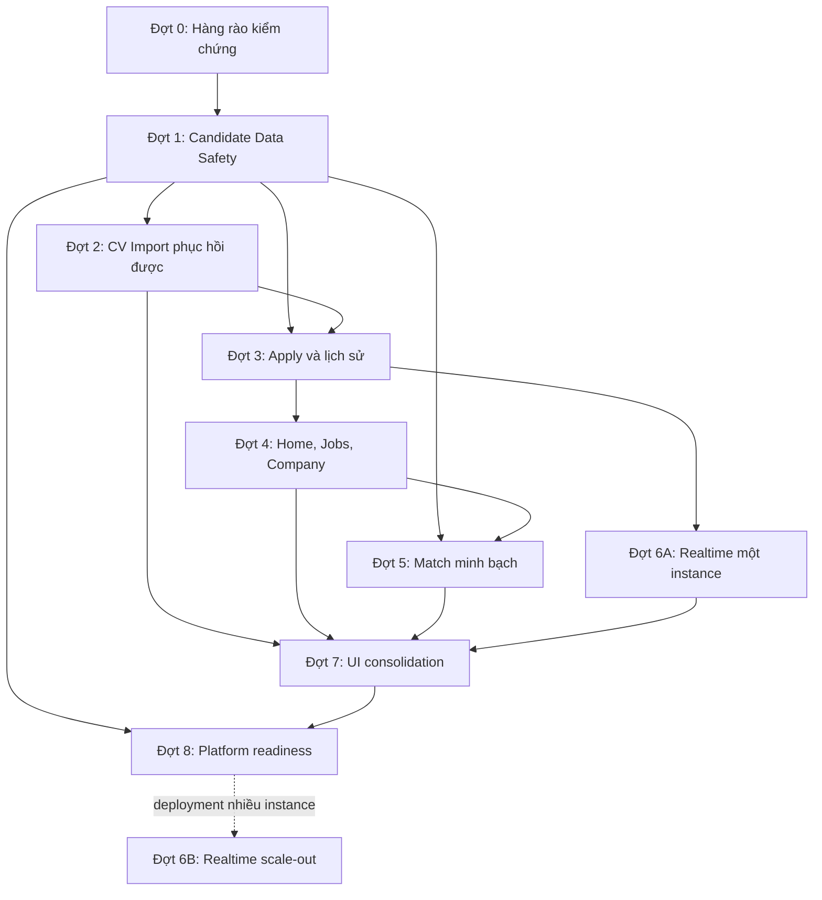

# Kế hoạch nâng cấp toàn diện Candidate-first

**Phiên bản:** 1.3<br>
**Ngày lập:** 2026-09-05<br>
**Current status:** Stage 0 **CLOSED for the Candidate-first scope**; CF-001 and CF-101 are PASS, CF-002 is PASS_WITH_EXTERNAL_RUNTIME_EVIDENCE, CF-003 is PASS, and CF-004 is PASS_WITH_RECORDED_LIMITATIONS. Xem mục 18 và [stage-0 final verification](2026-09-06-gate0-stage0-final-verification.json).<br>
**Nguồn:** [Consolidated System Audit](consolidated-system-audit-2026-09-05.md), [Feature 028 plan](../../spec-kit/specs/028-candidate-company-job-applications/plan.md)

## 1. Mục tiêu

Kế hoạch này tổ chức lần nâng cấp tiếp theo theo hướng **Candidate-first nhưng risk-first**. Hành trình Candidate được ưu tiên từ tải CV, hoàn thiện hồ sơ, tìm việc, nộp hồ sơ, theo dõi ứng tuyển đến nhận thông báo; các lỗi có thể làm mất tài liệu, xử lý lặp, tính sai kinh nghiệm hoặc tự thay đổi quyết định tuyển dụng phải được xử lý trước phần làm đẹp giao diện.

Kết quả cần đạt:

1. CV và hồ sơ ứng tuyển không bị mất, xóa nhầm hoặc xử lý lặp khi mạng chập chờn, refresh hay retry.
2. Candidate có thể quay lại đúng tiến trình CV Import bằng URL và trạng thái trong database.
3. Mọi hồ sơ ứng tuyển đều có đường truy cập ổn định, trạng thái dễ hiểu và tài liệu có thể đối chiếu.
4. Home, Jobs, Company and Job Detail share consistent display conditions, URLs, filters and application data.
5. Điểm phù hợp có bằng chứng, tính kinh nghiệm đúng và không tự ra quyết định thay con người.
6. Notification và Messaging hoạt động ổn định ở topology hiện tại; chỉ thêm hạ tầng phân tán khi có nhiều application instance.
7. Toàn bộ hành trình chính đạt yêu cầu EN/VI, keyboard, viewport hẹp, dark mode nơi được hỗ trợ và reduced motion.
8. Mỗi thay đổi có bằng chứng kiểm chứng phù hợp; không dùng một suite nhỏ hoặc typecheck để tuyên bố toàn hệ thống đã sẵn sàng production.

## 2. Nguyên tắc thực hiện

### 2.1. Nguyên tắc sản phẩm

- Candidate luôn biết hệ thống đang làm gì với CV, dữ liệu nào sẽ được ghi vào profile và hành động nào đã hoàn tất.
- Dữ liệu bền vững phía server là nguồn trạng thái chuẩn. Browser storage chỉ được giữ định danh mờ như `lastActiveUploadId`, không giữ CV text, draft, consent hay PII.
- Scoring và AI tạo gợi ý có bằng chứng. Chuyển stage có hậu quả vẫn thuộc quyền con người theo policy đã chốt.
- Mỗi đợt phải tạo một lát cắt dùng được từ backend đến UI, gồm cả lỗi, retry và khả năng phục hồi.

### 2.2. Nguyên tắc dữ liệu và bảo mật

- Transaction commit là ranh giới chuyển quyền sở hữu artifact. Lỗi dựng projection hoặc response sau commit không được xóa file đã thuộc bản ghi hoàn tất.
- Idempotency key nhận diện một command; SHA-256 xác nhận payload retry có thật sự giống nhau. Hai cơ chế không thay thế nhau.
- Chỉ tái sử dụng artifact khi cùng Candidate hoặc cùng scope được ủy quyền, digest trùng, artifact còn hạn, scan policy/engine version còn hợp lệ và trạng thái đã `CLEAN`.
- File chưa scan hoặc scanner không sẵn sàng phải fail closed, không được mở/tải hoặc đưa vào OCR.
- Không deduplicate artifact vật lý giữa các Candidate trong đợt này.

### 2.3. Nguyên tắc UI

- Dùng semantic token `--sh-*`, typography, component và pattern hiện có.
- Mọi copy mới phải có EN/VI; không hard-code chuỗi hoặc màu trong component.
- Trạng thái không chỉ thể hiện bằng màu. Keyboard, focus visible, focus return, screen reader và zoom 200% là tiêu chí nghiệm thu.
- Loading giữ bố cục; empty state có hành động rõ; lỗi nói được bước tiếp theo; animation tôn trọng reduced motion.
- Giữ Search button làm đường dự phòng khi bổ sung live/debounced search. URL/query là nguồn chuẩn cho filter, sort và pagination.

### 2.4. Nguyên tắc kiểm chứng

- Unit test kiểm tra invariant; integration test kiểm tra DB/storage/worker boundary; browser test kiểm tra hành trình và hành vi thật.
- Fault injection phải bao phủ lỗi trước commit, ngay sau commit, scanner/OCR lỗi, disconnect giữa `await`, retry và concurrent request.
- Ghi rõ: source đã sửa, test cô lập đạt, integration đạt, browser đạt và môi trường đích đã xác minh. Đây là các mức bằng chứng khác nhau.
- Không sửa hoặc xóa assertion về quyền, tenant isolation, dữ liệu và quyết định có hậu quả chỉ để làm suite xanh.

## 3. Phạm vi

### 3.1. Trong phạm vi

- Candidate CV library và CV Import.
- Direct Job Application và Company Team Application có CV.
- Candidate Applications, application detail, timeline, snapshot và download.
- Home, Jobs, Company Directory, Company Detail và Job Detail.
- Candidate match transparency và thuật toán tính tổng kinh nghiệm.
- Notification và recruitment messaging liên quan Candidate.
- Candidate UI consolidation, accessibility, responsive, EN/VI và theme.
- Các hàng rào platform bắt buộc để bảo vệ dữ liệu Candidate: request limits, CSRF boundary, retention/legal hold, export, backup/restore, worker lease và readiness.

### 3.2. Ngoài phạm vi

- Rebrand sản phẩm hoặc thay design system hiện có.
- Viết lại toàn bộ CSS sang Tailwind hoặc thay toàn bộ component library.
- Chuyển sang microservices hoặc thay toàn bộ queue khi chưa có số liệu chứng minh.
- Redis Pub/Sub hoặc adapter phân tán khi deployment vẫn chỉ có một application instance.
- Thay đổi chính sách `preferredSkillBonus = 0` của Feature 015 nếu chưa có quyết định sản phẩm mới.
- Tự động reject/shortlist Candidate bằng score hoặc AI.
- Deduplicate file CV giữa nhiều Candidate.
- Deploy production, chạy migration trên database dùng chung hoặc xóa dữ liệu thật trong phạm vi tài liệu này.

## 4. Hiện trạng đã xác minh

| Khu vực | Nền tảng đã có | Khoảng cần xử lý |
|---|---|---|
| CV Import | Có `CvUpload`, scan/extraction/parse/draft, SHA-256, idempotency và trang trạng thái theo `uploadId` | Chuyển ownership sau commit; safe artifact reuse; resume UX hiện còn phụ thuộc state trong tab |
| CV trên Team Application | Có service và retention policy riêng | Chưa dùng đầy đủ admission → quarantine → scan → encrypted storage → safe-to-open gate chung |
| Application | Có wizard, tracker, repository và idempotency tests ở một số luồng | Snapshot/download/timeline và pagination Candidate cần hoàn thiện đồng bộ |
| Kinh nghiệm | Có dữ liệu experience và scoring service | Cách tổng hợp hiện có thể lấy khoảng lớn nhất thay vì union các khoảng theo tháng |
| Home/Discovery | Có Home context, search, Jobs/Company flows và test tương ứng | Home đang trộn public/personal context; cần đo rồi tách cache, tag và invalidation |
| Realtime | Có Socket.IO gateway, registry/presence và authorization | Disconnect cleanup được đăng ký sau các `await`; multi-instance chưa phải nhu cầu mặc định |
| UI | Có `--sh-*`, EN/VI copy modules và nhiều accessibility tests | Cần kiểm tra browser thật, cascade, responsive, long data, focus và modal stacking |

## 4.1. Trạng thái lát cắt đầu tiên — 2026-09-05

| Hạng mục | Trạng thái hiện tại | Bằng chứng | Giới hạn còn lại |
|---|---|---|---|
| CF-001 | Guard URL fail-closed and namespaced Candidate/base fixtures implemented and verified | `web/tests/helpers/test-database-guard.ts`, contract/rollback tests; `smarthire_candidate_first_test` has 88 migrations/165 tables; create/delete control ran twice consecutively; read-only probe after teardown found 0 users/applications/accounts/memberships/threads/messages/notifications and 0 fixture artifacts; development URL rejected before connection with `TEST_DATABASE_NAME_UNSAFE` | CI provisioning and production-like storage fault integration still need a disposable environment; this is not production evidence |
| CF-002 | Historical 35-failure baseline retained and final-source triage recorded | [`candidate-first-baseline-triage-2026-09-05.md`](candidate-first-baseline-triage-2026-09-05.md) assigns owner/work item for the original 18 suites/35 tests; the current raw/triage pair is [final-source raw](2026-09-06-gate0-recheck-final-source-raw.json) and [final-source triage](2026-09-06-gate0-recheck-final-source-triage.json) | Broader failures remain visible outside the Stage 0 acceptance scope and are assigned to their owning work items |
| CF-003 | Candidate smoke reached CV status and scanner/worker deterministic boundaries are verified | Desktop smoke login/upload API returned 200/201; scanner/retry/reconciliation integration passed 3 files/32 tests on the isolated database; storage cleanup reported no error | Live journey still stops at `CV status` because `/run/clamav/clamd.sock` and the worker are unavailable; mobile, review/confirm/apply/download/notification/message remain unclaimed |
| CF-004 | Home keyboard and responsive browser matrices verified with real Chromium | `home-keyboard-responsive.spec.ts` passed 8/8 and `home-responsive-matrix.spec.ts` passed 8/8 across desktop/mobile projects; checks cover 320/375/768/1280, EN/VI, dark, reduced motion, overflow, focus and screenshot attachments | Home query/p50/p95/p99/pool wait (the dedicated performance gate received 0 active public jobs and required >=1000), realtime 1/10/40/100, full Candidate journey, accessibility score and restore drill still lack evidence |
| CF-101 | Post-commit ownership, replay and idempotent cleanup fixed in application CV paths | prepare, JobApplicationService, profile-save and TeamApplication ownership/replay tests; confirmed-CV promotion; post-commit fault; cleanup retry; fixture rollback; scanner/retry/reconciliation 32 tests pass | No fault/storage integration with real ClamAV yet; reconciliation/retention metrics and CI provisioning remain open in CF-107/CF-801 |

Các trạng thái trên chỉ áp dụng cho lát cắt đầu tiên. Không đánh dấu checkbox
Definition of Done cấp chương trình khi browser, integration, performance và
restore evidence còn thiếu. Lệnh, số pass/fail/skip và giới hạn phải được cập
nhật cùng artifact sau mỗi checkpoint.

**Lệnh checkpoint và kết quả:**

- `npm run test:candidate-first` → **pass**, 9 file và 26 test.
- Guard database có thêm kiểm tra IPv6 loopback và mã hóa database name lỗi; cả hai đều nằm trong 26 test tập trung.
- `npm exec --workspace @smarthire/web -- vitest run tests/backend/contract/jobs/job-application.contract.test.ts --reporter=dot` → **pass**, 1 file và 3 test.
- `npm run typecheck --workspace @smarthire/web` và `npm run lint --workspace @smarthire/web` → **pass**, exit 0.
- `npm exec --workspace @smarthire/web -- playwright test tests/system/e2e/candidate-first/candidate-first-smoke.spec.ts --list` → **pass**, 2 project test; headless Chromium probe cũng khởi động được.
- Database test cô lập `smarthire_candidate_first_test` → **pass**, PostgreSQL local reachable; `prisma migrate deploy` hoàn tất 88 migration; read-only probe xác nhận 165 bảng.
- Candidate fixture control lifecycle → **pass**, create/delete qua `tsx` subprocess; teardown sau smoke trả về 0 user/application/upload/artifact namespaced.
- Existing job application integration trên database test → **pass**, 1 file và 1 test; invariant hiện hành là một `RecruitmentNotificationWork` cho submission idempotent, teardown đã hoàn tất và không còn fixture rows.
- Live desktop smoke với app-only server thật và database test → **fail có chẩn đoán**, login/upload đạt, dừng ở `CV status` sau 90 giây vì pipeline không có worker/ClamAV Unix socket; không ghi nhận như browser pass.
- Integration invocation với `.env.local` hiện tại → **refuse trước kết nối**, `TEST_DATABASE_NAME_UNSAFE`; không tạo hoặc mutate database.
- `git diff --check`, Prettier cho artifact mới và `codegraph status` → **pass**; CodeGraph up to date (2.733 files, 216.472 nodes, 423.506 edges).
- `prettier --check` riêng toàn bộ file plan vẫn cảnh báo layout lịch sử; không mass-reformat để giữ diff tài liệu có thể review.

**Giới hạn còn lại:** database test local đã được provision và không đụng database
`smarthire`, nhưng Docker CLI và CUA browser interactive không khả dụng. CV worker
không thể qua readiness vì thiếu ClamAV socket, nên smoke chỉ đạt tới CV upload
API/status và chưa đạt toàn luồng. Candidate journey browser matrix, storage/DB fault integration,
performance pXX/pool-wait và restore drill chưa được đánh dấu đạt. Baseline 35 lỗi
lịch sử vẫn được giữ và triage, không bị skip.

**Đối chiếu điều kiện dừng:**

1. CF-001 guard and fixture lifecycle pass on `smarthire_candidate_first_test`; CF-002 retains the 35 historical failures; CF-003 live smoke reaches upload/status but is blocked by worker/scanner; CF-004 Home matrix passes while Candidate journey, performance and metrics remain open.
2. Fault sau commit được kiểm tra ở TeamApplication, JobApplication và profile-save; cleanup không xóa artifact đã claim.
3. Replay cùng idempotency key được kiểm tra ở TeamApplication và JobApplication; artifact retry được cleanup, không claim lần hai.
4. Focused checks and app/browser runs completed; remaining blockers are CV worker/ClamAV, the full Candidate journey matrix and performance/restore evidence. The shared database was not changed.

## 4.2. Candidate-first checkpoint and additional verification - 2026-09-05

This section supersedes stale counts in the first checkpoint. Definition of Done checkboxes remain open because browser journey, performance, realtime and restore evidence are incomplete.

- **CF-001:** The guard is exercised for a pathless/full `vitest run`, rejects the development URL before Prisma, validates protocol/host/database marker/schema and requires both matching `DATABASE_URL`/`DIRECT_URL`, and covers IPv6 loopback plus malformed percent-encoding. Candidate and base job-board fixtures roll back after injected mid-creation failures. Two consecutive `tsx` create/delete cycles returned `deleted: true`; a read-only probe found no mutable namespaced rows. `AuditEvent` is retained because the database trigger is append-only. Home, recruitment-pipeline and messaging E2E controls invoke the same guard before importing Prisma.
- **CF-002:** The broad isolated Vitest inventory captured before the final reconciliation-fixture adjustment was `807` files (`723` pass, `84` fail) and `3152` tests (`3013` pass, `134` fail, `5` skip). It is recorded separately from the historical 18-suite/35-test table.
- **CF-003/CF-101:** Deterministic scanner tests cover CLEAN, INFECTED, unavailable, stale definitions, timeout, stream limit and protocol boundaries. Retry lease and deletion reconciliation pass `3` files/`32` tests. This is unit/integration evidence with a transport fixture, not proof that production ClamAV is ready. Ownership after commit, concurrent temporary cleanup, same-key replay and cleanup retry have focused tests.
- **CF-004:** Real Chromium passes `8/8` keyboard tests and `8/8` responsive-matrix tests across desktop/mobile projects. The matrix covers `320x720`, `375x812`, `768x1024`, `1280x800`, EN/VI, dark color scheme, reduced motion, zoom/overflow and focus; each test attaches a screenshot. These checks do not imply performance or accessibility scores.
- **Remaining blocker:** `/run/clamav/clamd.sock` is absent and Docker/interactive CUA is unavailable, so the Candidate smoke stops at CV status. Home query tracing, p50/p95/p99/pool wait, realtime load 1/10/40/100, disconnect/presence and restore drill still need a dedicated environment/harness.

## 5. Sơ đồ phụ thuộc



Không bắt đầu Đợt 2 trước khi invariant ownership và scan gate của Đợt 1 ổn định. Có thể chạy phần platform độc lập của Đợt 8 song song sau Đợt 1 nếu không sửa cùng boundary hoặc migration.

## 6. Kế hoạch chi tiết theo đợt

## Đợt 0 — Hàng rào kiểm chứng

### CF-001 — Cô lập database và fixture Candidate

**Mục đích:** ngăn test chạm nhầm database phát triển hoặc dữ liệu dùng chung.

**Công việc:**

- Xác định biến môi trường và helper đang quyết định test database.
- Thêm guard tên database/host/schema và fail sớm nếu URL không đạt quy ước test.
- Tạo Candidate fixture tối thiểu: account, profile, CV, job, company, application và notification.
- Mỗi test tự dọn dữ liệu theo namespace; không dùng lệnh xóa rộng trên database chưa xác minh.

**Nghiệm thu:** suite Candidate từ chối chạy khi trỏ nhầm database; hai lần chạy liên tiếp không phụ thuộc dữ liệu lần trước; fixture không cần dữ liệu production.

### CF-002 — Triage baseline test

**Mục đích:** biến các lỗi baseline thành danh sách có chủ sở hữu và lý do.

**Công việc:** phân loại lỗi thành sản phẩm, setup/provider, assertion literal cũ, môi trường ngoài và boundary kiến trúc. Gắn từng lỗi với work item trong kế hoạch hoặc ghi rõ ngoài phạm vi.

**Nghiệm thu:** không còn lỗi “không rõ nguyên nhân”; không dùng `skip`, `only` hoặc nới assertion quyền để che lỗi.

### CF-003 — Candidate smoke journey

**Luồng chuẩn:** đăng nhập → profile → upload CV → status → review → confirm → Home → Jobs/Company → Job Detail → Apply → Candidate Applications → application detail/download → notification/message.

**Nghiệm thu:** fixture chạy được toàn luồng; mỗi bước có selector theo vai trò/nhãn thay vì phụ thuộc layout; failure chụp được URL và bước đang dừng.

### CF-004 — Baseline UI và hiệu năng

- Browser: 320/375/768/1280 px, zoom 200%, EN/VI, keyboard, theme được hỗ trợ, reduced motion.
- Backend: query count, p50/p95/p99 và pool wait cho Home guest/candidate/employer.
- Realtime: thời gian socket-ready và query count với 1/10/40/100 conversations.
- Lưu commit, seed/corpus, cấu hình máy và kết quả để so sánh sau thay đổi.

**Gate Đợt 0:** test DB an toàn, smoke journey có fixture, lỗi baseline được triage và có metric trước tối ưu. F04 vẫn được phép làm ngay nếu fault reproduction đã cô lập được.

---

## Đợt 1 — Candidate Data Safety

### CF-101 — Sửa ownership artifact sau commit (F04)

**Điểm chạm chính:** application submission/intake, document promotion/storage, response projection và cleanup handler.

**Công việc:**

1. Mô hình hóa trạng thái `temporary/quarantined/owned/deleting/deleted` hoặc contract tương đương.
2. Chuyển ownership ngay khi transaction tạo application/document commit.
3. Cleanup chỉ xóa artifact còn thuộc request tạm; cleanup phải idempotent.
4. Lỗi email, projection, serialization hoặc response sau commit trả kết quả có thể reconcile, không xóa artifact đã sở hữu.
5. Thêm reconciliation cho record/artifact lệch trạng thái và metric cleanup thất bại.

**Nghiệm thu:** fault ngay sau commit vẫn để Candidate mở được CV; retry không tạo application hoặc artifact thứ hai; cleanup chạy hai lần không gây lỗi hay xóa nhầm.

### CF-102 — Gate chung cho mọi CV upload (F03)

**Điểm chạm chính:** [CV Import receiver](../../web/src/backend/services/cv-import/receive-cv-content.ts), [Team Application CV service](../../web/src/backend/services/company-members/team-application-cv-service.ts), [Application document storage](../../web/src/backend/applications/storage/application-document-storage.ts).

**Pipeline đích:** admission → bounded stream → quarantine → SHA-256 → malware scan → encrypted storage/promotion → OCR/parser → safe-to-open.

**Công việc:**

- Tách admission policy dùng chung cho MIME, magic bytes, extension, byte limit và part count.
- Không cho route download/open vượt `safe-to-open` gate.
- Ghi scan engine/policy version và timestamp để quyết định reuse/rescan.
- Scanner unavailable, timeout hoặc kết quả không xác định phải tạo trạng thái phục hồi được và fail closed.
- Telemetry chỉ ghi metadata đã cho phép; không log nội dung CV hoặc signed URL.

**Nghiệm thu:** Team Application và Standard Import dùng cùng invariant; file nhiễm/không xác định không đến OCR và không tải được; artifact clean được mã hóa theo adapter đích.

### CF-103 — Retry idempotent và safe artifact reuse

**Công việc:**

- Giữ idempotency key cho command; dùng SHA-256 để so payload của replay.
- Nếu cùng key nhưng digest khác, trả conflict rõ ràng và không ghi side effect.
- Tái sử dụng artifact clean trong cùng Candidate/scope khi còn retention, scan policy còn hợp lệ và trạng thái không terminal-deleted.
- Dùng unique constraint hoặc compare-and-set để hai retry đồng thời chỉ tạo một pipeline.
- Nếu policy/engine thay đổi, yêu cầu rescan nhưng có thể tái dùng bytes đã quarantine nếu còn hợp lệ.

**Nghiệm thu:** retry cùng file không tạo scan/OCR/draft thứ hai; concurrent retry hội tụ về cùng upload/application; cross-user digest trùng không làm lộ hoặc chia sẻ artifact.

### CF-104 — Giới hạn request trước parse (F02)

- Giới hạn bytes, parts, field count và thời gian đọc stream tại ingress.
- Hủy stream và cleanup temp khi vượt giới hạn hoặc client disconnect.
- Chuẩn hóa lỗi Candidate có thể hiểu: file quá lớn, định dạng sai, timeout, scanner tạm thời không sẵn sàng.

**Nghiệm thu:** payload vượt giới hạn không được buffer toàn bộ; temp bytes được thu hồi; route JSON và multipart có test boundary.

### CF-105 — Giữ quyền quyết định của con người (F09)

- Loại đường tự động reject/shortlist dựa trên score.
- Score chỉ tạo suggestion, evidence hoặc review work item.
- Mọi stage change có hậu quả phải có actor, reason/audit và policy authorization.

**Nghiệm thu:** parser/scoring lỗi không đổi stage; không có worker nào tự reject/shortlist; integration test chứng minh stage chỉ đổi qua command được ủy quyền.

### CF-106 — Tính tổng kinh nghiệm bằng union theo tháng (F23)

- Chuẩn hóa mỗi khoảng thành tháng bắt đầu và tháng kết thúc theo quy ước inclusive/exclusive đã ghi trong contract.
- `Present/Hiện tại` nhận clock được inject; test luôn dùng fixed mock clock.
- Sort và merge khoảng chồng lấn hoặc liền nhau; không cộng trùng công việc song song.
- Báo incomplete khi ngày không đủ tin cậy; không biến thiếu dữ liệu thành 0 năm chắc chắn.

**Bộ ca tối thiểu:** overlap, nested interval, adjacent months, gap, open-ended, chỉ có năm, thứ tự đảo, ngày không hợp lệ và song ngữ.

**Nghiệm thu:** 2020–2022 cộng 2021–2023 bằng 3 năm theo quy ước; kết quả test không thay đổi theo ngày chạy; evidence chỉ ra khoảng nào được hợp nhất.

### CF-107 — Retention, legal hold và deletion manifest (F05)

- Tách user deletion request, retention expiry, legal hold và physical purge.
- Legal hold/report phải chặn purge nhưng vẫn ghi được trạng thái yêu cầu xóa.
- Manifest theo dõi DB record, object key/version và kết quả xóa để reconcile bytes.
- Candidate nhận receipt/status phù hợp, không tuyên bố đã xóa khi physical purge chưa hoàn tất.

**Nghiệm thu:** legal hold chặn purge; retry worker không xóa nhầm object mới; restore/reconciliation nhận diện object mồ côi và record thiếu object.

**Gate Đợt 1:** fault sau commit giữ được CV; mọi upload đi qua safe-to-open gate; replay không lặp pipeline; Candidate không bị tự động quyết định; tính kinh nghiệm và legal hold đạt bộ ca bắt buộc.

---

## Đợt 2 — CV Import phục hồi được

### CF-201 — URL bền vững ngay sau upload

**Điểm chạm chính:** [use-cv-import](../../web/src/frontend/features/cv-import/client/use-cv-import.ts), [CV Import workspace](../../web/src/frontend/features/cv-import/components/cv-import-workspace.tsx), route `/profile/cv-imports/[uploadId]`.

- Sau khi PUT content thành công, điều hướng bằng router tới `/profile/cv-imports/{uploadId}`.
- URL phải đủ để tab mới hoặc login lại đọc được trạng thái từ server.
- Back navigation không tự upload lại file.

**Nghiệm thu:** refresh ngay sau PUT không mất upload; URL sai quyền trả trạng thái an toàn và không tiết lộ sự tồn tại của CV người khác.

### CF-202 — Resume từ server state

- Trang status đọc DB projection rồi poll có backoff/jitter.
- Poll dừng ở terminal states và khi tab không còn active; resume đúng khi quay lại.
- `REVIEW_READY` hiển thị CTA rõ hoặc điều hướng có kiểm soát tới review của đúng draft.
- Import history đưa công việc chưa xong lên trước và có nút “Tiếp tục”.
- Browser storage, nếu dùng, chỉ lưu `lastActiveUploadId` có TTL và xóa khi terminal/deleted.

**Nghiệm thu:** F5, mất mạng, đóng/mở tab và login lại ở Scan/Extract/Review đều quay về đúng import mà không tải lại PDF.

### CF-203 — Stepper và error taxonomy

**Stepper:** Upload → Scan → Extract → Review → Confirm.

- Mỗi bước ánh xạ từ trạng thái server, không suy từ timer frontend.
- Phân biệt lỗi file, malware/scan, scanner unavailable, OCR/parser, consent, conflict và lỗi tạm thời.
- Lỗi có action hợp lệ: thử lại bước, tải file khác, xem chi tiết, tiếp tục review hoặc liên hệ hỗ trợ.

**Nghiệm thu:** không hiển thị progress giả; screen reader đọc được bước hiện tại và lỗi; EN/VI không tràn ở 320 px.

### CF-204 — Retry đúng stage

- Retry scan không tạo upload mới nếu bytes hợp lệ còn tồn tại.
- Retry OCR/parser không scan lại khi scan evidence còn hợp lệ.
- Retry confirm dùng draft/revision hiện tại và chống submit kép.
- Server quyết định stage được retry; client không gửi quyền tùy ý để bỏ qua gate.

**Nghiệm thu:** mỗi retry chỉ chạy side effect cần thiết; concurrent retry hội tụ; trạng thái lỗi cũ còn audit được.

### CF-205 — Review và conflict với profile

- Candidate xem dữ liệu trích xuất, nguồn/evidence và thay đổi dự kiến trước confirm.
- Nếu profile revision đã đổi, hiển thị so sánh và cho chọn giữ profile, dùng draft hoặc chỉnh từng trường theo contract.
- Confirm tạo receipt/version; refresh trang receipt không gửi lại mutation.

**Nghiệm thu:** dữ liệu profile không bị ghi ngầm; conflict có đường thoát bằng keyboard; confirm hai lần chỉ tạo một kết quả.

**Gate Đợt 2:** toàn bộ stage phục hồi bằng URL + DB; retry không lặp side effect; browser không giữ PII; review/confirm có EN/VI và accessibility evidence.

---

## Đợt 3 — Apply và lịch sử Candidate

### CF-301 — Submit application có idempotency và receipt

- Chuẩn hóa idempotency key cho mỗi submit attempt và digest cho payload/tài liệu.
- Gắn consent version, profile/CV version và job snapshot trong transaction phù hợp.
- Thông báo success chỉ xuất hiện sau commit; notification/email failure không đảo ngược application đã commit.
- Retry sau timeout trả lại cùng application và receipt.

### CF-302 — Snapshot và download

- Candidate xem được job snapshot, CV/document version và cover letter đã dùng lúc nộp.
- Download qua authorization, retention và safe-to-open gate; signed URL có TTL ngắn và không log.
- Khi tài liệu hết hạn/xóa hợp lệ, UI nói rõ trạng thái thay vì trả link hỏng.

### CF-303 — Timeline thống nhất

- Contract trạng thái gồm submitted/viewed/in review/decision và các trạng thái domain hiện có.
- Ngày giờ theo locale/timezone; nhãn và icon hỗ trợ màu.
- Không suy stage từ notification; timeline đọc nguồn bền vững.

### CF-304 — Candidate Applications pagination trước (F10)

- Cursor ổn định theo sort key đã chốt; response có `items`, `nextCursor`, `hasMore` và total nếu chi phí được chấp nhận.
- Filter/status/sort nằm trong URL để refresh/back/share giữ trạng thái.
- Khi có insertion đồng thời, không lặp hoặc bỏ item qua cursor boundary.
- Empty/loading/error/permission states dùng pattern chung.

**Nghiệm thu CF-301–304:** chạy với 101 và 1.000 hồ sơ; mọi hồ sơ có đường truy cập; retry không nhân bản; filter/back giữ đúng URL; tài liệu và timeline đối chiếu được.

### CF-305 — Áp dụng contract pagination cho Owner

Chỉ bắt đầu sau khi contract Candidate ổn định. Giữ company scope bắt buộc khi Owner có nhiều company; không chọn ngầm công ty đầu tiên.

**Gate Đợt 3:** submit, receipt, snapshot, timeline và pagination tạo thành một journey hoàn chỉnh; lỗi mạng hoặc request trùng không tạo dữ liệu mâu thuẫn.

---

## Đợt 4 — Home, Jobs, Company và Job Detail

### CF-401 — Đo Home trước khi đổi cache (F24)

- Đo riêng guest, candidate và employer: query count, latency, pool wait, payload size và six career-path lookups.
- Xác định phần public, phần session/account và phần private match.
- Chỉ tối ưu điểm đã có metric; không suy số SQL từ số lần gọi service.

### CF-402 — Tách public snapshot khỏi personal context

- Public projection: career paths, trending/spotlight jobs, public companies và nội dung chung.
- Personal projection: account actions, saved state, notification, private match, CSRF và dữ liệu theo quyền.
- Ghép hai projection tại boundary không làm cache public chứa dữ liệu cá nhân.

### CF-403 — Cache tag và invalidation

- Đặt tag theo domain, ví dụ `public-home-jobs`, `public-home-companies`, `public-job:{id}` và `public-company:{id}`.
- Lập bảng mutation → tag: publish/unpublish job, job expiry, company approval/suspension và thay đổi visibility.
- Dùng semantics tương thích Next.js 16: stale-while-revalidate cho nội dung công khai thông thường; đường thu hồi khẩn cấp phải bảo đảm visibility fail closed.
- Nếu dùng `cacheTag`/`"use cache"`, thêm `cacheComponents` chỉ sau khi đánh giá ảnh hưởng toàn app và test build/runtime.

Tham chiếu khi triển khai: [Next.js `cacheTag`](https://nextjs.org/docs/app/api-reference/functions/cacheTag), [`revalidateTag`](https://nextjs.org/docs/app/api-reference/functions/revalidateTag) và [`updateTag`](https://nextjs.org/docs/app/api-reference/functions/updateTag).

**Nghiệm thu:** không cache account/CSRF/private score; mutation công khai cập nhật trong freshness SLA; unpublish/suspend không tiếp tục lộ dữ liệu quá boundary đã chốt.

### CF-404 — Contract discovery thống nhất

- Home, Jobs, Company Jobs, saved jobs và private CV Match dùng cùng candidate visibility policy.
- Search/filter/sort/page nằm trong URL; live search có debounce và Search button dự phòng.
- Chuẩn hóa salary negotiable, deadline, location, remote/hybrid và application state.

### CF-405 — Hoàn thiện journey và UI

- Giữ thứ tự Home → Jobs → Company Directory → Company Detail → Job Detail → Apply.
- PageHeader/CTA hierarchy rõ; card dữ liệu dài không che CTA; loading giữ kích thước card.
- Company/location/category controls có label, keyboard support và focus rõ.
- Job đã nộp/saved/expired/closed có trạng thái thống nhất ở mọi bề mặt.

### CF-406 — Benchmark và recall

- Đo p50/p95/p99, cache hit/miss, mutation → read và query plans trên corpus đại diện.
- Giữ các truy vấn rộng và token ngắn có recall chấp nhận được; không tối ưu latency bằng cách giảm candidate cap thiếu bằng chứng.
- So sánh trước/sau bằng cùng seed, commit và cấu hình.

**Gate Đợt 4:** public/private đã tách; invalidation có test; URL/visibility nhất quán; browser journey và performance budget do nhóm chốt đều đạt.

---

## Đợt 5 — Match và gợi ý minh bạch

### CF-501 — Contract evidence

- Ghi nguồn dữ liệu: profile hoặc CV, CV/JD version, required skills, preferred skills trung lập, kinh nghiệm yêu cầu/phát hiện và parser completeness.
- Evidence phải truy ngược tới đoạn/trường đầu vào được phép hiển thị.
- Parser failure hoặc thiếu dữ liệu tạo nhãn incomplete; không hiển thị điểm chắc chắn giả.

### CF-502 — Candidate Match UI

- Score luôn đi cùng nhãn, số và evidence; giải thích đây là gợi ý hỗ trợ.
- Score ring chỉ render khi có dữ liệu thật và có reduced-motion state.
- Không dùng màu đỏ/xanh như kết luận tuyển dụng; không đặt copy ngụ ý hệ thống đã quyết định.

### CF-503 — Corpus EN/VI

- Xây corpus có nhãn cho CV/JD structured, PDF text phẳng, overlap timeline, synonym kỹ năng và dữ liệu thiếu.
- Đo sai số tổng tháng, precision/recall kỹ năng, parser drift và khác biệt theo nguồn input.

**Gate Đợt 5:** F09 và F23 đã đóng; evidence truy ngược được; hai cách viết cùng timeline cho kết quả nhất quán trong tolerance; UI thể hiện giới hạn rõ ràng.

---

## Đợt 6A — Notification và Messaging cho một instance

### CF-601 — Cleanup disconnect được đăng ký sớm (F14)

**Điểm chạm chính:** [Socket.IO chat gateway](../../web/src/backend/messaging/realtime/socket-io-chat-gateway.ts).

- Đăng ký disconnect/error cleanup trước mọi `await` trong initialization.
- Cleanup idempotent, kiểm tra `connected` sau mỗi boundary dài và hủy phần còn lại khi client rời đi.
- Registry/presence chỉ công bố online sau khi initialization đạt trạng thái hợp lệ.

**Nghiệm thu:** disconnect tại từng `await` không để stale presence/registry, room membership hoặc unhandled rejection.

### CF-602 — Giảm authorization query

- Batch conversation access/context/block status theo tập conversation.
- Lazy join hoặc giới hạn room ban đầu; tải thêm theo cursor khi người dùng mở hội thoại.
- Đo query count và socket-ready với 1/10/40/100 conversations.

### CF-603 — Semantics bền vững cho notification

- Phân biệt `enqueued`, `persisted`, `delivered` và `read`.
- Reconnect hoặc event realtime bị lỡ phải catch up từ history/cursor.
- Logout/session revoke dừng delivery đúng account; nhiều tab hội tụ unread/read.

### CF-604 — Runtime matrix

Test scanner/DB lỗi liên quan, socket disconnect, reconnect, nhiều tab, revoked session, notification retry và event trùng.

**Gate Đợt 6A:** không stale presence; query không tăng theo ba lượt tuần tự cho từng conversation; event bền vững không mất dù realtime bị gián đoạn.

## Đợt 6B — Realtime scale-out có điều kiện

### Điều kiện kích hoạt

Chỉ kích hoạt trước khi deployment chạy từ hai application instance hoặc khi topology/load test chứng minh một instance không đáp ứng mục tiêu.

### CF-651 — Chốt topology và ADR

Ghi số instance, sticky session, load balancer, failure model, presence TTL, revocation, ordering và delivery guarantee cần đạt.

### CF-652 — Shared bus/adapter

Chọn Redis Pub/Sub Adapter hoặc giải pháp tương đương theo ADR. Publisher không phụ thuộc registry cục bộ; presence/revocation có trạng thái chia sẻ và TTL/reconciliation.

### CF-653 — Two-instance test

Hai client ở hai instance phải nhận đúng message/presence/revocation; instance chết không để online vô hạn; bus failure không làm mất record bền vững.

**Gate Đợt 6B:** two-instance test, metric và runbook đạt. Nếu deployment vẫn một instance, ghi `not applicable` kèm topology evidence thay vì xây hạ tầng sớm.

---

## Đợt 7 — Hoàn thiện UI Candidate toàn diện

### CF-701 — Inventory và dọn ownership

- Lập inventory page/component/style/copy theo từng Candidate journey.
- Giữ semantic `--sh-*`; dọn selector trùng, cascade và CSS ownership theo component.
- Đo bundle trước/sau; không dùng số dòng CSS làm lý do rewrite.

### CF-702 — Chuẩn hóa page state

Mỗi trang phải có loading, empty, error, success, disabled, permission và stale/retry state phù hợp. Dùng PageHeader, CTA hierarchy và compact/guided empty state theo ngữ cảnh.

### CF-703 — Modal và overlay (F25)

- Tái hiện trên browser với ancestor stacking/overflow thực tế.
- Chỉ chuyển portal khi có clipping/stacking hoặc overlay-root requirement rõ.
- Nếu sửa, giữ focus trap, return focus, Escape, scroll lock, accessible name và reduced motion.

### CF-704 — Ma trận accessibility/responsive

| Hạng mục | Phạm vi bắt buộc |
|---|---|
| Viewport | 320, 375, 768, 1280 px |
| Zoom | 200% |
| Ngôn ngữ | EN và VI |
| Input | Keyboard-only, pointer, touch target |
| Trợ năng | Focus visible, label/name/role/value, live status hợp lý |
| Theme | Light và dark nơi app hỗ trợ |
| Motion | `prefers-reduced-motion` |
| Dữ liệu | Tên dài, công ty dài, salary/location dài, empty và 1.000 records |

### CF-705 — Browser evidence

Lưu screenshot/trace hoặc biên bản kiểm tra cho các journey chính. Mỗi lỗi UI ghi viewport, locale, theme, dữ liệu và bước tái hiện.

**Gate Đợt 7:** Candidate hoàn thành journey chính bằng keyboard; EN/VI không vỡ layout; trạng thái có nhãn ngoài màu; browser evidence bao phủ ma trận đã chốt.

---

## Đợt 8 — Platform readiness và phần còn lại

### CF-801 — Mutation/CSRF boundary (F01)

Chuẩn hóa boundary cho recruiter/admin mutation có liên quan dữ liệu Candidate; kiểm tra same-site/origin/token theo kiến trúc hiện có và giữ authorization độc lập.

### CF-802 — Dual-write, export và audit (F06–F07)

- Loại trạng thái nửa thành công hoặc thêm outbox/reconciliation phù hợp cho dual-write.
- Export chỉ báo hoàn tất khi artifact thật sự tồn tại và kiểm tra được; audit có actor, scope, status và lỗi.

### CF-803 — Backup lease, worker và restore (F08, F12–F16)

- Lease reclaim có owner/token/fencing phù hợp; worker hỗ trợ kill/restart/drain/cancel.
- Health/readiness phản ánh dependency quan trọng.
- Restore drill gồm database, private CV/application artifacts, encryption material và sample open/download.
- Ghi RPO/RTO thực tế; không suy từ cấu hình mong muốn.

### CF-804 — Dependency, CI và kiến trúc (F17–F20)

- Triage dependency theo reachability và advisory applicability; nâng theo cụm tương thích.
- CI dùng test DB cô lập, lưu artifact lỗi và không phụ thuộc thứ tự suite.
- Tách module theo invariant và ownership khi thay đổi có lợi cho kiểm chứng; không tách chỉ theo kích thước file.

### CF-805 — Observability, timezone và data scale (F21–F22)

- Thêm metric/log redaction cho upload, scan, OCR, application, cache, notification, worker và restore.
- Chuẩn hóa timezone boundary.
- Chỉ thêm index/partitioning sau query plan và dữ liệu đại diện; ghi before/after plan.

**Gate Đợt 8:** các P1 áp dụng đã đóng; restore drill mở được tài liệu mẫu; health/worker chịu fault; dependency và CI gate có bằng chứng; hạ tầng đích được xác minh trước production.

## 7. Bảng theo dõi công việc

| ID | Kết quả bàn giao | Phụ thuộc | Phát hiện | Mức ưu tiên |
|---|---|---|---|---|
| CF-001–004 | Hàng rào test, smoke và baseline | — | F18, F19 | P0 mở đường |
| CF-101 | Artifact ownership đúng sau commit | CF-001 tối thiểu | F04 | P0 |
| CF-102 | Gate CV dùng chung | CF-101 | F03 | P0 |
| CF-103 | Retry/reuse an toàn | CF-101, CF-102 | F03, F04 | P0 |
| CF-104 | Bounded request stream | CF-102 | F02 | P0 |
| CF-105 | Human-controlled stage | CF-001 | F09 | P0 |
| CF-106 | Union kinh nghiệm + fixed clock | CF-001 | F23 | P0 |
| CF-107 | Legal hold và deletion manifest | CF-101, CF-102 | F05 | P0 |
| CF-201–205 | CV Import resume/review hoàn chỉnh | CF-101–107 | Candidate UX | P1 |
| CF-301–305 | Apply/history/pagination hoàn chỉnh | CF-101–107, CF-201 | F10 | P1 |
| CF-401–406 | Discovery nhất quán và có cache đúng | CF-301–305 | F21, F22, F24 | P1 |
| CF-501–503 | Match minh bạch | CF-105, CF-106, CF-401 | F09, F23 | P1 |
| CF-601–604 | Realtime ổn định một instance | CF-301 | F14 | P1 |
| CF-651–653 | Realtime nhiều instance | Quyết định topology | F11 | Có điều kiện |
| CF-701–705 | UI/accessibility consolidation | CF-201–604 | F25 | P1 |
| CF-801–805 | Production readiness | Có thể chạy song song sau Đợt 1 | F01, F06–F08, F12–F22 | P0/P1 platform |

## 8. Chiến lược test và lệnh kiểm chứng

### 8.1. Tầng kiểm chứng

1. **Contract/unit:** invariant ownership, digest/idempotency, interval union, state mapping, cache tag map và policy.
2. **Integration:** database transaction, storage, scan/OCR dispatch, retention, application submission, notification history và cursor pagination.
3. **Fault/concurrency:** post-commit failure, retry trùng, scanner timeout, two requests đồng thời, worker death và disconnect tại từng `await`.
4. **Browser:** resume bằng URL, review conflict, apply receipt, application history, search/filter/back, accessibility và responsive.
5. **Performance/operations:** Home/search/socket metrics, load theo corpus, restore drill và dependency readiness.

### 8.2. Lệnh chuẩn của repository

Chạy từ repository root và chỉ sau khi đã xác minh test environment phù hợp:

```powershell
npm run typecheck
npm run lint
npm run test
npm run test:job-board
npm run test:search --workspace @smarthire/web
npm run cv:scanner:check
npm run ocr:check
npm run db:verify
npm run build
npm run test:e2e
```

Không cần chạy toàn bộ danh sách sau mỗi thay đổi nhỏ. Mỗi work item chạy test tập trung trước; chạy typecheck/lint và suite liên quan khi kết thúc lát cắt; build/E2E/restore chỉ ở gate phù hợp. Báo cáo phải nêu chính xác lệnh nào đã chạy và lỗi ngoài phạm vi nào còn tồn tại.

### 8.3. Bằng chứng đóng việc

Mỗi work item cần ghi:

- Commit hoặc diff được kiểm tra.
- Invariant/acceptance criteria đã đạt.
- Test file và lệnh đã chạy, số pass/fail/skip.
- Fixture/corpus, browser matrix hoặc load profile được dùng.
- Fault/concurrency case đã thử.
- Metric trước/sau nếu là hiệu năng.
- Hạn chế còn lại và work item tiếp theo.

## 9. Rollout và rollback

- Dùng feature flag cho UI/flow có thể chuyển dần: resume navigation, new application list, Home public projection và match explanation.
- Mọi migration cần backward-compatible trong giai đoạn code cũ/mới cùng tồn tại; backfill có checkpoint, metric và dry-run trên dữ liệu test.
- Không rollback bằng cách xóa record Candidate đã commit. Nếu flow mới lỗi, tắt entry point mới nhưng giữ đường đọc/reconcile dữ liệu đã tạo.
- Cache rollout phải có kill switch và quan sát hit/miss/staleness; invalidation lỗi phải ưu tiên ẩn dữ liệu không còn hợp lệ.
- Realtime rollout giữ persistent history làm đường phục hồi; adapter/bus không được là nguồn duy nhất của message.
- Với CV pipeline, rollback không được hạ safe-to-open gate hoặc cho phép file chưa scan.

## 10. Rủi ro cần theo dõi

| Rủi ro | Dấu hiệu | Cách kiểm soát |
|---|---|---|
| Retry tạo pipeline kép | Nhiều scan/OCR job cùng digest/upload | Unique/CAS, idempotency replay test, metric duplicate |
| Reuse sai scope | Digest trùng giữa hai Candidate dẫn tới chung quyền | Scope-bound lookup, authorization test, không global dedupe |
| Resume URL lộ dữ liệu | Đoán `uploadId` thấy trạng thái CV khác | Opaque ID, owner authorization, non-enumerating response |
| Cache lộ dữ liệu cá nhân | Public cache chứa saved/match/account | Tách projection, serialization test, cache inspection |
| Invalidation chậm khi thu hồi | Job/company bị ẩn vẫn còn hiện | Fail-closed visibility, mutation test, emergency path |
| Pagination lặp/mất item | Insert đồng thời qua cursor boundary | Stable compound cursor và concurrency test |
| Score tạo quyết định ngầm | Worker/UI tự đổi stage hoặc copy kết luận | Policy test, audit actor, human action required |
| Stale presence | Disconnect trong init nhưng registry còn online | Early cleanup, TTL/reconcile, fault test |
| Test chạm dữ liệu thật | URL DB không thuộc test namespace | Guard fail-fast, least privilege, isolated fixture |
| UI đẹp nhưng journey hỏng | Component tests xanh, browser flow lỗi | Smoke/E2E gate và evidence theo viewport/locale |

## 11. Thứ tự thực hiện đề xuất

Nếu chỉ có một luồng triển khai, bắt đầu theo thứ tự sau:

1. CF-001 → CF-004: test DB, baseline và smoke journey.
2. CF-101: post-commit artifact ownership.
3. CF-102 → CF-104: shared scan gate, retry/reuse và bounded stream.
4. CF-105 → CF-107: human decision, kinh nghiệm và retention/legal hold.
5. CF-201 → CF-205: CV Import resume, stepper, retry và review conflict.
6. CF-301 → CF-305: application submit, snapshot, timeline và pagination Candidate trước.
7. CF-401 → CF-406: Home/cache/invalidation rồi Jobs/Company/Job Detail.
8. CF-501 → CF-503: match evidence và corpus EN/VI.
9. CF-601 → CF-604: notification/messaging cho một instance.
10. CF-701 → CF-705: UI/accessibility consolidation.
11. CF-801 → CF-805: hoàn tất platform readiness trước dữ liệu thật/production.
12. CF-651 → CF-653 chỉ khi topology chuyển sang nhiều instance.

**Lát cắt triển khai đầu tiên nên giao:** CF-001 + CF-101. Đây là phạm vi nhỏ nhất vừa tạo hàng rào kiểm chứng vừa loại rủi ro mất CV sau commit. Sau khi gate đạt, tiếp tục CF-102 và CF-103 trong cùng nhánh chương trình Candidate Data Safety.

## 12. Quy tắc phối hợp với SpecKit

Đây là plan cấp chương trình, không thay thế plan của từng feature. Trước khi triển khai một đợt lớn:

1. Đối chiếu feature/spec hiện có để không đổi contract ngoài ý muốn.
2. Nếu thay đổi hành vi sản phẩm hoặc schema lớn, tạo/cập nhật spec và plan riêng của feature trước khi sinh tasks.
3. Feature 028 tiếp tục là nguồn chuẩn cho Company/Team Application scope và Owner authorization.
4. Không đưa scoring/AI vào Feature 028 nếu spec của feature vẫn loại phần đó khỏi phạm vi.
5. Sau mỗi đợt, cập nhật audit bằng bằng chứng mới; không đổi trạng thái phát hiện chỉ vì code đã merge.

## 13. Definition of Done cấp chương trình

- [ ] Không còn đường Candidate CV nào bỏ qua admission, quarantine, scan, encryption và safe-to-open gate áp dụng cho storage đích.
- [ ] Fault sau commit không làm mất artifact; replay và concurrent retry không tạo application/pipeline kép.
- [ ] CV Import phục hồi bằng URL + DB ở mọi stage; browser không lưu PII.
- [ ] Candidate xem được application snapshot, timeline và toàn bộ lịch sử qua pagination ổn định.
- [ ] Home public data tách khỏi personal context; cache tag/invalidation đạt freshness và visibility policy.
- [ ] Kinh nghiệm dùng interval union với fixed clock; scoring có evidence và không tự đổi stage.
- [ ] F14 đạt cho một instance; F11 đạt hoặc có topology evidence chứng minh chưa áp dụng.
- [ ] Candidate journeys đạt EN/VI, keyboard, zoom 200%, viewport 320/375/768/1280, theme và reduced motion phù hợp.
- [ ] Test DB cô lập; focused/integration/browser/performance/restore evidence được lưu và phân biệt rõ.
- [ ] Các P1 platform áp dụng đã đóng trước khi mở dữ liệu Candidate thật hoặc production traffic.
- [ ] Restore drill mở được CV/application document mẫu và đạt RPO/RTO đã được chủ sản phẩm chốt.

Các checkbox trên chỉ được đánh dấu khi có bằng chứng tương ứng. Việc hoàn thành tài liệu kế hoạch không đồng nghĩa hệ thống đã hoàn thành nâng cấp.

## 14. Execution checkpoint — 2026-09-06

> **Historical snapshot.** The counts and blockers in this section were captured before the live worker, performance, accessibility, realtime and restore checks completed. The current checkpoint is §15 below.

Đây là checkpoint kiểm chứng trực tiếp trên working tree hiện tại, không phải cập nhật kế hoạch trên giấy. CodeGraph đã được chạy lại sau các thay đổi: **2,736 files, 216,520 nodes, 423,719 edges, index up-to-date**. Commit vẫn là `60711785`, branch `audit_improvement`, working tree dirty được giữ nguyên.

### Trạng thái theo Candidate-first work item

| Work item | Trạng thái hiện tại | Bằng chứng chính | Giới hạn còn lại |
|---|---|---|---|
| **CF-001** | **HISTORICAL SNAPSHOT** | Guard, fixture rollback và cleanup namespace được kiểm chứng trong các suite dài hạn. | Chỉ dùng mục 18 cho acceptance hiện hành. |
| **CF-101** | **HISTORICAL SNAPSHOT** | Durable promotion ledger, post-commit ownership, replay/digest mismatch và cleanup retry đã được chuyển vào source/test hiện tại. | Chỉ dùng mục 18 cho acceptance hiện hành. |
| **CF-002** | **HISTORICAL SNAPSHOT** | Lần full-run này đã được supersede bởi [final-source raw](2026-09-06-gate0-recheck-final-source-raw.json) và [final-source triage](2026-09-06-gate0-recheck-final-source-triage.json). | Chỉ dùng mục 18 cho acceptance hiện hành. |
| **CF-003** | **HISTORICAL SNAPSHOT** | Scanner và Candidate journey hiện hành được dẫn trong [shared scanner](2026-09-06-cf003-scanner-shared.json) và [Candidate journey](2026-09-06-cf003-candidate-journey-live.json). | Chỉ dùng mục 18 cho acceptance hiện hành. |
| **CF-004** | **HISTORICAL SNAPSHOT** | Browser, realtime, accessibility và restore hiện hành được dẫn trong các artifact `cf004-*` canonical. | Chỉ dùng mục 18 cho acceptance hiện hành. |

### Gate 0 và Definition of Done

Đoạn này là snapshot lịch sử trước khi Stage 0 hoàn tất; không dùng các số liệu cũ để đánh giá trạng thái hiện tại. Bằng chứng hiện hành nằm trong mục 18 và [stage-0 final verification](2026-09-06-gate0-stage0-final-verification.json).
Inventory DB write hiện bao phủ **124 write-like references** dưới `web/tests` và `web/scripts`; các reference được phân biệt giữa runtime DB write (69 integration/compatibility, 2 performance/security, 2 system E2E, 8 guarded helpers, 2 identity unit dùng Prisma), mock/static (21) và operator scripts (20). Chi tiết và lệnh khám phá nằm trong [candidate-first-db-write-inventory-2026-09-06.json](candidate-first-db-write-inventory-2026-09-06.json); không coi mock/static reference là write runtime.
Đây là snapshot lịch sử của lần rerun trước; kết quả cuối được thay thế bởi [final-source raw](2026-09-06-gate0-recheck-final-source-raw.json) và [final-source triage](2026-09-06-gate0-recheck-final-source-triage.json).

Các snapshot full-run cũ chỉ giữ để đối chiếu lịch sử trong Git; không phải acceptance evidence của Stage 0.

## 15. Execution checkpoint continuation — 2026-09-06

Checkpoint này cập nhật trực tiếp sau khi chạy lại các gate còn thiếu trên working tree hiện tại. CodeGraph đã sync và xác nhận **2,744 files, 216,720 nodes, 424,205 edges, index up-to-date**. Branch vẫn là `audit_improvement`, commit gốc vẫn `60711785`, và dirty worktree được giữ nguyên.

### Trạng thái hiện tại

| Work item | Trạng thái | Bằng chứng mới nhất | Giới hạn còn lại |
|---|---|---|---|
| **CF-001** | **HISTORICAL SNAPSHOT** | Isolated guard, fixture rollback và residue probe đã được thay bằng acceptance evidence ở mục 18. | Chỉ dùng mục 18 cho quyết định hiện hành. |
| **CF-101** | **HISTORICAL SNAPSHOT** | Promotion/retention evidence hiện hành nằm trong focused và selected integration suite được nêu ở mục 18. | Chỉ dùng mục 18 cho quyết định hiện hành. |
| **CF-002** | **HISTORICAL SNAPSHOT** | Số liệu của lần chạy trước đã được thay thế bởi [final-source raw](2026-09-06-gate0-recheck-final-source-raw.json) và [final-source triage](2026-09-06-gate0-recheck-final-source-triage.json). | Chỉ dùng mục 18 cho quyết định Stage 0 hiện hành. |
| **CF-003** | **HISTORICAL SNAPSHOT** | Evidence live hiện hành nằm tại [shared scanner](2026-09-06-cf003-scanner-shared.json) và [Candidate journey](2026-09-06-cf003-candidate-journey-live.json). | Chỉ dùng mục 18 cho quyết định Stage 0 hiện hành. |
| **CF-004** | **HISTORICAL SNAPSHOT** | Các phép đo backend, realtime, accessibility và restore vẫn được giữ trong artifact `cf004-*`; browser production-mode evidence hiện hành nằm ở [cf004-browser-performance](2026-09-06-cf004-browser-performance.json). | Chỉ dùng mục 18 và artifact canonical cho acceptance hiện hành. |

### Gate 0 và DoD

Đoạn này là snapshot lịch sử trước Stage 0; các artifact cũ không còn là nguồn quyết định. Kết quả hiện hành và các giới hạn còn lại được ghi trong mục 18 và [stage-0 final verification](2026-09-06-gate0-stage0-final-verification.json).

Các kết quả PASS ở đây là PASS theo đúng phạm vi artifact và topology đã ghi. Chúng không được chuyển thành production readiness, không thay thế việc xử lý full-suite, refresh shared ClamAV, kiểm thử adapter realtime phân tán hay thiết kế backup object storage.

## 16. Historical execution checkpoint — 2026-09-06 (closure withdrawn)

Historical evidence only. The closure below was withdrawn after reproducing the Team Application UNKNOWN ledger defect and discovering that the full-process gate was not satisfied. New verification must supersede these results. Sections 14–15 also remain historical snapshots.

### Gate 0 decision

This withdrawn closure note is historical. The current decision is the Stage 0 record in mục 18.

| Work item | Current status | Evidence and acceptance result |
|---|---|---|
| **CF-001** | **HISTORICAL SNAPSHOT** | Database/fixture isolation evidence was superseded by the final Stage 0 record. |
| **CF-101** | **HISTORICAL SNAPSHOT** | CV artifact safety evidence was superseded by the final Stage 0 focused/integration record. |
| **CF-002** | **HISTORICAL SNAPSHOT** | Test-order and full-run evidence was superseded by the final-source raw/triage pair. |
| **CF-003** | **HISTORICAL SNAPSHOT** | Scanner and journey evidence is retained in the canonical cf003 artifacts. |
| **CF-004** | **HISTORICAL SNAPSHOT** | Production-mode performance evidence is retained in the canonical cf004 artifacts. |

Historical checkpoint artifacts were superseded. The current machine-readable decision is [2026-09-06-gate0-stage0-final-verification.json](2026-09-06-gate0-stage0-final-verification.json); the raw acceptance report and triage are [2026-09-06-gate0-recheck-final-source-raw.json](2026-09-06-gate0-recheck-final-source-raw.json) and [2026-09-06-gate0-recheck-final-source-triage.json](2026-09-06-gate0-recheck-final-source-triage.json). Supporting scanner, journey, performance, accessibility, realtime and restore evidence remains in the cf003-* and cf004-* canonical artifacts.

### Scope decisions and operational record

The restore rehearsal proves database rows and a separate object manifest. Automated object-storage bundling belongs to **CF-803** and is recorded as a follow-on dependency, not a Gate 0 blocker. Cross-process realtime adapter validation belongs to **CF-651–653** for a multi-instance topology; the one-instance evidence is retained separately.

An earlier operator command accidentally applied migration 089 to the shared `smarthire` database while targeting the isolated database from the wrong working directory. The migration is schema-only plus digest backfill; a read-only check after the event found **0 `CandidateCvArtifactPromotion` rows and 0 `ApplicationArtifactPromotion` rows** in the shared database. No test/reset rows were intentionally written and no rollback was attempted against shared data. All subsequent test writes used `smarthire_candidate_gate0_test`.

Sau khi lưu evidence, các database test cô lập `smarthire_candidate_gate0_test`, `smarthire_candidate_first_test` và `smarthire_candidate_gate0_test_20260906`, thư mục storage tạm và probe script đã được dọn. Không có container tạm nào còn chạy; các service dùng chung ClamAV, CV worker và Postgres được giữ nguyên, cổng 3001 không lắng nghe.

The full Vitest exit code remains an evidence boundary, not a hidden pass: residual broader failures are grouped and owned in the triage artifact. They must be handled in their respective CF-301–305 and other platform work items before a whole-product release claim, while Gate 0 for the Candidate-first slice is closed here.

## 17. Current recheck — 2026-09-06 22:04 +07:00

Checkpoint này đã được superseded bởi mục 18; các số liệu tại đây chỉ là lịch sử và không dùng cho quyết định hiện hành.

- CF-001: isolated database/fixture guard evidence was superseded by mục 18.
- CF-101: Team Application UNKNOWN recovery and Job Application ownership fixes were superseded by the final focused/integration evidence.
- CF-002: this intermediate full-run snapshot was superseded by the final-source raw/triage pair.
- Focused, Home, scanner and browser checks from this checkpoint are historical; use the canonical evidence listed in mục 18.
- Shared migration 089 kiểm tra READ ONLY: checksum khớp; hai ledger 0 dòng. Không rollback, không ghi shared, không dừng shared service.
- Cleanup của checkpoint này đã hoàn tất và được xác nhận trong [stage-0 final verification](2026-09-06-gate0-stage0-final-verification.json); database/storage test đã xóa, shared service không bị chạm.

## 18. Stage 0 final verification — 2026-09-06 22:54 +07:00

**Gate 0: CLOSED for the Candidate-first scope.** Checkpoint này thay thế quyết định OPEN ở mục 17.

- CF-001 **PASS**: database/fixture cô lập đã kiểm chứng và database cùng storage test đã được dọn.
- CF-101 **PASS**: source hiện tại đạt focused **66/66** và selected integration **32/32**. Nhánh storage UNKNOWN của Team Application giữ ledger ở trạng thái worker còn phát hiện được; không còn false `DELETED`.
- CF-002 **PASS_WITH_EXTERNAL_RUNTIME_EVIDENCE**: full-source raw có acceptance scope **561 pass, 2 fail, 0 skip**; hai failure duy nhất là sandbox từ chối mở Docker. Cùng ClamAV boundary suite chạy ngoài sandbox đạt **4/4**. Changed scope đạt **108/108** ngay trong full process.
- CF-003 **PASS**: giữ bằng chứng ClamAV thật, CLEAN/EICAR và Candidate journey desktop/mobile **2/2**.
- CF-004 **PASS_WITH_RECORDED_LIMITATIONS**: changed Home đạt **108/108**; benchmark production-mode local warm steady-state vẫn là bằng chứng hiệu năng của Stage 0.
- Typecheck, ESLint, `git diff --check` PASS; CodeGraph đã sync. Read-only shared probe xác nhận migration 089 checksum khớp và hai ledger đều 0 dòng.

Quyết định dùng split evidence cho hai kiểm tra Docker là giới hạn runner, không phải miễn trừ lỗi sản phẩm. Full product vẫn còn **100 failure và 1 opt-in skip ngoài Stage 0**; chúng tiếp tục ở các work item đã triage và không được diễn giải là toàn hệ thống đã xanh. Bằng chứng cuối: [2026-09-06-gate0-stage0-final-verification.json](2026-09-06-gate0-stage0-final-verification.json).

Post-cleanup verification đã chạy lại focused Candidate-first (**16 files, 66/66 PASS, 0 SKIP**) và selected integration CV/Application/Team Application (**8 files, 28/28 PASS, 0 SKIP**) trên database cô lập hậu tố `_test`. Bốn mươi artifact trung gian đã được xóa; bộ audit canonical được parse và kiểm tra liên kết thành công. Các capture `.local/mail` và `.local/cv-storage` dùng chung cho nhiều E2E được giữ nguyên vì chưa xác định được ownership theo riêng Candidate-first.
