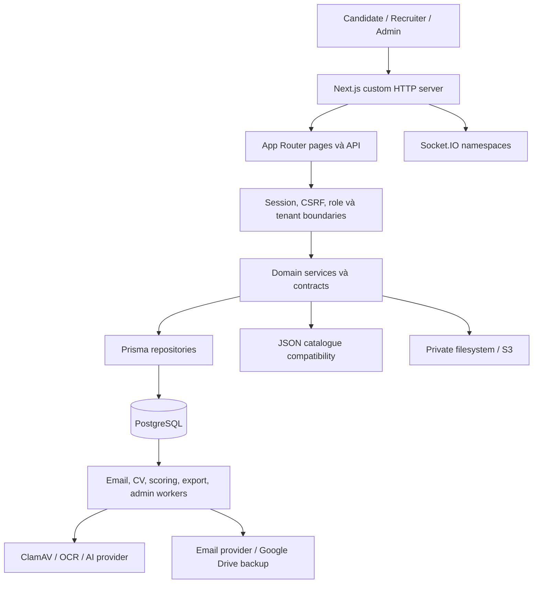

# Báo cáo audit hợp nhất hệ thống SmartHire

**Phiên bản:** 1.1 — roadmap Candidate-first và tinh chỉnh kỹ thuật ngày 05/09/2026.<br>
**Checkout:** `D:\HCMUS\PROJECT`. **Commit đối chiếu:** `607117854c0aeaf7127306ec4f5933f93d3d1ee0`.<br>
**Mục đích:** tài liệu chính để đọc kết quả audit, phân loại rủi ro và lập công việc khắc phục.

**Nguồn đầu vào:** [audit hệ thống và bằng chứng](system-audit.md), [audit kiến trúc/thuật toán/UI](../audit-report.md), và [Stage 0 final verification](candidate-first/pre-phase/integrated-gate.json). Các snapshot trước đó chỉ có giá trị lịch sử.

Bản này giữ chi tiết nghiệp vụ và tiêu chí nghiệm thu của audit hệ thống, bổ sung phân tích thuật toán, hiệu năng và UI từ bản còn lại, đồng thời điều chỉnh những nhận định chưa đủ bằng chứng. Phiên bản 1.1 chuyển lộ trình khắc phục sang Candidate-first, bổ sung chính sách tái sử dụng CV an toàn, phục hồi tiến trình bằng URL và database, cache invalidation cho dữ liệu Home công khai, quy tắc hợp khoảng kinh nghiệm và phân kỳ realtime theo topology triển khai. Đây là báo cáo hợp nhất có kiểm tra bổ sung theo phạm vi, không phải một lượt chạy lại toàn bộ audit.

**Cách đọc:** mục 1 để ra quyết định; mục 4 để tạo công việc sửa lỗi; mục 7 để sắp xếp thực hiện; mục 9 để xem cách xử lý các nhận định khác nhau; mục 10 để truy xuất và tái lập bằng chứng.

| Nội dung | Liên kết |
|---|---|
| Đánh giá tổng quan | [Mục 1](#section-1) |
| Phương pháp, bằng chứng và giới hạn | [Mục 2](#section-2) |
| Kiến trúc, bảo mật nền tảng và mô hình dữ liệu | [Mục 3](#section-3) |
| 25 phát hiện và điều kiện ưu tiên | [Mục 4](#section-4) |
| Đề xuất UI/UX | [Mục 5](#section-5) |
| Thuật toán, hiệu năng và bất đồng bộ | [Mục 6](#section-6) |
| Lộ trình và điều kiện nghiệm thu | [Mục 7](#section-7) |
| Giới hạn kết luận | [Mục 8](#section-8) |
| Đối chiếu hai báo cáo | [Mục 9](#section-9) |
| Bằng chứng và hướng dẫn tái lập | [Mục 10](#section-10) |

**Phạm vi thực hiện:** đọc và biên soạn tài liệu, đối chiếu một số luồng mã nguồn và chạy mô phỏng cô lập. Không sửa mã ứng dụng, cấu hình, migration, database, quyền hay dependency. Lượt hợp nhất bắt đầu khi hai báo cáo và thư mục bằng chứng đang là file chưa được Git theo dõi; các đầu vào được giữ nguyên. Chỉ tạo báo cáo hợp nhất, script tái hiện và JSON bổ sung. Không khởi động worker hoặc thực hiện thao tác nghiệp vụ thật.

<a id="section-1"></a>

## 1. Đánh giá tổng quan

SmartHire đã có nền tảng kỹ thuật đáng kể: modular monolith, phân chia frontend/backend/contracts, PostgreSQL với ràng buộc dữ liệu, xác thực và kiểm tra quyền phía server, CSRF, hàng đợi bền vững, lưu trữ riêng tư, nhiều lớp kiểm thử và hệ thống tìm kiếm có xử lý song ngữ.

**Tuy nhiên, chưa nên coi hệ thống đã sẵn sàng cho vận hành production có dữ liệu ứng viên thật hoặc mở rộng nhiều instance.** Những vấn đề quan trọng nhất nằm ở tính nhất quán sau giao dịch, bảo vệ vòng đời tài liệu, các điểm kiểm soát bảo mật chưa đồng đều và khả năng phục hồi khi worker gặp sự cố. Việc TypeScript và ESLint đạt không phát hiện được những lỗi này.

Các phát hiện đáng ưu tiên nhất:

1. POST/PATCH lưu tin tuyển dụng chưa áp dụng kiểm tra CSRF như các mutation khác.
2. CV của Team Application đi qua kiểm tra định dạng nhưng chưa đi qua quy trình quét an toàn tương đương CV import.
3. Một lỗi đọc dữ liệu sau khi nộp hồ sơ thành công có thể làm hệ thống xóa CV vừa gắn với hồ sơ đó.
4. Xóa công ty có thể xóa cả hồ sơ có legal hold và dấu vết xử lý báo cáo; đồng thời cập nhật JSON và PostgreSQL không nguyên tử.
5. Export có thể báo thành công trong database nhưng file đã bị xóa khi ghi audit thất bại.
6. Backup bị gián đoạn ở trạng thái LEASED chưa có đường tự phục hồi trong service hiện tại.
7. Logic tự động từ chối/đưa vào shortlist theo điểm và thời gian đang mâu thuẫn với nguyên tắc quyết định tuyển dụng do con người kiểm soát trong constitution.
8. Màn hình Team Applications chỉ nhận 100 hồ sơ mới nhất mà không có phân trang tiếp theo.
9. Bộ tính kinh nghiệm lấy thời lượng lớn nhất, có thể tính 10 năm làm việc liên tục qua 5 công ty thành 2 năm; ví dụ đã tái hiện trong lượt hợp nhất (F23).

Đây là đánh giá kỹ thuật theo checkout được kiểm tra, không phải kết luận đã xảy ra mất dữ liệu, bị tấn công hoặc vi phạm pháp luật.

### 1.1. Quyết định theo bối cảnh vận hành

| Bối cảnh | Đánh giá | Điều kiện cần đạt |
|---|---|---|
| Phát triển, demo với dữ liệu giả | Có thể tiếp tục trong môi trường kiểm soát | Ghi rõ giới hạn audit, không dùng kết quả demo làm chứng nhận vận hành |
| Dùng hồ sơ ứng viên thật | Chưa đủ cơ sở xác nhận sẵn sàng | Đóng các lỗi về boundary, file sau commit, vòng đời xóa và backup; xác minh chính sách quyết định tuyển dụng |
| Dùng điểm số để xếp hạng/review thực tế | Cần xử lý F23 và đối chiếu F09 | Kinh nghiệm có bằng chứng, kiểm thử trường hợp biên; điểm không tự thay quyết định của người có quyền theo spec hiện hành |
| Hơn 100 Team Applications | Cần xử lý F10 | Truy cập được toàn bộ hồ sơ, có phân trang và bộ lọc |
| Triển khai từ hai instance | Cần xử lý F11 và kiểm thử worker/realtime | Event, presence, session revocation và quyền sở hữu công việc hoạt động xuyên process |
| Dữ liệu lớn hoặc yêu cầu phục hồi | Chưa có benchmark/restore drill đủ | Đo RAM/latency, giới hạn công việc và phục hồi được cả DB lẫn tài liệu |

<a id="section-2"></a>

## 2. Phương pháp, bằng chứng và giới hạn

### 2.0. Nguồn gốc và mức độ xác minh

| Nhóm bằng chứng | Nguồn | Cách sử dụng trong bản hợp nhất |
|---|---|---|
| Kết quả audit gốc | Báo cáo system + JSON gốc ngày 05/09/2026 | Kế thừa các số liệu inventory, test, DB, dependency và sáu mô phỏng; không trình bày như vừa chạy lại |
| Nhận định bổ sung | Báo cáo audit-report | Dùng làm đầu mối đối chiếu; không tự chuyển mọi nhận định thành lỗi đã xác nhận |
| Đối chiếu mới | Mã nguồn tại commit trên, spec 015, script và JSON bổ sung | Kiểm tra kinh nghiệm, preferred skills, Owner/company scope, Home và Modal |
| Phân tích/đề xuất | Suy luận từ bằng chứng hoặc yêu cầu sản phẩm | Ghi điều kiện xảy ra, cách đo hoặc tiêu chí nghiệm thu; chưa coi là sự cố production |

Các nhãn bằng chứng ở mục 4 mô tả **loại bằng chứng được lưu trong hồ sơ audit**. F01–F22 kế thừa audit gốc; F23–F25 là bổ sung. Đọc source, mô phỏng với stub, truy vấn DB thật và kiểm tra browser là những mức xác minh khác nhau, không thay thế lẫn nhau. Những điểm còn điều kiện được giữ trong bảng đối chiếu mục 9 thay vì tăng mức ưu tiên thiếu căn cứ.

Các kết quả lịch sử dưới đây chỉ có giá trị tại thời điểm kiểm tra gốc. Việc HEAD còn cùng commit không chứng minh database, dependency trên máy hoặc môi trường triển khai vẫn có trạng thái giống hệt.

### 2.1. Mức độ bao phủ

| Thành phần được kiểm kê | Quy mô |
|---|---:|
| File TS/TSX/CSS trong `web/src`, loại mã Prisma sinh tự động | 1.494 |
| Dòng mã trong nhóm trên, gồm dòng trống/chú thích | 308.055 |
| API route handlers | 216 |
| Page components | 81 |
| File `.test.*` / `.spec.*` trong phạm vi kiểm kê | 856 |
| Prisma models | 164 |
| Migration được theo dõi trong Git | 88 |

Theo hồ sơ audit gốc, đã kiểm kê toàn bộ phạm vi trên và rà soát sâu các luồng có rủi ro cao: identity/session, tenant/Owner authorization, upload và truy cập CV, ứng tuyển, xóa công ty, scoring, email outbox, export, backup, realtime, tìm kiếm, cấu hình vận hành, CI, kiến trúc kiểm thử và UI chung.

Audit gốc dùng CodeGraph; lượt hợp nhất kiểm tra lại status và vẫn ghi nhận index cập nhật với 2.718 file. Công cụ được dùng trước để tìm luồng và liên kết; sau đó đọc trực tiếp những phần chưa được trả về, schema, migration và cấu hình. Số file CodeGraph bao gồm nhiều loại file và mã sinh tự động, nên không tương đương số file production ở bảng trên. Nhận xét “không thấy test” của CodeGraph không được dùng làm bằng chứng độc lập rằng một chức năng không có test.

**Đây không phải khẳng định đã kiểm chứng từng dòng của 308.055 dòng mã hoặc mọi tổ hợp của 216 endpoint.** Báo cáo phân biệt kiểm kê toàn repo, audit sâu luồng, kiểm thử cô lập và kiểm chứng database thật.

### 2.2. Kết quả chạy kiểm tra

| Kiểm tra trong audit gốc | Kết quả đã lưu | Ý nghĩa |
|---|---|---|
| TypeScript toàn workspace, không emit và không ghi incremental cache | Đạt | Không có lỗi kiểu được compiler báo trong cấu hình hiện tại |
| ESLint toàn `web`, không cache | Đạt | Không có lỗi theo bộ quy tắc lint hiện hành |
| Prisma schema validate | Đạt | Schema hợp lệ về cú pháp và cấu trúc Prisma |
| Kiểm tra chuỗi migration | Đạt, 88 migration | Không phát hiện lỗi quy tắc đánh số/tên qua script hiện tại |
| Truy vấn database với `default_transaction_read_only=on` và `BEGIN READ ONLY` | 88 hoàn tất, 0 chưa hoàn tất | Database local đã áp dụng 88/88 migration |
| Vitest: architecture, accessibility, Company UI, Search UI/unit, shared unit | 104 file đạt, 18 file lỗi; 575 test đạt, 35 lỗi | Đây là 122 file / 610 test được chọn, không phải toàn bộ 856 file test |
| Chạy lại riêng 18 file lỗi, lấy lỗi dạng JSON | Vẫn 35 lỗi, 73 test đạt trong các file đó | Các lỗi tái hiện; không cộng lượt chạy lại thành test độc lập |
| `npm audit --omit=dev` và full `npm audit` | Cùng trả 14 package bị ảnh hưởng: 2 High, 12 Moderate | Số package trong cây dependency, không phải 14 đường khai thác độc lập |
| `git diff --check` | Đạt | Không phát hiện lỗi whitespace ở phần thay đổi được kiểm tra |

Khi chạy Vitest, `DATABASE_URL` và `DIRECT_URL` được đổi trong tiến trình test sang loopback port 1 để ngăn test chạm database thật. Không chạy integration suite có khả năng tạo/xóa dữ liệu thật. File kiểm tra custom-server lock được loại khỏi lượt chọn để tránh đụng vòng đời runtime/output lock không cần thiết.

Sáu mô phỏng lỗi độc lập được audit gốc ghi nhận là chạy từ mã tại commit kiểm tra, với database/storage/session giả lập trong bộ nhớ, đã cho kết quả:

| Tình huống | Quan sát |
|---|---|
| Health: truy vấn database ném lỗi | Vẫn nhận `status: "ok"` |
| Export: ghi audit lỗi sau khi cập nhật SUCCEEDED | Trạng thái database vẫn SUCCEEDED, nhưng thao tác xóa artifact được gọi |
| Team Application: đọc projection lỗi sau commit | Transaction đã commit, nhưng cleanup CV vẫn được gọi |
| Backup: có lease hết hạn, không có bản ghi QUEUED | Không nhận lại việc; trả `ready: true, processed: false` |
| JSON không có Content-Length, giới hạn 1.024 byte | Đọc hết 262.144 byte mới trả 413 |
| POST tin tuyển dụng: session giả lập hợp lệ, Origin lạ, `text/plain`, không CSRF | Service tạo draft vẫn được gọi và route trả 201 |

Mô phỏng xác nhận nhánh điều khiển của mã. Chúng không thay thế browser exploit, stress test, transaction test trên PostgreSQL hoặc diễn tập crash thật.

### 2.3. Trạng thái database được ghi nhận trong audit gốc

Theo kết quả đọc được lưu trong JSON gốc, database local là PostgreSQL **16.12**, timezone **UTC**, dung lượng khoảng **423 MB**. Có **51.950 JobPosting**, **182 Company**, **0 JobApplication**, **0 TeamApplication** và chưa có bản ghi BackupRun tại thời điểm truy vấn.

Do đó, dữ liệu hiện tại hỗ trợ đánh giá quy mô danh mục việc làm, nhưng **không hỗ trợ kết luận về hiệu năng pipeline, export hàng nghìn ứng viên, history ứng tuyển hoặc phục hồi backup**. Số dead tuples trong mẫu thống kê không cho thấy một vấn đề phình bảng đáng kể; không có cơ sở đề nghị VACUUM FULL hoặc thay đổi database chỉ từ mẫu này.

Prisma root CLI, workspace CLI, client và adapter hiện cùng **7.9.0**. Cảnh báo lệch Prisma trong ghi chú audit trước đây đã được kiểm tra lại và không được đưa vào danh sách lỗi hiện tại. Company location query cũng đã có chặn 2.000 dòng; không còn đúng nếu mô tả là truy vấn hoàn toàn không giới hạn.

### 2.4. Giới hạn kế thừa từ audit gốc

- Chưa xem giao diện live: Chrome DevTools bị xung đột profile đang sử dụng; CUA không có browser/app khả dụng. Không đóng trình duyệt của người dùng để vượt qua hạn chế này.
- Chưa đo trực tiếp responsive, contrast, CLS/LCP/INP, thao tác bàn phím hoặc screen reader trên trình duyệt.
- Chưa chạy production build trong lượt audit này; không sử dụng số liệu build cũ làm kết quả mới.
- Chưa chạy toàn bộ E2E, load/stress/chaos test, kiểm thử nhiều instance hoặc phục hồi backup.
- Chưa xác minh IAM, bucket policy, TLS/reverse proxy, secret manager, cảnh báo vận hành hoặc cấu hình production thực tế.
- Chưa chạy Python/OCR test vì không có lệnh Python khả dụng trong môi trường shell; dependency Python và container image chưa được quét advisory đầy đủ.

Bằng chứng dạng máy đọc của lượt gốc nằm trong [verification.json](verification.json). Các hạn chế công cụ ở trên là ghi nhận của lượt gốc, không phải kết quả kiểm tra lại khả dụng của browser/Python trong lượt hợp nhất.

### 2.5. Kiểm tra bổ sung trong lượt hợp nhất

- Xác nhận HEAD vẫn là commit ghi đầu báo cáo và CodeGraph báo cập nhật.
- Đọc bộ tính automatic match, đối chiếu FR-001/FR-002/FR-025 của feature 015.
- Đối chiếu helper Owner, service, API, hai trang Team và liên kết Company Settings để phân biệt thiếu tenant scope với mất quyền thực sự.
- Đọc luồng Home, danh sách career paths và Modal; không gọi database hoặc render browser.
- Chạy script cô lập với **4 trường hợp kinh nghiệm, 4 trường hợp Owner và 1 kiểm tra preferred bonus**. Tất cả assertion về hành vi hiện tại đạt; đây là xác nhận tái hiện, không phải xác nhận mã đã đúng nghiệp vụ.
- Lưu hash SHA-256 của mã đối chiếu và các báo cáo đầu vào trong JSON bổ sung.

| Trường hợp mới | Quan sát |
|---|---|
| 5 công việc liên tiếp từ 2014 đến 2024 | Phát hiện 2 năm; 5/25 điểm kinh nghiệm với yêu cầu 10 năm |
| 1 công việc từ 2014 đến 2024 | Phát hiện 10 năm; 25/25 điểm kinh nghiệm |
| 5 công việc như trên + dòng tổng “10 years of experience” | Phát hiện 10 năm; cho thấy lỗi phụ thuộc cách biểu đạt CV |
| 2 khoảng 2014–2020 và 2018–2024 | Phát hiện 6 năm; chưa hợp khoảng để thành 10 năm lịch |
| 2 membership Owner đủ điều kiện, không truyền companyId | Helper trả TEAM_FORBIDDEN |
| Cùng 2 membership, truyền companyId thuộc quyền | Helper trả đúng công ty được chọn |
| companyId ngoài tập được phép | Helper vẫn từ chối |
| preferredSkillBonus | Bằng 0; phù hợp yêu cầu preferred skills trung lập của spec |

Script dùng dữ liệu giả: skill extractor được stub, truy vấn membership được thay bằng danh sách trong bộ nhớ. Phép đo không đi qua parser PDF/DOCX, phiên đăng nhập thật hoặc PostgreSQL. Script chạy các hàm từ mã hiện tại, không chép lại thuật toán kinh nghiệm. Xem [bằng chứng bổ sung](consolidated-verification.json) và mục 10.

### 2.6. Đối chiếu kỹ thuật phục vụ roadmap Candidate-first

Các quan sát dưới đây xác định phần đã có để tránh triển khai trùng, nhưng chưa được tính là một lượt regression test mới:

| Chủ đề | Cơ chế hiện có | Khoảng còn thiếu trong roadmap |
|---|---|---|
| CV Import idempotency | Reservation có idempotency digest; nội dung được tính SHA-256; PUT lặp cùng reservation so digest và trả `replayed: true` | Chính sách tái sử dụng artifact CLEAN giữa các lần thao tác, có ràng buộc account, scanner/parser/policy version, consent và retention |
| Direct Application CV | Có SHA-256 checksum sau khi kiểm tra kích thước/chữ ký | F03 vẫn thiếu scan/quarantine/encryption tương đương CV Import; digest không thay malware verdict |
| Khôi phục CV Import | Database có `CvUpload`, scan, extraction, parse job và draft; có route `/profile/cv-imports/{uploadId}` và `/review` | Trang upload giữ tiến trình hiện hành trong React state; cần điều hướng sớm sang URL bền vững và tiếp tục từ server sau reload |
| Home cache | Home hiện `force-dynamic`; public jobs/company/count và dữ liệu session/cá nhân được ghép trong cùng context | Tách public snapshot khỏi account/profile/saved/private score/CSRF; sau đó mới cache và gắn tag theo projection |
| Realtime | Registry/presence hoạt động trong một process; authorization chạy theo từng conversation | F14 cần sửa ngay cả ở một instance; F11 chỉ trở thành gate khi triển khai nhiều instance |

**Ranh giới an toàn:** không dùng digest để deduplicate xuyên tài khoản; không lưu CV text/draft/consent trong localStorage; không cache nguyên Home model có dữ liệu cá nhân; không coi thêm Redis Adapter là đã hoàn tất F11 nếu publisher, presence và session revocation vẫn chỉ cục bộ.

<a id="section-3"></a>

## 3. Kiến trúc và mô hình dữ liệu

### 3.1. Kiến trúc quan sát được



**Điểm hợp lý:** giữ modular monolith phù hợp hơn việc tách microservice ngay. Luồng nghiệp vụ có nhiều transaction và dữ liệu liên quan chặt chẽ; tách sớm sẽ làm các lỗi nhất quán hiện tại khó xử lý hơn. Contracts và adapters đã tạo nền cho việc tách worker độc lập khi có nhu cầu thực tế.

**Điểm cần cải thiện:** ranh giới đã được thiết kế nhưng chưa được tuân thủ đồng đều. Một số service truy cập Prisma trực tiếp; repository lại nhập helper từ service; custom server chạy cả công việc nền. JSON catalogue vẫn tham gia cập nhật nghiệp vụ nên PostgreSQL chưa phải nguồn ghi duy nhất cho toàn bộ hệ thống.

### 3.2. Chất lượng mô hình dữ liệu

| Nhóm | Điểm tốt | Điều cần kiểm soát |
|---|---|---|
| Identity, session, quyền | Tách account/session/membership/grant, có trạng thái và hết hạn | Xác thực session không thay cho kiểm tra origin/CSRF và quyền theo hành động |
| Job và review | Phân biệt bản đang soạn, bản review, public projection | Tránh lệch giữa JSON, approved snapshot và bảng công khai |
| JobApplication | Snapshot CV/job/profile, consent/version/idempotency, số lần ứng tuyển có unique | Snapshot chứa dữ liệu cá nhân cần vòng đời xóa rõ; hard delete phải tôn trọng legal hold |
| Documents và storage | Tách metadata khỏi bytes, có delete/access timestamps và promotion records | Không xóa metadata trước khi đã có công việc xóa bytes bền vững |
| Scoring | Tách deterministic/AI/published result, generation và lineage | Điểm số không đồng nghĩa với quyền quyết định tuyển dụng tự động |
| Messaging | Có sequence và idempotency cho message | Dữ liệu bền vững không tự làm realtime hoạt động xuyên nhiều process |
| Outbox/work items | Có trạng thái, attempts, lease và một số đường retry | Phải kiểm tra riêng từng worker; không suy ra mọi worker đều phục hồi tốt |
| Search | Có catalog version, aliases, projection, GIN và SQL ranking | Quản trị chất lượng và giới hạn candidate pool cần đo recall theo quy mô |

Không coi tất cả trường JSON là lỗi chuẩn hóa. Snapshot bất biến phục vụ lịch sử là một dạng phi chuẩn hóa có chủ đích. Ngược lại, dữ liệu dùng cho lọc/join/invariant quan trọng nên có cột/ràng buộc tương ứng, thay vì chỉ dựa vào nội dung JSON.

Schema và migrations có FK, unique, CHECK và partial unique index; ví dụ salary/version constraints, company-membership state constraints và uniqueness theo ứng viên/idempotency. Tuy vậy, **FK tồn tại không chứng minh quy tắc vòng đời đúng**: `ApplicationDocumentLegalHold → JobApplication` đang `ON DELETE CASCADE`, được xác nhận cả trong schema lẫn database thật.

### 3.3. Những nền tảng nên giữ và điều kiện để phát huy

| Nền tảng được hai báo cáo ghi nhận | Giá trị | Giới hạn cần đọc cùng |
|---|---|---|
| Modular monolith, contracts và server-only boundaries | Có cấu trúc để kiểm soát thay đổi và tách trách nhiệm | F20 cho thấy một số ranh giới vẫn lệch; không suy ra cần chuyển ngay sang microservices |
| OCR container được cấu hình cách ly, giới hạn tài nguyên và quyền | Giảm phạm vi tác động của xử lý tài liệu không tin cậy | Là nhận xét về cấu hình source; chưa kiểm tra container/hạ tầng production thực tế |
| Security headers/CSP, cookie và host boundaries | Có nhiều lớp bảo vệ request và trình duyệt | Header không bù cho mutation thiếu kiểm tra CSRF ở F01 |
| AES-256-GCM/AAD ở CV artifact pipeline | Có bảo vệ bí mật và tính toàn vẹn cho pipeline đi qua cryptor | Không mở rộng thành “mọi CV đều được mã hóa/quét”; F03 mô tả luồng còn thiếu |
| Snapshot, idempotency, generation/CAS, outbox | Hỗ trợ lịch sử và xử lý lặp có kiểm soát | Phải bảo vệ riêng sau commit, lease ownership và vòng đời bytes |
| Test nhiều lớp và CI | Có nền tảng tự động hóa kiểm chứng | Số file không phải coverage; cần xử lý 35 lỗi đã lưu và bổ sung kiểm thử hành vi trọng yếu |

Các điểm về OCR container, headers và cryptor trong bảng được kế thừa từ hai báo cáo, chưa diễn tập lại trong lượt hợp nhất. Không áp dụng đánh giá “xuất sắc” hoặc “enterprise-ready” khi thiếu xác minh vận hành.

### 3.4. Chương trình kiểm tra database cần bổ sung

Bản audit-report nêu “62 foreign key thiếu index”, “TOAST bloat” và thiếu partitioning. Chưa có danh sách tái lập/đo workload đủ để chốt chúng thành lỗi đồng mức với mất file sau commit.

| Chủ đề | Công việc kiểm tra cụ thể | Điều kiện mới đề xuất thay đổi |
|---|---|---|
| Index cho FK và truy vấn nghiệp vụ | Lập bảng FK → index thực tế trong DB/migration → truy vấn sử dụng → query plan; xét unique/composite index và thứ tự cột | Chứng minh truy vấn hoặc thao tác parent có chi phí đáng kể; tránh index trùng và tính chi phí ghi |
| Snapshot JSON và dung lượng | Đo số dòng, kích thước row/TOAST, projection đang select và tốc độ tăng trên dữ liệu đại diện | Có số liệu lưu trữ/đọc bất lợi; giữ snapshot bất biến cần cho lịch sử, không chuẩn hóa lại máy móc |
| Audit/event retention và partitioning | Chốt retention, tốc độ ghi, điều kiện lọc và khối lượng purge | Chọn partitioning khi workload/vòng đời dữ liệu chứng minh lợi ích; kiểm thử migration và truy vấn liên quan |
| Generated recovery directory | Kiểm tra đường dẫn thực tế, Git tracking, imports và đường build/runtime | Chỉ dọn khi đã chứng minh không cần cho build hoặc quy trình recovery; chưa xóa trong audit |

Không tạo migration bổ sung hàng loạt index hoặc yêu cầu partitioning chỉ từ việc có nhiều model/bảng log.

<a id="section-4"></a>

## 4. Danh sách phát hiện và ưu tiên

**P1:** cần giải quyết trước vận hành dữ liệu thật, hoặc trước điều kiện sử dụng/mở rộng nêu rõ. **P2:** cần đưa vào đợt củng cố chất lượng gần nhất; với phát hiện chỉ từ source, thực hiện kiểm chứng trước khi chốt sửa. Mức ưu tiên dựa trên tác động và điều kiện áp dụng, không phải CVSS tự gán. Các số F là định danh tra cứu, không phải thứ tự thực hiện; dùng mục 7 để xếp công việc.

| Mã | Ưu tiên | Phát hiện | Mức bằng chứng |
|---|---|---|---|
| F01 | P1 | Thiếu CSRF ở POST/PATCH tin tuyển dụng | Mã + mô phỏng route |
| F02 | P1 | Giới hạn body được kiểm tra sau khi đã nạp toàn bộ | Mã + mô phỏng stream |
| F03 | P1 | Team CV chưa qua scan; filesystem nhận bytes thô | Truy vết đầy đủ luồng |
| F04 | P1 | Cleanup CV sau transaction đã commit | Mã + mô phỏng fault |
| F05 | P1 | Xóa công ty vượt qua vòng đời legal hold và metadata tài liệu | Mã + FK database thật |
| F06 | P1 | Xóa JSON trước DB transaction, không có rollback chung | Mã |
| F07 | P1 | Export SUCCEEDED nhưng artifact bị xóa do audit lỗi | Mã + mô phỏng fault |
| F08 | P1 | Backup lease hết hạn không được nhận lại | Mã + mô phỏng fault |
| F09 | P1 | Tự động quyết định tuyển dụng mâu thuẫn constitution | Mã + tài liệu canonical |
| F10 | P1 khi vượt 100 hồ sơ | Team Applications cắt danh sách, không có trang tiếp | Repository + service/UI |
| F11 | P1 trước scale-out | Realtime phụ thuộc registry trong process | Gateway + publisher |
| F12 | P2 | Health báo ok khi database query lỗi | Mã + mô phỏng fault |
| F13 | P2 | Export nạp tất cả dòng vào RAM, không kiểm tra kết quả giữ lease | Mã |
| F14 | P2 | Socket khởi tạo có cửa sổ bỏ lỡ disconnect và N+1 | Mã; cần test runtime |
| F15 | P2 | Worker stop chưa drain; timeout không hủy processor | Mã; cần crash/load test |
| F16 | P2 | Backup buffer lớn, thiếu deadline và kế hoạch khôi phục toàn bộ | Mã; triển khai ngoài repo chưa rõ |
| F17 | P1 để phân loại, vá theo mức tiếp cận | 14 package nằm trong advisory ranges | npm audit + dependency tree |
| F18 | P2 | CI, test isolation và môi trường chưa phản ánh toàn hệ thống | Cấu hình + kết quả chạy |
| F19 | P2 | Nợ kiểm thử: 35 lỗi và nhiều kiểm tra bám chuỗi mã nguồn | Chạy và chạy lại |
| F20 | P2 | Ranh giới kiến trúc và file lớn gây khó bảo trì | Source + architecture tests |
| F21 | P2 | CSS nhiều lớp ghi đè; dropdown địa điểm thiếu bước chuyển focus | Source; chưa có visual QA |
| F22 | P2 | Search/observability/timezone còn các điều kiện cần kiểm chứng | Source và cấu hình |
| F23 | P1 trước dùng điểm để đánh giá ứng viên thật | Tính kinh nghiệm bằng khoảng dài nhất làm mất tổng thời gian làm việc | Source + mô phỏng bổ sung |
| F24 | P2 | Home thực hiện nhiều lượt tìm kiếm đếm nhóm nghề trên đường render | Source bổ sung; chưa đo tải |
| F25 | P2 để xác minh | Modal render trong cây cha, cần kiểm tra stacking/focus ở ngữ cảnh thật | Source bổ sung; chưa có browser QA |

### F01 — CSRF chưa nhất quán ở lưu tin tuyển dụng

**Bằng chứng:** [job-postings/route.ts](../../web/src/app/api/recruiter/job-postings/route.ts), dòng 30, 94–125: POST/PATCH chỉ gọi `requireSession`. DELETE ngay bên dưới lại sử dụng `requireJobActor(..., { mutation: true })`. `request.json()` không tự bắt buộc Content-Type JSON.

Mô phỏng với session hợp lệ được inject, Origin lạ, Content-Type `text/plain` và không có CSRF token vẫn gọi service tạo draft, trả 201. Đây là lỗ hổng kiểm soát ở route; chưa thực hiện khai thác bằng browser/session thật. SameSite=Lax và host-only cookie giảm một số tình huống cross-site nhưng không thay thế kiểm tra origin/CSRF, đặc biệt với origin không tin cậy trong cùng site.

**Tác động:** hành động ghi draft có lớp bảo vệ yếu hơn các mutation khác; độ an toàn phụ thuộc vào môi trường trình duyệt/deployment ngoài route.

**Đề xuất:** thống nhất mutation boundary cho POST/PATCH/DELETE, kiểm tra origin, fetch metadata, proof và body trước service. Test phải bao gồm origin sai, thiếu/sai proof và simple-request content type; vẫn giữ tenant authorization trong service.

### F02 — Giới hạn request chưa bảo vệ bộ nhớ trước khi parse

**Bằng chứng:** [account-request-boundary.ts](../../web/src/backend/security/account-request-boundary.ts), dòng 46–89: kiểm tra Content-Length nếu có, sau đó `await request.text()` và mới đo số byte. Mô phỏng giới hạn 1 KB đã tiêu thụ 256 KB rồi mới trả 413. [identity/login/route.ts](../../web/src/app/api/identity/login/route.ts) gọi `request.json()` trước logic đăng nhập. [team-applications/route.ts](../../web/src/app/api/candidate/team-applications/route.ts), dòng 77, parse toàn bộ multipart trước giới hạn file.

**Tác động:** body thiếu Content-Length hoặc multipart nhiều phần có thể tiêu thụ tài nguyên vượt xa giới hạn nghiệp vụ. Rate limit chạy sau parse không bảo vệ được chi phí parse ban đầu. Chưa đo được ngưỡng DoS thực tế hoặc giới hạn của reverse proxy production.

**Đề xuất:** bộ đọc stream đếm byte và dừng ngay khi vượt ngưỡng; giới hạn tổng multipart, số phần và độ dài field; giới hạn body/request timeout ở ingress. Tiêu chí: request lớn bị ngắt trước khi nạp toàn bộ, kể cả chunked body và nhiều request đồng thời.

### F03 — Team Application CV chưa có cùng mức bảo vệ với pipeline CV import

**Bằng chứng:** [team-application-cv-service.ts](../../web/src/backend/services/company-members/team-application-cv-service.ts), dòng 32–49 → [validated-file-upload.ts](../../web/src/backend/cv/validated-file-upload.ts) → [prepare-direct-application-cv.ts](../../web/src/backend/services/jobs/prepare-direct-application-cv.ts), dòng 58–73. Chuỗi này xác nhận MIME/signature/size rồi lưu; không có ClamAV verdict, quarantine state hoặc safe-to-open gate. Luồng mở file trả bytes qua route CV sau kiểm tra Owner.

Ở filesystem, [filesystem.ts](../../web/src/backend/cv/storage/filesystem.ts), dòng 120–132, ghi chính chunk nhận được. Luồng này không gọi lớp mã hóa artifact trước storage. Không nên mở rộng nhận xét thành “mọi CV đều không mã hóa”: CV import có cryptor riêng và S3 adapter có SSE-KMS.

**Tác động:** file đúng chữ ký PDF/DOCX vẫn có thể chứa nội dung nguy hiểm; kiểm tra định dạng không phải malware scan. Với filesystem adapter, mức bảo vệ dữ liệu khi đọc được ổ đĩa yếu hơn pipeline có envelope encryption.

**Đề xuất:** dùng admission/scan/quarantine và encryption chung cho tài liệu ứng tuyển; chỉ mở sau verdict sạch, có integrity check và trạng thái lỗi scanner. Giữ checksum SHA-256 hiện có làm bằng chứng toàn vẹn, nhưng bind scan verdict vào artifact, account, scanner engine/signature-policy version và thời điểm đánh giá. Test xác nhận scanner unavailable phải chặn mở, file không sạch bị cách ly, và bytes lưu không phải plaintext trong adapter yêu cầu mã hóa.

Nếu tái sử dụng artifact để tránh quét/OCR lại, chỉ cho phép khi cùng account, digest/MIME/byte size, parser class/version, scanner policy còn hợp lệ, consent còn hiệu lực và artifact chưa archive/quarantine/hết retention. Không deduplicate toàn cục bằng digest vì có thể tạo side channel về việc hai tài khoản sở hữu cùng tài liệu và làm phức tạp ownership.

### F04 — Nộp hồ sơ thành công nhưng mất CV khi bước đọc tiếp theo thất bại

**Bằng chứng:** [team-application-service.ts](../../web/src/backend/services/company-members/team-application-service.ts), dòng 178–303. Sau khi `$transaction` trả về, service gọi `getCandidate` trong cùng `try`. Mọi lỗi ở bước này đi vào `catch` và `cleanup()`. Cleanup thực sự xóa storage object tại [prepare-direct-application-cv.ts](../../web/src/backend/services/jobs/prepare-direct-application-cv.ts), dòng 83–84. Route còn có cleanup ở lớp ngoài nếu prepared chưa được giải phóng.

**Đã tái hiện cô lập:** transaction committed = true; getter ném lỗi; cleanup được gọi một lần trong service.

**Tác động:** hồ sơ đã tồn tại và trỏ đến file bị xóa; người dùng thấy lỗi và thử lại có thể chỉ nhận hồ sơ cũ với CV không còn dùng được.

**Đề xuất:** tách rõ tài liệu tạm và tài liệu đã được commit; chuyển quyền sở hữu artifact ngay khi giao dịch thành công, không dùng cleanup rollback cho lỗi đọc response. Idempotency key là khóa của command retry; content digest chứng minh payload không đổi và không thay thế idempotency key. Test fault sau commit phải giữ CV và lần retry cùng idempotency key phải trả cùng hồ sơ hợp lệ, không tạo application, artifact, scan hoặc OCR job thứ hai.

**Tiêu chí tái sử dụng:** replay cùng command/payload trả lại resource đã commit; cùng idempotency key nhưng digest khác trả conflict; retry sau lỗi mạng không chạy lại pipeline đã hoàn tất; scanner/parser policy đổi hoặc artifact không còn CLEAN phải tạo đánh giá mới thay vì dùng kết quả cũ.

### F05 — Xóa công ty phá vỡ cơ chế lưu giữ và có thể bỏ lại bytes không còn metadata

**Bằng chứng:** [recruiter-job-posting-data.ts](../../web/src/backend/services/jobs/recruiter-job-posting-data.ts), dòng 2062–2288. Owner có thể đi vào hard-delete; code xóa report, conversation, export request, application và verification request. Không có kiểm tra legal hold trong chuỗi này. [schema.prisma](../../web/prisma/schema.prisma), dòng 3322–3336, đặt legal hold `onDelete: Cascade`; FK này được xác nhận trong database thật và không thấy custom trigger trên ba bảng liên quan để bổ sung chặn.

Metadata `ApplicationDocument` và export có storage locator bị xóa mà luồng này chưa tạo một công việc bền vững để xóa bytes tương ứng. Các vòng retention dựa vào metadata đã mất sẽ không tự biết locator cần xử lý; external lifecycle/sweeper có thể giảm tác động nhưng chưa được xác minh.

**Tác động:** mất lịch sử ứng tuyển và bằng chứng đang cần lưu; mất dữ liệu phục vụ xử lý báo cáo; hoặc còn file cá nhân trên storage nhưng không còn bản ghi để quản lý. Hiện database không có application nên chưa quan sát sự cố dữ liệu thật.

**Đề xuất:** quy trình deactivation → chặn truy cập → kiểm tra hold/report → lập deletion manifest/outbox → xóa bytes theo chính sách → purge metadata. Bản ghi hold đang hiệu lực phải thực sự chặn purge. Giữ audit nghiệp vụ và số phận từng artifact; test cả legal hold, report mở và storage lỗi.

### F06 — JSON và PostgreSQL không có giao dịch chung khi xóa công ty

**Bằng chứng:** cùng [recruiter-job-posting-data.ts](../../web/src/backend/services/jobs/recruiter-job-posting-data.ts), dòng 2323–2339 và 2370–2382. JSON jobs/applications/companies được cập nhật trước, rồi mới bắt đầu transaction PostgreSQL.

**Tác động:** nếu DB thất bại do timeout, FK hoặc cạnh tranh sau khi file đã ghi, JSON đã xóa nhưng DB chưa xóa. Database rollback không thể hoàn tác filesystem. Ghi ba file cũng có thể thành công một phần. Lease ghi từng catalogue không tạo tính nguyên tử cho toàn bộ workflow.

**Đề xuất:** PostgreSQL làm nguồn ghi chính; xuất JSON bằng outbox/reconciliation. Nếu cần giai đoạn chuyển tiếp, có operation journal, trạng thái hoàn tất từng bước và recovery idempotent. Test cố tình thất bại ở từng ranh giới I/O, kiểm tra kết quả phục hồi.

### F07 — Export thành công nhưng bị xóa vì audit thất bại

**Bằng chứng:** [candidate-export-worker.ts](../../web/src/backend/exports/candidate-export-worker.ts), dòng 69–111: storage put → `requests.succeed()` → append audit, tất cả cùng `try`; `catch` xóa artifact. [prisma-export-request-repository.ts](../../web/src/backend/repositories/analytics/prisma-export-request-repository.ts), hàm `fail`, chỉ cập nhật bản ghi còn LEASED.

**Đã tái hiện cô lập:** `succeed` đã đổi thành SUCCEEDED; audit ném lỗi; storage delete được gọi; `fail` không đổi được SUCCEEDED.

**Tác động:** UI báo có file sẵn sàng nhưng tải file thất bại. Đây là lỗi toàn vẹn dữ liệu, không chỉ thiếu log.

**Đề xuất:** cập nhật completion và audit/outbox trong cùng transaction nếu có thể; hoặc coi lỗi audit sau commit là công việc cần retry riêng. Không xóa artifact đã được record hoàn tất sở hữu. Test failure injection đúng sau succeed.

### F08 — Backup có thể kẹt vĩnh viễn sau khi worker chết

**Bằng chứng:** [backup-service.ts](../../web/src/backend/backup/backup-service.ts), dòng 35–54: chỉ tìm `status: "QUEUED"`; lúc claim chuyển LEASED với hạn 10 phút; không có điều kiện reclaim LEASED đã hết hạn. `activeKey: "platform"` giữ unique slot của backup đang chạy.

**Đã tái hiện cô lập:** một backup LEASED đã hết hạn không được xử lý, service trả ready=true. Request mới cũng có thể bị activeKey cũ giữ lại. Lỗi không được khắc phục chỉ bằng việc chờ hết 10 phút.

**Đề xuất:** reclaim lease hết hạn với attempt limit và ownership token; cập nhật completion có kiểm tra owner; heartbeat nếu cần; terminal/dead state và cảnh báo tuổi job. Diễn tập kill worker giữa dump/upload rồi khởi động lại phải chứng minh queue tiếp tục tiến triển.

### F09 — Quy tắc tự động tuyển dụng mâu thuẫn nguyên tắc sản phẩm

**Bằng chứng:** [constitution.md](../../spec-kit/.specify/memory/constitution.md), Principle I, yêu cầu quyết định con người trước khi AI tự từ chối hoặc nâng trạng thái ứng viên. Snapshot audit tại commit `60711785` tham chiếu `web/src/backend/applications/services/automatic-viewed-stage-rules.ts` (file lịch sử này không còn trong source cuối); source hiện tại giữ cấu hình ngưỡng ở [automatic-score-stage-config.ts](../../web/src/backend/applications/services/automatic-score-stage-config.ts) và projection/action ở [ranked-candidate-list.ts](../../web/src/backend/applications/services/ranked-candidate-list.ts). [scoring-worker-runtime.ts](../../web/src/backend/scoring/workers/scoring-worker-runtime.ts) gọi worker nền; mặc định timeout review là 12 giờ trong [automatic-score-stage-config.ts](../../web/src/backend/applications/services/automatic-score-stage-config.ts).

**Tác động:** ứng viên có thể bị đổi trạng thái khi không có quyết định thủ công trong cửa sổ review. Hybrid score hiện có thành phần AI 60%, nên không thể mô tả đây là quy tắc hoàn toàn độc lập với AI. Đây là mâu thuẫn giữa code và quy tắc canonical, không phải suy đoán về tính hợp pháp.

**Đề xuất:** quyết định rõ chính sách sản phẩm và làm đồng bộ constitution/spec/code. Với nguyên tắc hiện tại, automation nên tạo gợi ý/công việc nhắc review; thao tác ảnh hưởng ứng viên cần người có quyền xác nhận. Kiểm thử backend phải chứng minh không có actor tự động vượt qua quy tắc đã chốt.

### F10 — Team Applications không thể duyệt hết khi vượt 100 hồ sơ

**Bằng chứng:** [prisma-team-application-repository.ts](../../web/src/backend/repositories/company-members/prisma-team-application-repository.ts), dòng 59–91: cả `listForCandidate` và `listForOwner` đều `take: 100`, sắp xếp mới nhất trước. Service trả `{ items }`, không có cursor/hasMore; màn hình Owner dùng trực tiếp danh sách này.

**Tác động:** hồ sơ cũ nằm ngoài 100 bản ghi biến mất khỏi danh sách; hồ sơ chưa review không được ưu tiên đưa trở lại. Đây không phải pagination hoàn chỉnh, dù bản ghi vẫn còn trong database.

**Đề xuất:** cursor pagination, tổng/chỉ báo còn dữ liệu, bộ lọc trạng thái và ưu tiên pending. Test với 101 và 1.000 hồ sơ, chứng minh mỗi hồ sơ có đường truy cập và không bị lặp/mất khi có hồ sơ mới.

### F11 — Realtime chưa sẵn sàng cho nhiều instance

**Bằng chứng:** [socket-io-chat-gateway.ts](../../web/src/backend/messaging/realtime/socket-io-chat-gateway.ts) tạo Socket.IO Server mặc định; [messaging-socket-registry.ts](../../web/src/backend/messaging/realtime/messaging-socket-registry.ts), dòng 5–10, dùng Map/Set trong process. [messaging-realtime-publisher.ts](../../web/src/backend/messaging/realtime/messaging-realtime-publisher.ts) tìm socket qua registry và namespace local. Không tìm thấy adapter/bus xuyên process trong luồng được kiểm tra.

**Tác động khi scale-out:** người dùng ở hai instance có thể không nhận event của nhau; presence và thông báo thu hồi session cũng có thể chỉ tác động cục bộ. Chưa khẳng định đây là lỗi ở deployment một instance hiện tại.

**Điều kiện kích hoạt:** F11 là gate trước khi deployment có từ hai application instance trở lên. Với topology một instance, chưa cần thêm Redis chỉ để đóng audit; vẫn phải sửa F14.

**Đề xuất khi scale-out:** chọn transport/bus và registry policy hỗ trợ nhiều instance, cơ chế đồng bộ revocation, cursor catch-up sau reconnect và ownership của presence event. Chỉ thêm Redis adapter chưa đủ nếu publisher tiếp tục chỉ duyệt socket local. Socket.IO có tài liệu chính thức về [vận hành nhiều node](https://socket.io/docs/v4/using-multiple-nodes/); với websocket-only hiện tại không nên máy móc áp dụng yêu cầu sticky session của long-polling.

**Tiêu chí nghiệm thu scale-out:** hai client ở hai instance nhận message/presence/revocation đúng; disconnect/reconnect không tạo hai trạng thái mâu thuẫn; instance chết không để presence online vô hạn; history/cursor bù được event realtime bị lỡ; thử fail bus/adapter và chứng minh dữ liệu bền vững vẫn đọc lại được.

### F12 — Health check che khuất lỗi phụ thuộc

**Bằng chứng:** [get-system-health.ts](../../web/src/backend/services/system/get-system-health.ts), dòng 9–27: truy vấn thất bại được đổi thành `[]`, nhưng status luôn `ok`; [health/route.ts](../../web/src/app/api/health/route.ts) trả JSON với HTTP 200. CI dùng endpoint này để chờ server sẵn sàng.

**Tác động:** liveness và readiness bị trộn; deploy có thể được coi là sẵn sàng dù phụ thuộc quan trọng không dùng được. Flags readiness=false không đủ nếu consumer chỉ xét HTTP code hoặc status.

**Đề xuất:** endpoint liveness nhẹ và readiness có timeout/HTTP 503 khi phụ thuộc bắt buộc hỏng; tách capability tùy chọn. Không công khai chi tiết nhạy cảm về hạ tầng trong error response.

### F13 — Export có batching ở truy vấn nhưng chưa có giới hạn tổng RAM/lease

**Bằng chứng:** [candidate-export-worker.ts](../../web/src/backend/exports/candidate-export-worker.ts), dòng 40–66: từng batch được `rows.push(...)` vào một array đến hết rồi mới tạo CSV/XLSX Buffer. Lease mặc định 60 giây; không thấy heartbeat trong worker này. Kết quả `requests.succeed()` là `updateMany`, nhưng worker không kiểm tra `count === 1`.

**Tác động:** bộ nhớ vẫn tăng O(N); chia truy vấn thành batch không giải quyết tổng RAM. Worker mất ownership có thể tiếp tục upload rồi ghi audit thành công dù không cập nhật được bản ghi, để lại orphan artifact. Bản ghi hết số attempts trong trạng thái LEASED cũng cần terminalization riêng.

**Đề xuất:** streaming writer/storage, giới hạn số dòng/bytes, timeout, lease renewal hoặc deadline nhỏ hơn lease; kiểm tra CAS completion và xóa riêng artifact chưa được nhận quyền sở hữu. Test export lớn cùng hai worker và tình huống fail ở lần claim cuối.

### F14 — Socket khởi tạo có race và chi phí truy vấn tuyến tính

**Bằng chứng:** [socket-io-chat-gateway.ts](../../web/src/backend/messaging/realtime/socket-io-chat-gateway.ts), handler connection đăng ký registry/presence, sau đó await join và tải/authorize từng conversation; handler disconnect được gắn ở cuối. `emitPresence` và publisher cũng kiểm tra nhiều quan hệ trong vòng lặp.

**Rủi ro:** disconnect xảy ra khi đang await có thể bị bỏ lỡ, để lại presence/registry stale; lỗi truy vấn ngoài try trong async connection callback cần kiểm tra xử lý rejection. Người có nhiều conversation tạo N+1 authorization queries và kéo dài thời gian sẵn sàng.

**Ưu tiên:** làm F14 ngay cả khi production chỉ chạy một container/một instance; không phụ thuộc quyết định F11.

**Đề xuất:** gắn handler cleanup ngay sau khi đăng ký registry/presence, trước các `await`; có try/finally và guard `socket.connected`; batch đọc access/context/block theo phạm vi thay vì ba nhóm truy vấn lặp cho từng conversation; giới hạn hoặc lazy-join room khi số conversation lớn. Đo query count và thời gian socket-ready với 1, 10, 40 và 100 conversation.

**Tiêu chí nghiệm thu:** test disconnect tại từng điểm await, DB lỗi và retry/reconnect; registry/presence luôn trở về trạng thái đúng; không có unhandled rejection; số query không tăng theo mô hình ba truy vấn tuần tự cho mỗi conversation; dữ liệu message bền vững vẫn là nguồn khôi phục khi realtime gián đoạn. Đây vẫn là phân tích mã cho tới khi test Socket.IO runtime tái hiện và xác nhận bản sửa.

### F15 — Stop/timeout của worker chưa đồng nghĩa đã dừng công việc

**Bằng chứng:** [server.ts](../../web/server.ts) gọi `scoring.stop()` và `candidateExports.stop()` trước đóng app. Hai runtime chỉ clear timer, không await tick đang chạy. [scoring-worker.ts](../../web/src/backend/scoring/workers/scoring-worker.ts), `withTimeout`, từ chối Promise ngoài khi hết giờ nhưng không hủy processor bên trong. Runtime còn dùng worker id cố định `application-scoring-runtime`.

**Tác động:** deploy/shutdown có thể cắt ngang tác vụ; timeout không nhất thiết dừng CPU, I/O hoặc chi phí provider. Các kiểm tra generation/state đang có giúp giảm stale publication; không vì vậy mà có thể kết luận không còn việc nền chạy tiếp. Owner token cố định cũng làm dấu vết phân biệt các instance yếu hơn.

**Đề xuất:** stop-claim → drain/abort có deadline → đóng dependencies; truyền AbortSignal xuyên processor; lease/attempt token riêng cho mỗi lần claim; test late completion sau timeout và restart. Không tăng timeout đại trà để che lỗi pool/worker.

### F16 — Backup chưa là một phương án khôi phục toàn hệ thống

**Bằng chứng:** [postgres-backup.ts](../../web/src/backend/backup/postgres-backup.ts), dòng 13–21, gom stdout `pg_dump` vào RAM và truyền connection URL qua argv. [google-drive-backup.ts](../../web/src/backend/backup/google-drive-backup.ts) mã hóa, ghép multipart Buffer và fetch upload; chưa có deadline hủy rõ trong chuỗi này. Backup hiện tại tạo DB dump, không có manifest đồng bộ private CV/application/export/evidence storage.

**Tác động:** khi database lớn, nhiều bản sao Buffer làm tăng RAM; dump/upload treo có thể giữ worker; connection string trong process arguments có thể bị người có quyền quan sát tiến trình đọc. Khôi phục DB thành công chưa đảm bảo tải lại được các tài liệu mà DB tham chiếu.

**Đề xuất:** pipeline streaming, deadline và giới hạn dung lượng; không đưa password vào argv; quản lý backup storage, khóa mã hóa và phiên bản khóa cùng chiến lược restore. Chốt RPO/RTO theo nhu cầu sản phẩm, diễn tập restore vào môi trường riêng và kiểm tra mở được tài liệu. Chưa có bằng chứng để khẳng định hiện tại mất backup hoặc lộ credential.

### F17 — Advisory dependency cần xử lý theo đường sử dụng thực tế

| Package / đường phụ thuộc quan sát được | Phiên bản | Nhận xét |
|---|---|---|
| `sanitize-html` trực tiếp | 2.17.6 | Advisory SVG SMIL; bản vá 2.17.7. Luồng PlainTextNormalizer hiện `allowedTags: []`, không đáp ứng điều kiện cho SVG của advisory |
| `mysql2` qua Prisma / Better Auth | 3.15.3 | Có advisory High về authentication downgrade. Ứng dụng hiện cấu hình PostgreSQL; chưa thấy đường kết nối MySQL production |
| `fast-uri` qua React Email → conf → ajv | 3.1.5 | Có advisory High về normalization/host confusion; chưa chứng minh nó được dùng làm SSRF guard trên input người dùng |
| `@xmldom/xmldom` qua Mammoth | 0.8.13 | Cần ưu tiên kiểm tra vì hệ thống nhận DOCX; advisory liên quan serialization/EntityReference, không thể suy ra mọi thao tác đọc DOCX đều khai thác được |
| `decode-uri-component` qua react-admin → query-string | 0.2.2 | Advisory chi phí decode đầu vào malformed; cần test đường query string của admin |
| `uuid` qua ExcelJS | 8.3.2 | Advisory liên quan các API/buffer cụ thể; cần xác minh API ExcelJS thực sự gọi |

Các package `query-string`, `ra-core`, `ra-ui-materialui`, `react-admin`, `exceljs`, `prisma` còn được đánh dấu do kế thừa vấn đề từ dependency. Không cộng chúng thành các lỗ hổng độc lập.

Đã đối chiếu [advisory sanitize-html](https://github.com/advisories/GHSA-g8qq-57p8-ggw5) và [advisory fast-uri](https://github.com/advisories/GHSA-f65p-4m7j-42xc); toàn bộ advisory IDs nằm trong file bằng chứng. Kết luận ở đây là dependency nằm trong affected range; chưa kết luận ứng dụng có XSS/SSRF đã khai thác được.

**Đề xuất:** vá tương thích các package lá, làm regression test trên CV parsing, auth, export và admin navigation; thêm dependency review/audit vào CI. Không dùng `npm audit fix --force` máy móc: output đang đề xuất một số downgrade/major change như Prisma 6.x, ExcelJS 3.x hoặc react-admin bản cũ, không phù hợp để áp dụng tự động.

### F18 — CI và môi trường kiểm thử chưa bao phủ các rủi ro chính

**Bằng chứng:** [ci.yml](../../.github/workflows/ci.yml) chạy typecheck/lint/build, search, admin-management và core unit; browser gates tập trung vào search/admin search. Không thấy gate tổng cho toàn bộ architecture/accessibility/security, Python OCR, dependency advisory hoặc coverage threshold. CI PostgreSQL 17 trong khi compose và database local là 16.12.

[vitest.config.ts](../../web/vitest.config.ts) tự nạp `.env.local`; [setup.ts](../../web/tests/setup.ts) đặt nhiều biến bằng `??=`, nên cấu hình có sẵn vẫn có thể thắng test defaults. File test chạy tuần tự vì có database và cleanup workers dùng chung. Không có bảo đảm tổng quát rằng cứ chạy `npm test` là cô lập khỏi database của app.

**Đề xuất:** database test tách biệt có guard tên/URL và quyền; test unit mặc định không có network; integration tạo môi trường riêng; thống nhất PostgreSQL hoặc có matrix 16/17; gate nghiệp vụ trọng yếu gồm ứng tuyển, authorization, documents, worker recovery. Duy trì subset nhanh cho PR và full suite định kỳ, nhưng phải hiển thị rõ phạm vi từng gate.

### F19 — 35 lỗi test là tín hiệu nợ kiểm thử, không phải 35 lỗi production

Các lỗi được tái hiện thành bốn nhóm:

| Nhóm | Ví dụ | Cách hiểu |
|---|---|---|
| Thiếu test provider | Home candidate/employer, NotificationCenter: `No QueryClient set` | Test không dựng đúng AppProviders; root thực tế có AppProviders, nên chưa chứng minh trang thật crash |
| Kiểm tra literal đã cũ | Chuỗi `4_000`, nhãn tiếng Anh, tên CSS module, `window.confirm` | Refactor/i18n/custom dialog có thể làm test sai dù hành vi đúng |
| Quy tắc kiến trúc không còn khớp mã | Route trực tiếp nhập provider, repo nhập service, file storage thiếu server-only marker | Có lệch ranh giới thực; cần phân biệt ngoại lệ framework hợp lệ như error boundary |
| Test DOM kỳ vọng flow cũ | Password change không tìm thấy Current password/Cancel; CV upload không thấy group Choose a parser | Cần cập nhật setup/flow hoặc xác nhận hành vi sản phẩm; chưa đủ bằng chứng gọi đây là lỗi accessibility live |

Một test theme còn nhạy với `\n` so với `\r\n`, không phải phép đo contrast. Test private-match được chạy qua hai file, nên có lỗi lặp. Một “integration test” Team Application chỉ kiểm tra schema/signature và mã lỗi, không thực hiện submit transaction hoặc đua hai lệnh thật: [candidate-submission.test.ts](../../web/tests/backend/integration/company-team-applications/candidate-submission.test.ts).

**Đề xuất:** kiểm tra behavior/contracts/AST khi phù hợp; dùng test render wrapper chuẩn, fixture locale rõ; giữ negative security tests thực sự đi qua request boundary; thêm failure injection cho F04/F07/F08. Không sửa test thành pass bằng cách bỏ assertion về quyền hoặc dữ liệu.

### F20 — Ranh giới kiến trúc và file quá lớn

Ví dụ có thể kiểm chứng:

- [recruiter-job-posting-data.ts](../../web/src/backend/services/jobs/recruiter-job-posting-data.ts): khoảng 2.430 dòng, gồm đọc catalogue, quyền, CRUD job/company, đồng bộ và hard delete nhiều domain.
- [search-query-resolver.ts](../../web/src/backend/services/search/search-query-resolver.ts): khoảng 2.319 dòng; cần giữ pure domain nhưng tách bước nhận diện, candidate generation, scoring và explanation.
- [job-posting-editor.tsx](../../web/src/frontend/features/recruiter-workspace/job-posting-editor.tsx): khoảng 2.209 dòng.
- [prisma-public-job-repository.ts](../../web/src/backend/repositories/jobs/prisma-public-job-repository.ts): khoảng 1.886 dòng SQL/filter/projection logic.
- [prisma-application-repository.ts](../../web/src/backend/repositories/applications/prisma-application-repository.ts) nhập `safeFilename` từ service; helper loại này nên ở tầng thấp hơn cả service/repository.

**Tác động:** thay đổi nhỏ khó xác định phạm vi ảnh hưởng; dễ lặp chính sách; mock khó phản ánh implementation; sửa UI và nghiệp vụ vô tình chạm nhau.

**Đề xuất:** tách theo trách nhiệm và invariant, không tách chỉ để giảm số dòng. Đặt deletion workflow, catalogue adapter, authorization, query/projection và editor form sections vào module chuyên trách. Ưu tiên refactor quanh lỗi đã có test chứng minh; chưa có lý do kỹ thuật đủ mạnh để viết lại toàn bộ hoặc tách microservices.

`JobBoardExperience` còn chứa client filtering/sorting có thể lệch SQL search, nhưng không tìm thấy import production trong `web/src` hiện tại. Đây là mã legacy cần quyết định giữ/xóa, **không được dùng làm bằng chứng rằng trang Jobs hiện đang lọc sai**.

### F21 — UI/CSS: nền tảng có sẵn nhưng nhiều lớp ghi đè

| Stylesheet | Dòng | Bytes nguồn | `!important` | Literal hex |
|---|---:|---:|---:|---:|
| Job board | 14.850 | 354.158 | 32 | 40 |
| Recruiter workspace | 10.985 | 264.667 | 14 | 176 |
| Home | 7.424 | 173.337 | 16 | 168 |

Đây là kích thước file nguồn, không phải dung lượng network sau bundling/gzip. Hex có thể bao gồm legacy/theme overrides; không mặc định mỗi literal là một lỗi contrast. Tuy vậy, kích thước và số lớp override khiến việc duy trì dark mode, responsive và hierarchy khó hơn. `(workspace)/layout` cùng import cả recruiter workspace và job-board styles, tăng phạm vi cascade cần quản lý.

**Lỗi tương tác cần xác minh trên browser:** [company-list-screen.tsx](../../web/src/frontend/features/candidate-company/company-list-screen.tsx), dòng 155–165 và 188–218: ArrowDown trên trigger chỉ mở menu, chưa chuyển focus vào option hoặc đặt active descendant; ArrowDown/Up ở option chỉ hoạt động khi đã vào option. Tab có thể đưa người dùng vào option đang chọn, nhưng trải nghiệm combobox bằng phím mũi tên chưa liền mạch. Không khẳng định dropdown hoàn toàn không dùng được bằng bàn phím.

**Đề xuất:** gom các rule đang thắng về component ownership rõ, dùng semantic `--sh-*`, giữ locale/theme hiện có; bổ sung focus entry, Escape restore, active option và test ArrowDown → ArrowDown → Enter. Tránh tiếp tục thêm một lớp CSS cuối file để sửa một biểu hiện riêng lẻ.

### F22 — Search, telemetry và thời gian: các điều kiện cần kiểm chứng thêm

**Search:** SQL ranking có stable tie-breaker, pagination và projection; truy vấn raw được xem trong analytics sử dụng bind parameters, nên tên `$queryRawUnsafe` tự nó không phải bằng chứng SQL injection. Search repository có candidate preselection cap **5.000** và cờ `candidateCapReached`. Cần đo recall dưới broad query khi cap được chạm, không chỉ latency. Company location đã chặn **2.000** raw location rồi chuẩn hóa và lấy 200 region: có thể mất một region nếu nhiều raw address đứng trước nó; đây là rủi ro dữ liệu tăng, chưa tái hiện với 182 company hiện tại.

**Observability:** [search-observability-composition.ts](../../web/src/backend/observability/search-observability-composition.ts), dòng 30–43, publish vào diagnostics channel. Không tìm thấy subscriber/exporter trong runtime source được rà soát; một agent APM inject từ deployment vẫn có thể đăng ký ngoài repo. Vì vậy “có emit metric” chưa chứng minh dashboard/cảnh báo production tồn tại. Một số error boundaries trả lỗi 503 chung mà không ghi correlation/error nội bộ ngay tại boundary.

**Timezone:** schema có nhiều timestamp không timezone; CV/scoring worker có helper dịch Date theo `getTimezoneOffset`, trong khi Vitest ép UTC. Database hiện UTC không chứng minh process Windows và container diễn giải mọi đường timestamp giống nhau. Cần compatibility test create/read/claim/expire ở UTC và Asia/Bangkok; chưa có cơ sở kết luận đã lệch 7 giờ trong dữ liệu hiện tại.

**Đề xuất:** performance/correctness matrix với dữ liệu phân bố thật; metrics về pool wait, event-loop lag, queue age, lease reclaim, dead jobs, orphan artifacts và search cap; xác minh đường metric tới alert. Chốt hợp đồng timestamp UTC và kiểm tra adapter thực tế trước khi thay toàn bộ schema.

### F23 — Kinh nghiệm nhiều công việc bị tính thành khoảng dài nhất

**Bằng chứng mới:** [automatic-match-calculator.ts](../../web/src/backend/scoring/domain/automatic-match-calculator.ts), dòng 65–109, chuyển từng khoảng ngày thành số năm rồi lấy `Math.max(...values)`. Các khoảng không được hợp/cộng theo dòng thời gian. Phần tính điểm ở dòng 125–131 dùng trực tiếp số năm phát hiện.

**Đã tái hiện cô lập từ source:**

```text
Work Experience
Company A 2014 - 2016
Company B 2016 - 2018
Company C 2018 - 2020
Company D 2020 - 2022
Company E 2022 - 2024

Khoảng làm việc: 2, 2, 2, 2, 2 năm
Quan sát: detectedExperience.years = 2
Với minimumExperienceYears = 10: experiencePoints = 5/25
```

Trong fixture không yêu cầu kỹ năng bắt buộc, calculator mặc định cho 75 điểm kỹ năng; tổng automatic score là 80, so với 100 khi cùng 10 năm được viết thành một khoảng duy nhất. Đây là ví dụ định lượng tác động **trong fixture**, không phải điểm của ứng viên thật. Nếu CV đã ghi rõ “10 years of experience”, trường hợp mẫu được tính 10 năm; không khẳng định mọi CV nhiều công ty đều sai.

**Tác động:** hai CV thể hiện cùng thời gian làm việc có thể nhận điểm khác nhau chỉ vì cách trình bày. Khi score đi vào ranking hoặc automation, sai lệch có thể ảnh hưởng thứ tự review; cần đọc cùng F09. Phép tái hiện chưa chứng minh parser tài liệu thật luôn tạo đúng chuỗi đầu vào mẫu.

**Đề xuất:** xác định khoảng kinh nghiệm liên quan có evidence, chuẩn hóa mỗi khoảng về `[startMonth, endMonth)`, sắp xếp theo thời điểm bắt đầu, hợp khoảng chồng lấn/liền kề theo quy tắc đã chốt rồi cộng số tháng của các khoảng đã hợp. Không làm tròn trong lúc hợp; chỉ định dạng năm/tháng ở projection/UI. Phân biệt thời lượng tự khai báo với thời lượng suy ra; xử lý mâu thuẫn và độ tin cậy thay vì luôn lấy số lớn nhất.

Ví dụ bắt buộc: 2020–2022 ở công ty A và 2021–2023 ở công ty B phải cho timeline 2020–2023, tức 3 năm, không cộng thành 4 năm. Khoảng có gap không được nối; khoảng học vấn hoặc ngày không hợp lệ không được đưa vào work experience. `Present`/`Hiện tại` phải nhận clock được inject và cố định trong test để kết quả không trôi theo ngày chạy.

**Tiêu chí nghiệm thu:** 5 khoảng liên tiếp như fixture cho tổng 10 năm theo quy ước đã chốt; hai khoảng overlap ở ví dụ trên cho 3 năm; 2014–2020 và 2018–2024 không bị đếm thành 12 năm; gap không được cộng như thời gian làm; học vấn không bị nhận là công việc; kết quả có evidence/phiên bản thuật toán và nhãn không xác định khi thiếu cơ sở. Giữ bộ đối chứng EN/VI gồm khoảng liền nhau, overlap, gap, nhiều current jobs, chỉ có năm, end trước start và dòng tự khai báo mâu thuẫn với timeline; chạy qua parser thật chứ không chỉ chuỗi dựng tay.

**Điểm không phải lỗi:** `preferredSkillBonus: 0` phù hợp [feature 015, FR-002](../../spec-kit/specs/015-candidate-hybrid-ranking/spec.md), quy định preferred skills trung lập. Không thêm bonus để “sửa lỗi” nếu chưa thay đổi chính sách/spec hợp lệ.

### F24 — Home có nhiều lượt tìm kiếm trên đường render, cần đo và tối ưu có phạm vi

**Bằng chứng mới:** [app/page.tsx](../../web/src/app/page.tsx), dòng 6, đặt force-dynamic. [get-home-page-context.ts](../../web/src/backend/services/home/get-home-page-context.ts), phần defaultDependencies và getHomePageContext, chạy tìm việc, danh sách/đếm công ty và careerPaths. careerPaths map qua [careerPathSlugs](../../web/src/shared/contracts/jobs/career-paths.ts), hiện có **6** phần tử, mỗi phần tử gọi service.search với limit 1 để lấy total.

Đây là **6 lượt gọi service tìm kiếm cho nhóm nghề**, không phải “10 câu SQL”. Mỗi lượt service có thể phát sinh nhiều thao tác bên dưới; chưa đo query count thực tế. Với người đăng nhập, còn có account/profile/recruiter context; recommendation/private score chỉ chạy ở nhánh tương ứng.

**Rủi ro:** lượng công việc trên mỗi request có thể làm tăng TTFB và cạnh tranh pool khi traffic lớn. force-dynamic tự nó không chứng minh bottleneck; chưa có benchmark để khẳng định Home đang nghẽn CPU, pool hoặc không đạt mục tiêu tải.

**Đề xuất kiến trúc:** đo riêng guest/candidate/employer với cold/warm cache; ghi số SQL thực thi, pool wait và p50/p95/p99. Sau đó tách `getPublicHomeSnapshot()` chứa latest public jobs, company spotlights/count và sáu career-path counts khỏi `getPersonalHomeContext()` chứa session, account/profile, recruiter status, saved state, recommendation/private score và CSRF proof. Chỉ public snapshot được cache; không cache chung model theo account và không chuyển toàn bộ phần động sang client nếu chưa đánh giá waterfall, SEO và accessibility.

Public snapshot nên có tag theo projection thay vì một tag mơ hồ:

- `public-home-jobs`;
- `public-home-companies`;
- `public-home-career-paths`;
- `public-job:{jobId}` và `public-company:{companyId}` khi cần invalidation hẹp.

Invalidation chỉ chạy sau khi mutation canonical và đồng bộ projection liên quan đã thành công: publish/unpublish/close/reactivate/delete job; thay đổi review visibility hoặc featured placement; approve/deactivate/update/delete company; thay đổi taxonomy ảnh hưởng career-path counts. Không invalidation trước commit và không dùng cache làm authority cho visibility/security.

Ở Next.js 16, `revalidateTag(tag, "max")` dùng stale-while-revalidate: dữ liệu được đánh dấu stale và được làm mới khi có lượt đọc tiếp theo, không bảo đảm mọi người đọc thấy bản mới ngay lập tức. Dạng một tham số đã deprecated; `updateTag` có read-your-writes nhưng chỉ dùng trong Server Actions, còn Route Handlers dùng `revalidateTag`. Nếu chọn `"use cache"` + `cacheTag`, [next.config.ts](../../web/next.config.ts) hiện chưa bật `cacheComponents`; thay đổi này cần build/regression riêng. Xem tài liệu chính thức: [cacheTag](https://nextjs.org/docs/app/api-reference/functions/cacheTag), [revalidateTag](https://nextjs.org/docs/app/api-reference/functions/revalidateTag), [updateTag](https://nextjs.org/docs/app/api-reference/functions/updateTag).

**Tiêu chí nghiệm thu:** benchmark có corpus và tải xác định, đạt ngân sách latency/pool được thống nhất; public count vẫn tuân theo điều kiện hiển thị; hai tài khoản không nhìn thấy dữ liệu cá nhân của nhau; thay đổi publish/visibility được phản ánh trong freshness SLA đã chốt; thu hồi khẩn cấp vẫn fail closed; không tạo invalidation storm khi cập nhật hàng loạt; section lỗi vẫn có recovery phù hợp. Kiểm tra cold/warm cache, mutation → read, publish/unpublish và concurrent readers.

### F25 — Modal cần xác minh trong stacking context và luồng focus thực tế

**Bằng chứng mới:** [modal.tsx](../../web/src/frontend/components/ui/modal.tsx) render backdrop/section ngay tại vị trí component, không dùng createPortal. Component đã có role dialog, aria-modal, title/description IDs, khóa body scroll, Escape, vòng Tab và trả focus khi đóng. Icon mặc định “!”/“i” được aria-hidden và có thể thay bằng prop icon.

**Rủi ro có điều kiện:** vị trí DOM có thể chịu tác động bởi ancestor tạo stacking/containing context; cần dựng đúng ancestor/CSS để chứng minh clipping hoặc lớp phủ sai. Chưa có ảnh/kiểm thử browser để gọi đây là lỗi hiển thị đã xảy ra. Icon dạng chữ là lựa chọn cần đồng bộ thị giác, không tự nó là lỗi accessibility.

**Đề xuất:** kiểm tra các màn hình thực sự sử dụng Modal, đặc biệt editor/drawer và nội dung cuộn. Nếu tái hiện vấn đề, dùng overlay root/portal chung, giữ hành vi focus và quản lý khóa cuộn nhất quán. Dùng icon hệ thống qua prop/pattern có sẵn khi cần; không thay toàn bộ thư viện UI vì một icon.

**Tiêu chí nghiệm thu:** modal phủ đúng vùng dự kiến dưới ancestor có transform/overflow, không để focus đi ra nền, Escape và nút đóng tôn trọng busy state, trả focus hợp lý, nội dung dài còn cuộn được ở mobile/zoom 200%. Kiểm tra trường hợp mở/đóng nhiều dialog và theme/locale thực tế. Source inspection hiện tại chưa thay được các phép thử này.

<a id="section-5"></a>

## 5. Đề xuất UI/UX dễ dùng và đẹp hơn

Phần này là hướng cải thiện dựa trên source và design system, chưa phải kết luận từ ảnh chụp giao diện live. Không đổi branding, route hay ý nghĩa nghiệp vụ trong đợt cải thiện hình thức.

| Màn hình | Tác vụ chính | Hướng cải thiện | Tiêu chí nghiệm thu |
|---|---|---|---|
| Home | Hiểu giá trị sản phẩm, bắt đầu tìm việc | Một CTA tìm việc chính; giảm phần trang trí cạnh tranh với search; card nội dung có nhịp spacing nhất quán | Ở mobile thấy hành động chính sớm; một H1; EN/VI không phá layout |
| Jobs | Lọc và so sánh cơ hội | Phân biệt tổng kết quả và số đang hiển thị; filter đang áp dụng rõ; trạng thái đang cập nhật không xóa ngữ cảnh | URL, chips, sort và kết quả nhất quán; dữ liệu dài không che CTA |
| Company | Tìm và đánh giá công ty | Logo/tên/vị trí/quy mô theo hierarchy cố định; dropdown có focus chuẩn; pending state nhẹ | Hoàn thành chọn địa điểm bằng keyboard; Search button vẫn là fallback |
| Job detail | Hiểu yêu cầu và quyết định ứng tuyển | Lương, vị trí, deadline và Apply có ưu tiên rõ; tránh nhiều card tương đương về thị giác | CTA hiển thị theo đúng trạng thái; không nhầm “đã từng nộp” với “hết quyền nộp” |
| CV import | Hiểu file đang ở bước nào | Stepper upload → scan → extract → review; lỗi có hành động cụ thể | Scanner/provider hỏng không bị hiển thị như lỗi file; retry đúng bước và giữ dữ liệu |
| Candidate applications | Theo dõi tiến trình | Tách “đã xem”, “đang xử lý”, “quyết định”; lịch sử rõ và có ngày giờ phù hợp locale | Không dùng màu làm tín hiệu duy nhất; có đường tải tài liệu còn hiệu lực |
| Recruiter editor | Soạn và gửi review | Chia section theo nội dung nghiệp vụ, progress vừa đủ; autosave state gần thao tác Save/Submit | Người dùng hiểu Draft/Pending Review/Rejected và việc nào còn sửa được |
| Pipeline | Review, so sánh, ra quyết định | Phân biệt stage và scoring status; density nhất quán, action quan trọng nổi bật | List thay thế Kanban; keyboard thao tác được; quyết định có căn cứ và người chịu trách nhiệm |
| Team Applications | Review toàn bộ hồ sơ | Danh sách có pagination/status filter; pending dễ thấy; chi tiết và quyết định không đổi ngữ cảnh bất ngờ | Review được hơn 100 hồ sơ; tải lỗi không xóa selection; trạng thái dựa trên server |
| Admin | Xử lý rủi ro và công việc chờ | Ưu tiên mức nghiêm trọng, tuổi công việc và hành động; giảm dashboard card trang trí | Rõ trạng thái queue, scope quyền, lý do và audit trail |

Các quy tắc thẩm mỹ nên áp dụng chung:

- Workspace dùng PageHeader gọn; trang marketing mới dùng hero lớn.
- Một hành động chính trong mỗi vùng làm việc; destructive action tách khỏi Save/Apply.
- Dùng semantic tokens cho surface/text/status/focus; không tạo palette mới cho từng feature.
- Dùng cùng hệ typography, radius và spacing; ưu tiên tương phản và khả năng đọc trước shadow/gradient.
- Empty state nhỏ cho panel phụ; guided empty state chỉ khi có một bước tiếp theo rõ ràng.
- Loading giữ bố cục; error cho biết có thể retry gì; success không đồng nghĩa “đã gửi email” nếu mới enqueue.
- Giữ EN/VI, dark mode và reduced motion. Việc Home/auth cố định light trong code là một lựa chọn sản phẩm hiện tại, không tự động bị đánh dấu là bug.
- Kiểm tra 320/375/768/1280 px, zoom 200%, dữ liệu dài, bàn phím và screen reader; cần browser QA trước khi tuyên bố giao diện đạt accessibility.

### 5.1. Chắt lọc các đề xuất thiết kế từ audit-report

| Đề xuất | Quyết định áp dụng | Điều kiện và nghiệm thu |
|---|---|---|
| Hiển thị điểm bằng ring/gauge | Có thể dùng ở nơi đã có score thật | Có số và nhãn đọc được, evidence/giải thích, threshold lấy từ contract; không thêm AI score vào Company/Team Applications |
| Progress nhiều bước khi xử lý CV | Ưu tiên sự rõ ràng của trạng thái | Tái dùng stepper; bước hiện tại lấy từ server, không giả lập phần trăm hay mặc định mọi file mất 10–30 giây |
| Preview CV và nội dung trích xuất | Đề xuất sản phẩm có điều kiện | Ưu tiên khả năng có sẵn; kiểm tra quyền, dữ liệu nhạy cảm, parser state và khả năng sửa draft trước khi mở rộng API |
| Kanban mobile có list/tab thay thế | Nên đưa vào browser QA và cải thiện tác vụ | Duyệt/đổi stage bằng bàn phím và touch, giữ selection; không khẳng định đang vỡ ở 375 px khi chưa đo |
| Batch actions cho recruiter | Công việc nghiệp vụ riêng nếu chưa có | Authorization theo từng hồ sơ, xác nhận quyết định, idempotency, báo thành công/thất bại từng mục và audit trail |
| Micro-animation | Chỉ dùng để phản hồi thao tác/trạng thái | Tái dùng motion token; reduced motion tương đương; không thêm thư viện chỉ để trang trí |
| Glassmorphism/gradient border | Không coi là yêu cầu mặc định của audit | Chỉ cân nhắc ở vùng marketing phù hợp token, sau kiểm tra contrast/readability; workspace ưu tiên tác vụ |
| Smart Job Alert sau phân tích CV | Ý tưởng cần xác định riêng với sản phẩm | Kiểm tra chức năng hiện có, consent, cơ sở gợi ý và dữ liệu được phép dùng; không đưa vào điều kiện đóng lỗi kỹ thuật |

**Thứ tự thực hiện UI đề xuất:** (1) sửa khả năng truy cập dữ liệu/focus và trạng thái sai; (2) ổn định hierarchy, spacing, density và responsive; (3) mới bổ sung phản hồi thị giác. F10 cần backend pagination; F23 cần scoring domain; chúng không thể hoàn tất bằng CSS.

**Ngoài phạm vi đợt UI refinement:** rebrand, thay toàn bộ CSS sang Tailwind, thêm hệ token/font, thay chính sách scoring hoặc tự động hóa quyết định tuyển dụng. Mọi copy bổ sung cần qua i18n EN/VI; không coi nhãn tiếng Anh đang có là lỗi chỉ vì ngôn ngữ hiển thị.

<a id="section-6"></a>

## 6. Chất lượng thuật toán và bất đồng bộ

**Những lựa chọn nên giữ:** SQL pagination/ranking thay cho tải toàn bộ Jobs về browser; catalog và resolver có version; query normalization/alias có kiểm soát; atomic SQL upsert cho rate limiting; outbox claim bằng `FOR UPDATE SKIP LOCKED`; CAS/state/generation trong scoring; immutable snapshot cho ứng tuyển; provider timeout/AbortSignal ở một số adapter CV/image search.

**Những chỗ cần tập trung tối ưu:**

| Luồng | Chi phí hoặc rủi ro | Cách đo phù hợp |
|---|---|---|
| Home | 6 lượt search nhóm nghề và các nhánh cá nhân hóa | Query count, pool wait, TTFB theo role/cache; F24 |
| Scoring experience | Nhạy với cách chia khoảng thời gian và cách viết CV | Corpus có nhãn, lỗi tổng tháng, evidence EN/VI; F23 |
| Search | Query rộng, count toàn tập, candidate cap, nhiều predicate | EXPLAIN ANALYZE trên test DB; p50/p95/p99 + recall và cap-hit rate |
| Recruiter catalogue | Đọc/parse/filter JSON và cache liên quan filesystem | CPU/RSS theo kích thước danh mục, độ trễ sau mutation, hai instance |
| Messaging | Authorize lặp theo conversation/socket | Query count mỗi connect/presence/message; latency khi nhiều conversation |
| Export | Array + Buffer toàn bộ kết quả, không chỉ batch hiện tại | Peak RSS, thời gian file, lease ownership khi 1.000/10.000/100.000 dòng |
| Backup | DB dump + encrypted copy + multipart copy | Peak RSS, upload interruption, deadline, restore toàn bộ tài liệu |
| Worker | Pool cạnh tranh giữa request và công việc nền | Pool wait, queue age, event-loop lag, drain/restart |
| Retention | Metadata/bytes và retry sau lỗi giữa chừng | Orphan count, số tài liệu quá hạn, pháp lý/hold invariant |

Các mô phỏng bổ sung chỉ kiểm tra correctness của nhánh mã. Không có số liệu tải mới để tuyên bố hệ thống chịu được một con số người dùng đồng thời cụ thể. Không tái sử dụng p95 tìm kiếm từ audit cũ làm baseline của commit này. “Có Promise.all”, “có lease” hoặc “có index” là thiết kế hỗ trợ; cần phép đo tương ứng để kết luận năng lực thực tế.

<a id="section-7"></a>

## 7. Lộ trình Candidate-first để nâng cấp toàn diện

Roadmap dùng nguyên tắc **Candidate-first nhưng risk-first**: ưu tiên hành trình Candidate, đồng thời xử lý trước những lỗi có thể làm mất CV, sai điểm hoặc tự thay đổi quyết định tuyển dụng. Mỗi đợt phải tạo một lát cắt dùng được từ backend đến UI và có bằng chứng đóng việc; không hoàn thiện hình thức của một trang trong khi invariant dữ liệu phía sau còn sai.

Kế hoạch triển khai độc lập với mã công việc, phụ thuộc, gate và Definition of Done nằm tại [candidate-first roadmap](candidate-first/roadmap.md).

```mermaid
flowchart LR
    A[Đợt 0<br/>Hàng rào kiểm chứng] --> B[Đợt 1<br/>Candidate Data Safety]
    B --> C[Đợt 2<br/>CV Import phục hồi được]
    C --> D[Đợt 3<br/>Apply và lịch sử]
    D --> E[Đợt 4<br/>Home Jobs Company]
    E --> F[Đợt 5<br/>Match minh bạch]
    F --> G[Đợt 6A<br/>Realtime một instance]
    G --> H[Đợt 7<br/>UI và accessibility]
    H --> I[Đợt 8<br/>Platform readiness]
    I -. chỉ khi scale-out .-> J[Đợt 6B<br/>Realtime nhiều instance]
```



### Đợt 0 — Hàng rào kiểm chứng

1. Tạo database test riêng có guard tên/URL và quyền, không cho suite Candidate kết nối nhầm database phát triển.
2. Phân loại 35 lỗi test gốc thành lỗi sản phẩm, test setup/provider, assertion literal cũ và vi phạm ranh giới kiến trúc; giữ lại mọi assertion về quyền/dữ liệu.
3. Dựng smoke journey: login → profile → CV upload → status/review → Jobs/Company → Job Detail → Apply → Candidate Applications → tải lại tài liệu.
4. Ghi browser baseline ở 320/375/768/1280 px, zoom 200%, EN/VI, keyboard, theme được hỗ trợ và reduced motion.
5. Ghi baseline query count/latency cho Home guest/candidate/employer và socket connect trước tối ưu.

**Gate:** suite không chạm database thật; mỗi kiểm tra ghi rõ phạm vi; có fixture Candidate tách biệt và artifact baseline. Đợt này không được dùng để trì hoãn F04 nếu lỗi post-commit đã có fault reproduction.

### Đợt 1 — Candidate Data Safety

Thứ tự trong đợt:

1. **F04:** chuyển ownership artifact ngay khi transaction commit; lỗi projection/response sau commit không được cleanup file.
2. **F03:** đưa Team Application CV vào admission → quarantine → scan → encrypted storage → safe-to-open gate chung.
3. Hoàn thiện retry idempotent và safe artifact reuse theo mục 2.6; idempotency key nhận diện command, digest xác nhận cùng payload.
4. **F02:** giới hạn JSON/multipart theo stream trước parse; thêm ingress byte/time/part limits.
5. **F09:** dừng automation đổi stage trái nguyên tắc con người ra quyết định; scoring chỉ tạo suggestion/review work.
6. **F23:** sửa tổng kinh nghiệm bằng union theo tháng, overlap/gap và fixed clock.
7. **F05:** hard delete phải tôn trọng legal hold/report và giữ được manifest quản lý bytes.

**Gate:** fault sau commit vẫn mở được CV; replay không tạo application/artifact/scan/OCR job thứ hai; scanner unavailable fail closed; overlap 2020–2022 + 2021–2023 cho 3 năm; Candidate không bị tự động reject/shortlist; legal hold thực sự chặn purge.

### Đợt 2 — CV Import phục hồi được

1. Ngay sau PUT content thành công, điều hướng tới `/profile/cv-imports/{uploadId}` để URL và DB trở thành nguồn trạng thái bền vững.
2. Trang trạng thái đọc server state và poll theo `uploadId`; khi `REVIEW_READY`, cung cấp CTA/điều hướng có kiểm soát tới `/review`.
3. Lịch sử imports đặt công việc đang chạy lên vị trí dễ thấy và có nút “Tiếp tục”; refresh/tab mới/login lại không yêu cầu tải PDF lại.
4. Stepper phản ánh trạng thái thật: Upload → Scan → Extract → Review → Confirm; phân biệt lỗi file, scanner, OCR/parser, consent và lỗi tạm thời.
5. Retry đúng stage và giữ upload/draft đã bền vững. Browser storage nếu dùng chỉ giữ opaque `lastActiveUploadId`; không lưu CV text, draft payload, consent hoặc PII.
6. Candidate xem và xác nhận dữ liệu trích xuất trước khi thay đổi profile; conflict với profile revision có màn hình xử lý rõ.

**Gate:** F5 hoặc mất mạng ở từng stage đều quay lại đúng import; `REVIEW_READY` mở đúng draft; retry không lặp side effect; trạng thái terminal/retention hiển thị đúng từ server; kiểm tra EN/VI, keyboard và lỗi provider.

### Đợt 3 — Apply và lịch sử Candidate

1. Hoàn thiện Job Application submit/retry idempotent, consent/version/snapshot và thông báo sau commit.
2. Candidate xem được CV/job snapshot đã dùng khi nộp và tải tài liệu còn hiệu lực; trạng thái success không xuất hiện trước commit.
3. Chuẩn hóa timeline “đã nộp/đã xem/đang xử lý/quyết định”, ngày giờ theo locale và không dùng màu làm tín hiệu duy nhất.
4. Sửa **F10 phía Candidate trước**: cursor pagination, status filter, total/hasMore và URL state; sau đó áp dụng cùng contract cho Owner.
5. Test 101 và 1.000 bản ghi, concurrent insertion, reload/filter/back navigation và selection khi request lỗi.

**Gate:** mọi hồ sơ đều có đường truy cập; không lặp/mất item khi có bản ghi mới; retry sau lỗi mạng trả cùng application; Candidate hiểu trạng thái và tài liệu nào đang được dùng.

### Đợt 4 — Home, Jobs, Company và Job Detail

Thực hiện theo hành trình Home → Jobs → Company Directory → Company Detail → Job Detail → Apply.

1. **F24:** đo trước, tách public snapshot khỏi personal context rồi cache public projection với tag/freshness như mô tả ở F24.
2. Gom sáu career-path counts thành truy vấn/projection phù hợp nếu benchmark chứng minh cần; không suy số SQL chỉ từ số lượt service.
3. Giữ URL/query làm nguồn chuẩn cho search/filter/sort; live search vẫn có Search button dự phòng.
4. Dùng cùng candidate visibility policy cho Home, Jobs, Company Jobs, saved jobs và private CV Match.
5. Chuẩn hóa salary/deadline/location/application state và card hierarchy; loading giữ bố cục, dữ liệu dài không che CTA.
6. Đo query count, pool wait, p50/p95/p99, cache hit/miss, mutation → read và broad-query recall/candidate-cap.

**Gate:** không cache dữ liệu account/CSRF/private score; publish/unpublish/company visibility cập nhật trong freshness SLA; thu hồi khẩn cấp fail closed; URL/filter/pagination nhất quán; đạt performance budget đã chốt trên corpus đại diện.

### Đợt 5 — Match và gợi ý minh bạch

Đợt này chỉ bắt đầu sau khi F09 và F23 đã đóng ở tầng domain.

1. Hiển thị nguồn score (profile/CV), CV/JD version, required skills, neutral preferred skills, kinh nghiệm yêu cầu/phát hiện, evidence và giới hạn.
2. Nêu rõ score/AI là gợi ý hỗ trợ; không dùng score để tự đổi stage.
3. Score ring chỉ dùng khi có dữ liệu thật, luôn kèm số/nhãn/evidence và reduced-motion state.
4. Xây corpus CV/JD EN/VI có nhãn; đo sai số tổng tháng, precision/recall kỹ năng, parser drift và khác biệt giữa structured input/PDF text phẳng.

**Gate:** hai CV biểu đạt cùng timeline không bị chênh chỉ vì chia nhiều công ty; evidence truy ngược được; parser failure tạo nhãn incomplete thay vì điểm chắc chắn; UI không biến gợi ý thành quyết định.

### Đợt 6A — Notification và Messaging cho một instance

1. Sửa **F14**: đăng ký disconnect cleanup trước các `await`, guard trạng thái connected và xử lý lỗi initialization.
2. Batch access/context/block authorization; giới hạn hoặc lazy-join room; đo socket-ready/query count theo 1/10/40/100 conversations.
3. Notification phân biệt enqueue với delivered; unread/read/retry và reconnect không bỏ sự kiện bền vững.
4. Test disconnect tại từng await, DB lỗi, logout/session revoke, nhiều tab và reconnect.

**Gate:** registry/presence không stale; không có unhandled rejection; query không tăng theo ba lượt tuần tự mỗi conversation; history bền vững bù được event realtime bị lỡ.

### Đợt 6B — Realtime nhiều instance, chỉ khi scale-out

Kích hoạt trước khi deployment có từ hai application instance: xử lý **F11** bằng shared bus/adapter, presence/revocation xuyên process, publisher không phụ thuộc registry cục bộ và cursor catch-up. Redis Pub/Sub Adapter là một lựa chọn sau khi chốt topology/tải, không phải mặc định của audit.

**Gate:** hai client ở hai instance nhận đúng message/presence/revocation; instance chết không để online vô hạn; bus failure không làm mất dữ liệu bền vững; có runbook và metric cho adapter.

### Đợt 7 — Hoàn thiện UI Candidate toàn diện

UI được cải thiện trong từng đợt; đây là vòng consolidation cuối:

1. Dùng semantic `--sh-*`, typography và component hiện có; giữ EN/VI, dark mode nơi được hỗ trợ và reduced motion.
2. Chuẩn hóa PageHeader, CTA hierarchy, form, badge, compact/guided empty state, loading/error/success/disabled/permission states.
3. Dọn CSS theo component ownership và cascade; đo bundle thực tế trước khi đề xuất rewrite.
4. Xác minh **F25** trên browser; chỉ chuyển Modal sang portal khi tái hiện stacking/clipping hoặc có yêu cầu overlay root rõ, đồng thời giữ focus trap/return focus/scroll lock.
5. Kiểm tra keyboard, screen reader, zoom 200%, dữ liệu dài và 320/375/768/1280 px.

**Gate:** không hard-code copy/màu mới; Candidate hoàn thành các journey chính bằng keyboard; EN/VI không vỡ layout; trạng thái có nhãn ngoài màu; browser evidence được lưu cho light/dark và reduced motion.

### Đợt 8 — Recruiter, Admin và production readiness

1. F01: chuẩn hóa CSRF/mutation boundary cho Recruiter.
2. F06–F08: xử lý dual-write, export completion/audit và backup lease reclaim.
3. F12–F16: readiness, streaming/lease ownership, drain/cancellation và restore toàn bộ DB + private artifacts.
4. F17–F20: dependency reachability/upgrade, CI isolation, xử lý nợ test và tách module theo invariant.
5. F21–F22: observability/timezone/search cap; kiểm tra index/partitioning bằng query plan và dữ liệu đại diện trước migration.

**Gate:** P1 áp dụng đã đóng; restore drill đạt RPO/RTO; health phản ánh dependency; worker chịu kill/restart; dependency gate có triage; môi trường đích xác minh IAM/storage/secrets/alerting.

### 7.1. Thứ tự bắt tay vào làm

Nếu chỉ có một luồng triển khai, dùng thứ tự này:

1. F04 post-commit ownership.
2. F03 scan/quarantine/encryption.
3. Idempotent retry và safe artifact reuse.
4. F02 bounded streaming request.
5. F09 human-controlled stage.
6. F23 union kinh nghiệm/fixed clock.
7. F05 legal hold/deletion workflow.
8. CV Import resume bằng URL + DB.
9. Apply và Candidate Applications pagination.
10. Home public cache/invalidation → Jobs → Company → Job Detail.
11. Match transparency.
12. F14 realtime một instance.
13. UI/accessibility consolidation.
14. Platform P1 và production hardening.
15. F11 nếu quyết định scale-out.

### 7.2. Luồng nền bắt buộc trước dữ liệu thật

Candidate-first không cho phép trì hoãn vô hạn rủi ro platform. Ngay sau Đợt 1, hoặc song song nếu có nguồn lực tách biệt, phải đóng F01, F07, F08 và triage F17; trước production còn phải hoàn tất F06, F12–F16. Không mở dữ liệu ứng viên thật chỉ vì UI Candidate đã đẹp hoặc smoke journey đã chạy.

### 7.3. Gói công việc, vai trò và bằng chứng cần bàn giao

Vai trò dưới đây là nhóm trách nhiệm đề xuất, chưa phải phân công cho cá nhân hoặc cam kết lịch.

| Gói | Phát hiện/phạm vi | Vai trò phối hợp | Bằng chứng đóng việc |
|---|---|---|---|
| Candidate document safety | F02–F05, idempotency/reuse | Backend, security, storage, QA | Fault/replay/scan/quarantine/encryption/retention tests |
| Candidate application lifecycle | F09–F10, F23 | Product, backend, scoring, frontend, QA | Human decision invariant; corpus kinh nghiệm; 101/1.000 records |
| Candidate discovery/performance | F21–F22, F24 | Backend, frontend, QA | Query/cache/search benchmark; URL and visibility contract tests |
| Candidate experience | F25 + toàn journey | Frontend, design, QA | Browser/keyboard/screen-reader/theme/locale matrix |
| Messaging một instance | F14 | Backend, QA | Disconnect fault tests; query/socket-ready metrics |
| Messaging scale-out | F11 | Backend, vận hành, QA | Two-instance tests; bus/revocation/presence runbook |
| Platform integrity/recovery | F01, F06–F08, F12–F16 | Backend, security, vận hành, QA | Fault/kill/drain/load/restore evidence |
| Dependency/architecture | F17–F20 | Maintainer, QA | Reachability triage, compatible upgrades, CI isolation |

### 7.4. Điều kiện xem xét sẵn sàng vận hành

- [ ] Các P1 áp dụng cho bối cảnh triển khai đã đóng bằng bằng chứng, hoặc được loại khỏi phạm vi bằng cơ chế sản phẩm/kỹ thuật rõ ràng.
- [ ] Có regression/fault tests chứng minh DB record hoàn tất không trỏ tới artifact bị cleanup; replay không tạo pipeline thứ hai; legal hold thực sự chặn purge.
- [ ] Scoring có evidence/kinh nghiệm đã kiểm chứng, fixed clock và tuân theo chính sách con người ra quyết định.
- [ ] CV Import phục hồi bằng URL/DB sau reload/mất mạng; browser storage không chứa nội dung nhạy cảm.
- [ ] Public Home cache tách khỏi dữ liệu cá nhân, có tag/freshness/invalidation và visibility fail closed.
- [ ] Backup/restore đã diễn tập trong môi trường riêng, đạt RPO/RTO được chủ sản phẩm chốt và mở được tài liệu mẫu.
- [ ] CI/test DB tách biệt; lỗi test gốc được xử lý hoặc triage có lý do, không che lỗi bằng cách bỏ assertion.
- [ ] Browser QA các luồng chính đã chạy với EN/VI, keyboard, viewport hẹp, dark mode nơi được hỗ trợ và reduced motion.
- [ ] F14 đạt ở một instance; F11 đạt nếu topology có nhiều instance.
- [ ] Đã kiểm tra cấu hình hạ tầng đích, secrets/IAM/storage, baseline tải và đường cảnh báo vận hành.

**Trạng thái:** các checkbox là tiêu chí đề xuất, chưa đánh dấu hoàn thành trong lượt biên soạn. Bản audit hoàn chỉnh về nội dung không đồng nghĩa hệ thống đã đạt các điều kiện này. Không ước lượng lịch khi chưa biết nhân lực, mục tiêu tải, topology và quyết định giữ hay loại JSON compatibility; giao việc theo invariant và bằng chứng nghiệm thu.

<a id="section-8"></a>

## 8. Những kết luận không nên suy diễn

- Không có bằng chứng đã rò rỉ secret từ repo; danh sách file theo dõi không chứa `.env` thật/token OAuth thật. Đây không phải full historical secret scan.
- Không có bằng chứng mọi truy vấn raw đều SQL injection; các truy vấn analytics được đọc dùng tham số bind.
- Không có bằng chứng CV của mọi luồng đều thiếu mã hóa; F03 mô tả riêng direct Team Application và adapter liên quan.
- Không có bằng chứng production Home đang crash vì QueryClient; lỗi này được tái hiện trong test harness, trong khi root app đã có provider.
- Không có bằng chứng đang mất hồ sơ thật: database local hiện có 0 JobApplication và 0 TeamApplication.
- Không coi 575 test đạt, schema validate hoặc 88 migration hoàn tất là chứng nhận production readiness.
- Không có thay đổi code nào được thực hiện trong audit này. Các hướng khắc phục trên là đề xuất để triển khai trong một phạm vi công việc tiếp theo.

<a id="section-9"></a>

## 9. Đối chiếu và xử lý các nhận định giữa hai báo cáo

Bảng này giữ giá trị của các đầu mối từ audit-report, đồng thời tránh biến giả thuyết thành lỗi chắc chắn. “Điều chỉnh” không có nghĩa rủi ro đã được khắc phục.

| Nhận định từ audit-report | Kết luận hợp nhất | Cơ sở / bước tiếp theo |
|---|---|---|
| Math.max làm thiếu kinh nghiệm | **Giữ, bổ sung bằng chứng và điều kiện** — F23 | Đã tái hiện từ source; phân biệt CV có/không ghi tổng năm và điểm fixture với dữ liệu thật |
| preferredSkillBonus = 0 là lỗi | **Không xếp là lỗi theo spec hiện hành** | Feature 015 FR-002 và data-model quy định preferred trung lập; không tự kích hoạt bonus |
| Home gọi 10 search cho ngành nghề | **Sửa thành 6 lượt service.search** — F24 | careerPathSlugs hiện có 6 phần tử; số SQL và bottleneck cần đo |
| Owner 2+ công ty luôn bị chặn | **Thu hẹp thành thiếu companyId khi scope mơ hồ** | Helper từ chối khi có 2 membership đủ điều kiện và không chỉ định công ty; truyền đúng scope thì qua |
| Fallback về công ty đầu tiên để sửa Owner | **Không khuyến nghị chọn ngầm** | Bảo toàn tenant isolation; chọn công ty rõ ràng hoặc điều hướng Company Settings |
| 62 FK thiếu index cần thêm đồng loạt | **Chưa xác nhận con số và nhu cầu sửa** | Thiếu inventory index thực tế/query plan/workload; xử lý theo mục 3.4 |
| Snapshot JSON sẽ phình hàng chục GB / TOAST bloat | **Rủi ro cần đo, chưa phải hiện trạng** | DB gốc chưa có application; cần số liệu row/TOAST/growth, không suy ra bloat từ số cột JSON |
| Thiếu partitioning là lỗi | **Quyết định thiết kế phụ thuộc tải/retention** | Chưa có benchmark hoặc quy mô log chứng minh nhu cầu |
| Có 14 CVE/đường khai thác độc lập | **Sửa cách đếm** — F17 | JSON gốc đếm 14 package ảnh hưởng, gồm dependency kế thừa; không tương đương 14 CVE độc lập |
| sanitize-html/fast-uri đồng nghĩa XSS/SSRF trực tiếp | **Chưa chứng minh khả năng khai thác ứng dụng** — F17 | Xét API/config và đường input thực tế; vẫn cần triage/vá affected dependencies |
| queryRawUnsafe + nối chuỗi đủ kết luận SQL injection | **Không đủ cơ sở** — F22 | Audit gốc ghi nhận bind parameters; muốn kết luận phải truy vết input điều khiển SQL, không dựa tên API |
| Worker CAS gây tranh chấp nên cần thay toàn bộ queue | **Giữ khả năng contention, không suy ra lỗi độc quyền** | CAS có thể ngăn hai worker cùng claim; đo claim thất bại/throughput/fairness, ưu tiên lỗi reclaim/drain đã chỉ ra |
| Backup dùng Buffer có nguy cơ RAM lớn | **Giữ, bỏ ngưỡng crash chắc chắn 1–4 GB** — F16 | DB size không đồng nhất kích thước dump; đo peak RSS/buffer/multipart và memory budget; bổ sung restore tài liệu |
| Socket không hỗ trợ scale ngang, connect N+1 | **Giữ với điều kiện triển khai và phép đo** — F11/F14 | Adapter/bus, publisher/registry và revocation phải được kiểm tra cùng nhau; số query cụ thể cần đo runtime |
| Bộ 855 file test là đáng tin cậy | **Sửa thành inventory, không phải coverage/pass rate** — F18/F19 | Báo cáo system ghi 856 theo phạm vi kiểm kê; 610 test được chọn có 35 lỗi, không đại diện toàn suite |
| Modal thiếu Portal nên đang vỡ UI | **Giữ source fact, chưa xác nhận triệu chứng live** — F25 | Có focus/ARIA/scroll behavior hiện hữu; kiểm tra ancestor và browser trước khi sửa |
| Kanban vỡ ở ≤375 px, CV luôn chờ 10–30 giây | **Chưa có bằng chứng đo trong bộ hồ sơ** | Đưa vào browser/timing QA; không ghi thành lỗi tái hiện |
| CSS lớn nên đổi toàn bộ sang Tailwind | **Không lấy rewrite làm mặc định** — F21 | Dọn ownership/cascade, giữ token/component và đo bundle thực tế |
| prisma-old-recovery là dead code cần xóa | **Chưa xác minh bổ sung** | Kiểm tra tồn tại/tracking/import/build/recovery trước; không lấy generated code làm quy mô production |
| Sửa các mục trên là đạt enterprise | **Không sử dụng kết luận này** | Còn thiếu build/E2E/load/restore/hạ tầng và dữ liệu ứng tuyển đại diện |

### 9.1. Owner nhiều công ty: hành vi thực sự quan sát được

[requireActiveCompanyOwner](../../web/src/backend/company-members/company-team-authorization.ts) lọc membership OWNER/ACTIVE chưa bị remove, công ty đang ACTIVE, rồi lấy tối đa 2 bản ghi. Không có companyId và còn hai bản ghi thì từ chối để tránh chọn nhầm tenant.

[API Team](../../web/src/app/api/recruiter/company/team/route.ts) đọc companyId từ query; lỗi helper được chuyển thành HTTP 403. Hai trang [Team](../../web/src/app/recruiter/company-settings/team/page.tsx) và [Team Applications](../../web/src/app/recruiter/company-settings/team/applications/page.tsx) cũng nhận query này; khi không giải quyết được Owner, chúng điều hướng về Company Settings. [Company Settings](../../web/src/frontend/features/recruiter-workspace/company-settings-screen.tsx), dòng 1042–1048, đã thêm companyId vào cả hai liên kết.

Vì vậy chưa có cơ sở gọi toàn bộ luồng nhiều công ty là hỏng. Khoảng cần kiểm tra UX là mở URL trực tiếp/bookmark thiếu scope: người dùng có hiểu cần chọn công ty không, và sau khi chọn có quay lại đúng màn hình không. Mọi sửa đổi cần tiếp tục từ chối companyId ngoài quyền; không đổi helper thành lấy bản ghi đầu tiên.

### 9.2. Các đầu mối chưa đóng

| Đầu mối | Bằng chứng còn thiếu | Kết quả cần ghi vào lần cập nhật |
|---|---|---|
| FK/index, snapshot và partitioning | DB index inventory, plans, dữ liệu tăng trưởng đại diện | Danh sách cần sửa có tác động đo được hoặc quyết định chưa cần |
| Generated recovery | Tracking, build/runtime/recovery reachability | Giữ hoặc dọn với lý do và kiểm tra build phù hợp |
| Owner URL thiếu scope | Browser flow với 1/2/3 công ty, direct link và back navigation | Lỗi UX cụ thể hoặc bằng chứng điều hướng phù hợp |
| Dependency exploitability | Input path, config/API và advisory applicability từng package | Affected nhưng không reachable / reachable cần vá / chưa rõ |
| Queue contention | Nhiều worker, tỷ lệ claim thất bại và tuổi job | Tối ưu claim tại worker cần thiết; không thay queue đại trà |
| UI và hiệu năng | Browser, query tracing, load/restore fixtures | Triệu chứng/metric thực tế và tiêu chí đóng từng vấn đề |

<a id="section-10"></a>

## 10. Bằng chứng, tái lập và quản lý cập nhật

### 10.1. Danh mục tài liệu

| Artifact | Nội dung | Giới hạn |
|---|---|---|
| [system-audit.md](system-audit.md) | Audit gốc F01–F22, kết quả kiểm tra và giới hạn | Giữ nguyên làm nguồn; chưa chạy lại toàn bộ khi hợp nhất |
| [audit-report.md](../audit-report.md) | Đầu mối thuật toán, kiến trúc, hiệu năng và UI | Đọc cùng các điều chỉnh mục 9 |
| [verification.json](verification.json) | Inventory, test failures, DB snapshot, dependency advisory và sáu mô phỏng gốc | Có kết quả tóm tắt; chưa chứa đủ script/fixture/log thô để tái lập mọi kiểm tra |
| [reproduce-consolidated-audit.cjs](reproduce-consolidated-audit.cjs) | Script cô lập kiểm tra bộ tính kinh nghiệm và helper Owner từ source hiện tại | Stub skill evidence/Prisma; không thay integration/E2E |
| [consolidated-verification.json](consolidated-verification.json) | Input/output 9 kiểm tra bổ sung, commit/runtime, source/input hashes và giới hạn | Snapshot tại thời điểm chạy; cần tạo bản mới khi source đổi |
| [Feature 015](../../spec-kit/specs/015-candidate-hybrid-ranking/spec.md) | Required/neutral preferred, evidence và human-controlled stage | Dùng đối chiếu chính sách scoring, không tự sửa spec |
| [Feature 028 plan](../../spec-kit/specs/028-candidate-company-job-applications/plan.md) | Company/Team scope, quyền Owner và giới hạn không scoring/AI | Dùng kiểm soát đề xuất cho Team Applications |

### 10.2. Tái lập phép kiểm tra bổ sung

Từ repository root, dùng Node.js và TypeScript dependency đã cài của dự án:

```powershell
node docs/audits/reproduce-consolidated-audit.cjs
```

Script chỉ đọc các file đã nêu, transpile hai module vào VM với import allowlist/stub, gọi git rev-parse để ghi commit, rồi in JSON ra stdout. Không nạp .env, không khởi động app và không kết nối DB/storage/AI/email. Assertion được viết để tái hiện **hành vi của commit audit**; sau khi sửa code, assertion có thể thất bại và cần tạo báo cáo mới, không chỉnh production cho khớp bằng chứng cũ.

Để tái lập F01–F22 đầy đủ, cần bổ sung nguyên bản script/fixture chọn test, fault injection và các truy vấn read-only từ lượt gốc, cùng log đầu ra. Không dựng lại các lệnh chưa lưu rồi mô tả chúng là lệnh gốc. Trước khi chạy integration/build/restore mới, kiểm tra môi trường test riêng và dev-server/output lock; không dùng một lệnh chạy toàn suite như bằng chứng mặc định rằng database thật được cô lập.

### 10.3. Quy tắc cập nhật báo cáo

Mỗi phát hiện khi được xử lý cần ghi commit sửa, phạm vi thử, dữ liệu/tải, kết quả mong đợi/thực tế, artifact bằng chứng và giới hạn còn lại. Phân biệt **đã sửa source**, **test cô lập đạt**, **integration/browser đạt** và **đã xác minh trên môi trường đích**. Không chuyển sang “đã đóng” chỉ vì PR được merge hoặc typecheck xanh.

Báo cáo này là nền để triển khai công việc có kiểm chứng. Các sửa đổi ứng dụng, migration, deployment, benchmark lớn và quyết định sản phẩm nêu trong báo cáo là công việc tiếp theo, chưa được thực hiện trong lượt hợp nhất.
## 11. Candidate-first implementation checkpoint - 2026-09-05

The historical audit and its 25 findings remain the source for risk classification. The working tree now contains an explicitly scoped Candidate-first implementation slice; read the [upgrade plan](candidate-first/roadmap.md) and [current baseline](candidate-first/pre-phase/evidence/baseline.md) for live evidence.

- **CF-001:** fail-closed test-database guard, IPv4/IPv6 and encoded-name checks, matching direct/pool URLs, and rollback-safe Candidate/base fixtures are implemented. Two consecutive create/delete controls and a read-only probe left zero mutable namespaced rows; immutable AuditEvent retention is documented.
- **CF-002:** the historical 18-suite/35-test table is fully owned. A separate broad full-suite rerun (before the final reconciliation-fixture adjustment) recorded 807 files (723 pass, 84 fail) and 3152 tests (3013 pass, 134 fail, 5 skip); it is not conflated with the historical baseline.
- **CF-003/CF-101:** post-commit ownership, replay and cleanup invariants have focused coverage; scanner/retry/reconciliation integration is 3 files/32 tests pass. Live Candidate smoke reaches login/profile/upload but stops at CV status because the ClamAV socket and worker are unavailable.
- **CF-004:** Home keyboard and exact responsive Chromium matrices are both 8/8 across desktop/mobile projects, covering 320/375/768/1280, EN/VI, dark, reduced motion, overflow, focus and screenshot attachments. Query latency, realtime load, full journey and restore evidence remain open; the dedicated Home performance run stopped at its >=1000-public-job gate because the isolated corpus had 0 active public jobs.

This checkpoint supersedes the closing sentence of the historical artifact that said implementation work had not started; no production deployment, commit, push, shared-database mutation or SpecKit edit was performed as part of this checkpoint.

## 12. Candidate-first execution status — 2026-09-06 (historical pre-live-gate snapshot)

The current source and tests were rechecked against the Candidate-first plan with CodeGraph and an isolated PostgreSQL database. CF-001 and CF-101 have passing focused evidence, including sequential and concurrent fixture lifecycle cleanup and post-commit artifact ownership. CF-002 is partial because the full suite still has 116 failed and 5 pending tests; every failure is preserved in the separate machine-readable triage artifact. CF-003 is blocked by Docker/ClamAV/worker readiness. CF-004 is partial: Home browser matrices pass, while the required data-volume performance, realtime, axe, real zoom and restore evidence is still missing.

Các snapshot raw của checkpoint này đã được thay thế. Evidence hiện hành là [Stage 0 final verification](candidate-first/pre-phase/integrated-gate.json), [full-run raw](candidate-first/pre-phase/evidence/full-run-raw.json), [full-run triage](candidate-first/pre-phase/evidence/full-run-triage.json) và [DB-write inventory](candidate-first/pre-phase/evidence/db-write-inventory.json).
The final isolated Vitest report now contains 807 collected files (735 passing, 72 failing) and 3,167 tests (3,046 passing, 116 failing, 5 pending). The new retention-worker orphan reconciliation test passes 6/6, and the v2 triage artifact records every failed assertion without hidden skips.
CF-001 fixture teardown also records which Skill rows it created and preserves any row still referenced by another job or candidate profile; the shared-Skill fault-injection test is green.
Các kiểm thử lifecycle tuần tự/concurrent vẫn được giữ trong suite dài hạn; kết quả acceptance và cleanup cuối nằm trong Stage 0 final verification.

## 13. Candidate-first verification continuation — 2026-09-06

The current continuation is superseded by [Stage 0 final verification](candidate-first/pre-phase/integrated-gate.json). CodeGraph is refreshed after the final source/test changes; current status is summarized in the upgrade plan.

The retained live evidence records Candidate smoke **2/2 PASS** on desktop and mobile, plus CLEAN PDF and EICAR detection through the ClamAV/worker boundary. Shared services were read only and left running.

CF-004 evidence remains split across the retained Home performance, production browser, realtime, accessibility and restore artifacts. Production-mode browser runs are the current performance evidence; realtime topology and automated object-storage bundling remain explicitly scoped follow-ons.

CF-002 current acceptance evidence is the final-source raw/triage pair. The Candidate-first scope is closed with the documented sandbox Docker exception; broader failures remain assigned outside Stage 0 and are not hidden.
