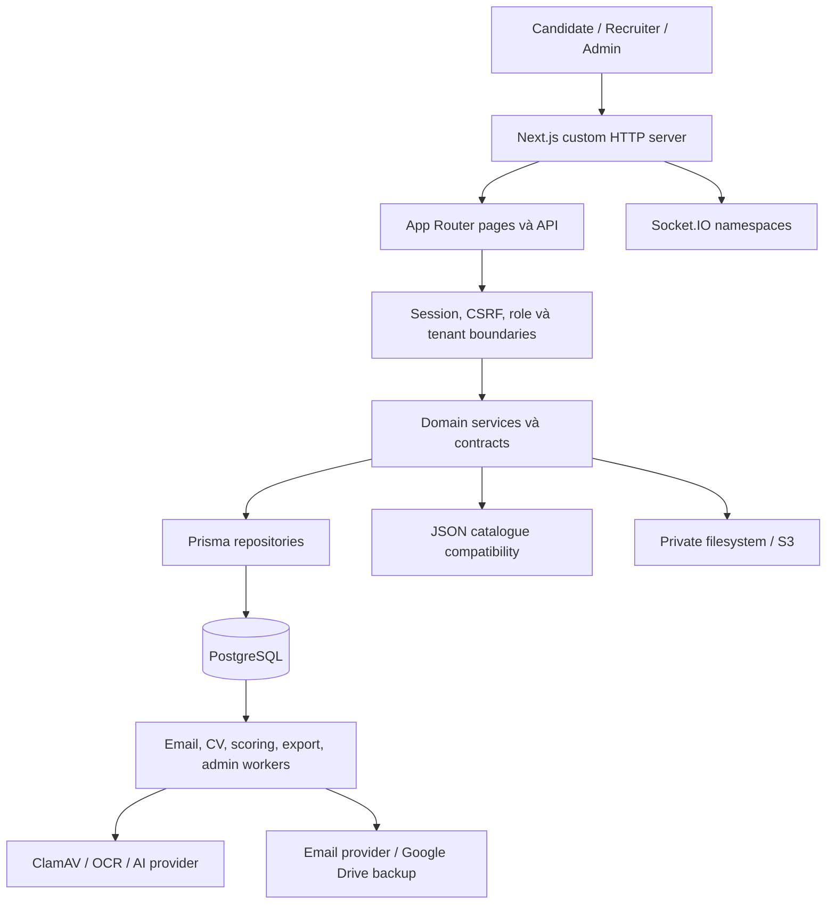

# Báo cáo audit hệ thống SmartHire

**Ngày kiểm tra:** 05/09/2026. **Checkout:** `D:\HCMUS\PROJECT`. **Commit:** `60711785`.

**Phạm vi:** audit chỉ đọc. Không sửa mã nguồn, cấu hình, migration, dữ liệu, quyền truy cập hoặc dependency. Các file được tạo chỉ là báo cáo và bằng chứng audit. Git sạch trước khi kiểm tra; không khởi động worker, gửi email, gọi AI hoặc thực hiện thao tác nghiệp vụ trên database thật.

**Current checkpoint:** This file is a historical audit snapshot. Current Candidate-first changes and verification are tracked in the [upgrade plan](candidate-first-upgrade-plan-2026-09-05.md), [baseline](candidate-first-baseline-2026-09-05.md) and [triage](candidate-first-baseline-triage-2026-09-05.md); do not infer current source or test status from this snapshot

## 1. Đánh giá tổng quan

SmartHire đã có nền tảng kỹ thuật đáng kể: modular monolith, phân chia frontend/backend/contracts, PostgreSQL với ràng buộc dữ liệu, xác thực và kiểm tra quyền phía server, CSRF, hàng đợi bền vững, lưu trữ riêng tư, nhiều lớp kiểm thử và hệ thống tìm kiếm có xử lý song ngữ.

**Tuy nhiên, chưa nên coi hệ thống đã sẵn sàng cho vận hành production có dữ liệu ứng viên thật hoặc mở rộng nhiều instance.** Những vấn đề quan trọng nhất nằm ở tính nhất quán sau giao dịch, bảo vệ vòng đời tài liệu, các điểm kiểm soát bảo mật chưa đồng đều và khả năng phục hồi khi worker gặp sự cố. Việc TypeScript và ESLint đạt không phát hiện được những lỗi này.

Các phát hiện đáng ưu tiên nhất:

1. POST/PATCH lưu tin tuyển dụng chưa áp dụng kiểm tra CSRF như các mutation khác.
2. CV của Team Application đi qua kiểm tra định dạng nhưng chưa đi qua quy trình quét an toàn tương đương CV import.
3. Một lỗi đọc dữ liệu sau khi nộp hồ sơ thành công có thể làm hệ thống xóa CV vừa gắn với hồ sơ đó.
4. Xóa công ty có thể xóa cả hồ sơ có legal hold và dấu vết xử lý báo cáo; đồng thời cập nhật JSON và PostgreSQL không nguyên tử.
5. Export có thể báo thành công trong database nhưng file đã bị xóa khi ghi audit thất bại.
6. Backup bị gián đoạn ở trạng thái LEASED chưa có đường tự phục hồi trong service hiện tại.
7. Logic tự động từ chối/đưa vào shortlist theo điểm và thời gian đang mâu thuẫn với nguyên tắc quyết định tuyển dụng do con người kiểm soát trong constitution.
8. Màn hình Team Applications chỉ nhận 100 hồ sơ mới nhất mà không có phân trang tiếp theo.

Đây là đánh giá kỹ thuật theo checkout được kiểm tra, không phải kết luận đã xảy ra mất dữ liệu, bị tấn công hoặc vi phạm pháp luật.

## 2. Phương pháp, bằng chứng và giới hạn

### 2.1. Mức độ bao phủ

| Thành phần được kiểm kê | Quy mô |
|---|---:|
| File TS/TSX/CSS trong `web/src`, loại mã Prisma sinh tự động | 1.494 |
| Dòng mã trong nhóm trên, gồm dòng trống/chú thích | 308.055 |
| API route handlers | 216 |
| Page components | 81 |
| File `.test.*` / `.spec.*` trong phạm vi kiểm kê | 856 |
| Prisma models | 164 |
| Migration được theo dõi trong Git | 88 |

Đã kiểm kê toàn bộ phạm vi trên và rà soát sâu các luồng có rủi ro cao: identity/session, tenant/Owner authorization, upload và truy cập CV, ứng tuyển, xóa công ty, scoring, email outbox, export, backup, realtime, tìm kiếm, cấu hình vận hành, CI, kiến trúc kiểm thử và UI chung.

CodeGraph báo index cập nhật, với 2.718 file được index. Công cụ được dùng trước để tìm luồng và liên kết; sau đó đọc trực tiếp những phần chưa được trả về, schema, migration và cấu hình. Số file CodeGraph bao gồm nhiều loại file và mã sinh tự động, nên không tương đương số file production ở bảng trên. Nhận xét “không thấy test” của CodeGraph không được dùng làm bằng chứng độc lập rằng một chức năng không có test.

**Đây không phải khẳng định đã kiểm chứng từng dòng của 308.055 dòng mã hoặc mọi tổ hợp của 216 endpoint.** Báo cáo phân biệt kiểm kê toàn repo, audit sâu luồng, kiểm thử cô lập và kiểm chứng database thật.

### 2.2. Kết quả chạy kiểm tra

| Kiểm tra | Kết quả hiện tại | Ý nghĩa |
|---|---|---|
| TypeScript toàn workspace, không emit và không ghi incremental cache | Đạt | Không có lỗi kiểu được compiler báo trong cấu hình hiện tại |
| ESLint toàn `web`, không cache | Đạt | Không có lỗi theo bộ quy tắc lint hiện hành |
| Prisma schema validate | Đạt | Schema hợp lệ về cú pháp và cấu trúc Prisma |
| Kiểm tra chuỗi migration | Đạt, 88 migration | Không phát hiện lỗi quy tắc đánh số/tên qua script hiện tại |
| Truy vấn database với `default_transaction_read_only=on` và `BEGIN READ ONLY` | 88 hoàn tất, 0 chưa hoàn tất | Database local đã áp dụng 88/88 migration |
| Vitest: architecture, accessibility, Company UI, Search UI/unit, shared unit | 104 file đạt, 18 file lỗi; 575 test đạt, 35 lỗi | Đây là 122 file / 610 test được chọn, không phải toàn bộ 856 file test |
| Chạy lại riêng 18 file lỗi, lấy lỗi dạng JSON | Vẫn 35 lỗi, 73 test đạt trong các file đó | Các lỗi tái hiện; không cộng lượt chạy lại thành test độc lập |
| `npm audit --omit=dev` và full `npm audit` | Cùng trả 14 package bị ảnh hưởng: 2 High, 12 Moderate | Số package trong cây dependency, không phải 14 đường khai thác độc lập |
| `git diff --check` | Đạt | Không phát hiện lỗi whitespace ở phần thay đổi được kiểm tra |

Khi chạy Vitest, `DATABASE_URL` và `DIRECT_URL` được đổi trong tiến trình test sang loopback port 1 để ngăn test chạm database thật. Không chạy integration suite có khả năng tạo/xóa dữ liệu thật. File kiểm tra custom-server lock được loại khỏi lượt chọn để tránh đụng vòng đời runtime/output lock không cần thiết.

Sáu mô phỏng lỗi độc lập chạy từ mã hiện tại, với database/storage/session giả lập trong bộ nhớ, đã cho kết quả:

| Tình huống | Quan sát |
|---|---|
| Health: truy vấn database ném lỗi | Vẫn nhận `status: "ok"` |
| Export: ghi audit lỗi sau khi cập nhật SUCCEEDED | Trạng thái database vẫn SUCCEEDED, nhưng thao tác xóa artifact được gọi |
| Team Application: đọc projection lỗi sau commit | Transaction đã commit, nhưng cleanup CV vẫn được gọi |
| Backup: có lease hết hạn, không có bản ghi QUEUED | Không nhận lại việc; trả `ready: true, processed: false` |
| JSON không có Content-Length, giới hạn 1.024 byte | Đọc hết 262.144 byte mới trả 413 |
| POST tin tuyển dụng: session giả lập hợp lệ, Origin lạ, `text/plain`, không CSRF | Service tạo draft vẫn được gọi và route trả 201 |

Mô phỏng xác nhận nhánh điều khiển của mã. Chúng không thay thế browser exploit, stress test, transaction test trên PostgreSQL hoặc diễn tập crash thật.

### 2.3. Database đang có gì?

Database local được đọc là PostgreSQL **16.12**, timezone **UTC**, dung lượng khoảng **423 MB**. Có **51.950 JobPosting**, **182 Company**, **0 JobApplication**, **0 TeamApplication** và chưa có bản ghi BackupRun tại thời điểm truy vấn.

Do đó, dữ liệu hiện tại hỗ trợ đánh giá quy mô danh mục việc làm, nhưng **không hỗ trợ kết luận về hiệu năng pipeline, export hàng nghìn ứng viên, history ứng tuyển hoặc phục hồi backup**. Số dead tuples trong mẫu thống kê không cho thấy một vấn đề phình bảng đáng kể; không có cơ sở đề nghị VACUUM FULL hoặc thay đổi database chỉ từ mẫu này.

Prisma root CLI, workspace CLI, client và adapter hiện cùng **7.9.0**. Cảnh báo lệch Prisma trong ghi chú audit trước đây đã được kiểm tra lại và không được đưa vào danh sách lỗi hiện tại. Company location query cũng đã có chặn 2.000 dòng; không còn đúng nếu mô tả là truy vấn hoàn toàn không giới hạn.

### 2.4. Chưa kiểm chứng

- Chưa xem giao diện live: Chrome DevTools bị xung đột profile đang sử dụng; CUA không có browser/app khả dụng. Không đóng trình duyệt của người dùng để vượt qua hạn chế này.
- Chưa đo trực tiếp responsive, contrast, CLS/LCP/INP, thao tác bàn phím hoặc screen reader trên trình duyệt.
- Chưa chạy production build trong lượt audit này; không sử dụng số liệu build cũ làm kết quả mới.
- Chưa chạy toàn bộ E2E, load/stress/chaos test, kiểm thử nhiều instance hoặc phục hồi backup.
- Chưa xác minh IAM, bucket policy, TLS/reverse proxy, secret manager, cảnh báo vận hành hoặc cấu hình production thực tế.
- Chưa chạy Python/OCR test vì không có lệnh Python khả dụng trong môi trường shell; dependency Python và container image chưa được quét advisory đầy đủ.

Bằng chứng dạng máy đọc nằm trong [2026-09-05-verification.json](2026-09-05-verification.json).

## 3. Kiến trúc và mô hình dữ liệu

### 3.1. Kiến trúc quan sát được

**Điểm hợp lý:** giữ modular monolith phù hợp hơn việc tách microservice ngay. Luồng nghiệp vụ có nhiều transaction và dữ liệu liên quan chặt chẽ; tách sớm sẽ làm các lỗi nhất quán hiện tại khó xử lý hơn. Contracts và adapters đã tạo nền cho việc tách worker độc lập khi có nhu cầu thực tế.

**Điểm cần cải thiện:** ranh giới đã được thiết kế nhưng chưa được tuân thủ đồng đều. Một số service truy cập Prisma trực tiếp; repository lại nhập helper từ service; custom server chạy cả công việc nền. JSON catalogue vẫn tham gia cập nhật nghiệp vụ nên PostgreSQL chưa phải nguồn ghi duy nhất cho toàn bộ hệ thống.

### 3.2. Chất lượng mô hình dữ liệu

| Nhóm | Điểm tốt | Điều cần kiểm soát |
|---|---|---|
| Identity, session, quyền | Tách account/session/membership/grant, có trạng thái và hết hạn | Xác thực session không thay cho kiểm tra origin/CSRF và quyền theo hành động |
| Job và review | Phân biệt bản đang soạn, bản review, public projection | Tránh lệch giữa JSON, approved snapshot và bảng công khai |
| JobApplication | Snapshot CV/job/profile, consent/version/idempotency, số lần ứng tuyển có unique | Snapshot chứa dữ liệu cá nhân cần vòng đời xóa rõ; hard delete phải tôn trọng legal hold |
| Documents và storage | Tách metadata khỏi bytes, có delete/access timestamps và promotion records | Không xóa metadata trước khi đã có công việc xóa bytes bền vững |
| Scoring | Tách deterministic/AI/published result, generation và lineage | Điểm số không đồng nghĩa với quyền quyết định tuyển dụng tự động |
| Messaging | Có sequence và idempotency cho message | Dữ liệu bền vững không tự làm realtime hoạt động xuyên nhiều process |
| Outbox/work items | Có trạng thái, attempts, lease và một số đường retry | Phải kiểm tra riêng từng worker; không suy ra mọi worker đều phục hồi tốt |
| Search | Có catalog version, aliases, projection, GIN và SQL ranking | Quản trị chất lượng và giới hạn candidate pool cần đo recall theo quy mô |

Không coi tất cả trường JSON là lỗi chuẩn hóa. Snapshot bất biến phục vụ lịch sử là một dạng phi chuẩn hóa có chủ đích. Ngược lại, dữ liệu dùng cho lọc/join/invariant quan trọng nên có cột/ràng buộc tương ứng, thay vì chỉ dựa vào nội dung JSON.

Schema và migrations có FK, unique, CHECK và partial unique index; ví dụ salary/version constraints, company-membership state constraints và uniqueness theo ứng viên/idempotency. Tuy vậy, **FK tồn tại không chứng minh quy tắc vòng đời đúng**: `ApplicationDocumentLegalHold → JobApplication` đang `ON DELETE CASCADE`, được xác nhận cả trong schema lẫn database thật.

## 4. Danh sách phát hiện và ưu tiên

**P1:** cần giải quyết trước vận hành dữ liệu thật, hoặc trước điều kiện mở rộng nêu rõ. **P2:** cần đưa vào đợt củng cố chất lượng gần nhất. Mức ưu tiên dựa trên tác động, không phải CVSS tự gán.

| Mã | Ưu tiên | Phát hiện | Mức bằng chứng |
|---|---|---|---|
| F01 | P1 | Thiếu CSRF ở POST/PATCH tin tuyển dụng | Mã + mô phỏng route |
| F02 | P1 | Giới hạn body được kiểm tra sau khi đã nạp toàn bộ | Mã + mô phỏng stream |
| F03 | P1 | Team CV chưa qua scan; filesystem nhận bytes thô | Truy vết đầy đủ luồng |
| F04 | P1 | Cleanup CV sau transaction đã commit | Mã + mô phỏng fault |
| F05 | P1 | Xóa công ty vượt qua vòng đời legal hold và metadata tài liệu | Mã + FK database thật |
| F06 | P1 | Xóa JSON trước DB transaction, không có rollback chung | Mã |
| F07 | P1 | Export SUCCEEDED nhưng artifact bị xóa do audit lỗi | Mã + mô phỏng fault |
| F08 | P1 | Backup lease hết hạn không được nhận lại | Mã + mô phỏng fault |
| F09 | P1 | Tự động quyết định tuyển dụng mâu thuẫn constitution | Mã + tài liệu canonical |
| F10 | P1 khi vượt 100 hồ sơ | Team Applications cắt danh sách, không có trang tiếp | Repository + service/UI |
| F11 | P1 trước scale-out | Realtime phụ thuộc registry trong process | Gateway + publisher |
| F12 | P2 | Health báo ok khi database query lỗi | Mã + mô phỏng fault |
| F13 | P2 | Export nạp tất cả dòng vào RAM, không kiểm tra kết quả giữ lease | Mã |
| F14 | P2 | Socket khởi tạo có cửa sổ bỏ lỡ disconnect và N+1 | Mã; cần test runtime |
| F15 | P2 | Worker stop chưa drain; timeout không hủy processor | Mã; cần crash/load test |
| F16 | P2 | Backup buffer lớn, thiếu deadline và kế hoạch khôi phục toàn bộ | Mã; triển khai ngoài repo chưa rõ |
| F17 | P1 để phân loại, vá theo mức tiếp cận | 14 package nằm trong advisory ranges | npm audit + dependency tree |
| F18 | P2 | CI, test isolation và môi trường chưa phản ánh toàn hệ thống | Cấu hình + kết quả chạy |
| F19 | P2 | Nợ kiểm thử: 35 lỗi và nhiều kiểm tra bám chuỗi mã nguồn | Chạy và chạy lại |
| F20 | P2 | Ranh giới kiến trúc và file lớn gây khó bảo trì | Source + architecture tests |
| F21 | P2 | CSS nhiều lớp ghi đè; dropdown địa điểm thiếu bước chuyển focus | Source; chưa có visual QA |
| F22 | P2 | Search/observability/timezone còn các điều kiện cần kiểm chứng | Source và cấu hình |

### F01 — CSRF chưa nhất quán ở lưu tin tuyển dụng

**Bằng chứng:** [job-postings/route.ts](../../web/src/app/api/recruiter/job-postings/route.ts), dòng 30, 94–125: POST/PATCH chỉ gọi `requireSession`. DELETE ngay bên dưới lại sử dụng `requireJobActor(..., { mutation: true })`. `request.json()` không tự bắt buộc Content-Type JSON.

Mô phỏng với session hợp lệ được inject, Origin lạ, Content-Type `text/plain` và không có CSRF token vẫn gọi service tạo draft, trả 201. Đây là lỗ hổng kiểm soát ở route; chưa thực hiện khai thác bằng browser/session thật. SameSite=Lax và host-only cookie giảm một số tình huống cross-site nhưng không thay thế kiểm tra origin/CSRF, đặc biệt với origin không tin cậy trong cùng site.

**Tác động:** hành động ghi draft có lớp bảo vệ yếu hơn các mutation khác; độ an toàn phụ thuộc vào môi trường trình duyệt/deployment ngoài route.

**Đề xuất:** thống nhất mutation boundary cho POST/PATCH/DELETE, kiểm tra origin, fetch metadata, proof và body trước service. Test phải bao gồm origin sai, thiếu/sai proof và simple-request content type; vẫn giữ tenant authorization trong service.

### F02 — Giới hạn request chưa bảo vệ bộ nhớ trước khi parse

**Bằng chứng:** [account-request-boundary.ts](../../web/src/backend/security/account-request-boundary.ts), dòng 46–89: kiểm tra Content-Length nếu có, sau đó `await request.text()` và mới đo số byte. Mô phỏng giới hạn 1 KB đã tiêu thụ 256 KB rồi mới trả 413. [identity/login/route.ts](../../web/src/app/api/identity/login/route.ts) gọi `request.json()` trước logic đăng nhập. [team-applications/route.ts](../../web/src/app/api/candidate/team-applications/route.ts), dòng 77, parse toàn bộ multipart trước giới hạn file.

**Tác động:** body thiếu Content-Length hoặc multipart nhiều phần có thể tiêu thụ tài nguyên vượt xa giới hạn nghiệp vụ. Rate limit chạy sau parse không bảo vệ được chi phí parse ban đầu. Chưa đo được ngưỡng DoS thực tế hoặc giới hạn của reverse proxy production.

**Đề xuất:** bộ đọc stream đếm byte và dừng ngay khi vượt ngưỡng; giới hạn tổng multipart, số phần và độ dài field; giới hạn body/request timeout ở ingress. Tiêu chí: request lớn bị ngắt trước khi nạp toàn bộ, kể cả chunked body và nhiều request đồng thời.

### F03 — Team Application CV chưa có cùng mức bảo vệ với pipeline CV import

**Bằng chứng:** [team-application-cv-service.ts](../../web/src/backend/services/company-members/team-application-cv-service.ts), dòng 32–49 → [validated-file-upload.ts](../../web/src/backend/cv/validated-file-upload.ts) → [prepare-direct-application-cv.ts](../../web/src/backend/services/jobs/prepare-direct-application-cv.ts), dòng 58–73. Chuỗi này xác nhận MIME/signature/size rồi lưu; không có ClamAV verdict, quarantine state hoặc safe-to-open gate. Luồng mở file trả bytes qua route CV sau kiểm tra Owner.

Ở filesystem, [filesystem.ts](../../web/src/backend/cv/storage/filesystem.ts), dòng 120–132, ghi chính chunk nhận được. Luồng này không gọi lớp mã hóa artifact trước storage. Không nên mở rộng nhận xét thành “mọi CV đều không mã hóa”: CV import có cryptor riêng và S3 adapter có SSE-KMS.

**Tác động:** file đúng chữ ký PDF/DOCX vẫn có thể chứa nội dung nguy hiểm; kiểm tra định dạng không phải malware scan. Với filesystem adapter, mức bảo vệ dữ liệu khi đọc được ổ đĩa yếu hơn pipeline có envelope encryption.

**Đề xuất:** dùng admission/scan/quarantine và encryption chung cho tài liệu ứng tuyển; chỉ mở sau verdict sạch, có integrity check và trạng thái lỗi scanner. Test xác nhận scanner unavailable phải chặn mở, file không sạch bị cách ly, và bytes lưu không phải plaintext trong adapter yêu cầu mã hóa.

### F04 — Nộp hồ sơ thành công nhưng mất CV khi bước đọc tiếp theo thất bại

**Bằng chứng:** [team-application-service.ts](../../web/src/backend/services/company-members/team-application-service.ts), dòng 178–303. Sau khi `$transaction` trả về, service gọi `getCandidate` trong cùng `try`. Mọi lỗi ở bước này đi vào `catch` và `cleanup()`. Cleanup thực sự xóa storage object tại [prepare-direct-application-cv.ts](../../web/src/backend/services/jobs/prepare-direct-application-cv.ts), dòng 83–84. Route còn có cleanup ở lớp ngoài nếu prepared chưa được giải phóng.

**Đã tái hiện cô lập:** transaction committed = true; getter ném lỗi; cleanup được gọi một lần trong service.

**Tác động:** hồ sơ đã tồn tại và trỏ đến file bị xóa; người dùng thấy lỗi và thử lại có thể chỉ nhận hồ sơ cũ với CV không còn dùng được.

**Đề xuất:** tách rõ tài liệu tạm và tài liệu đã được commit; chuyển quyền sở hữu artifact ngay khi giao dịch thành công, không dùng cleanup rollback cho lỗi đọc response. Test fault sau commit phải giữ CV và lần retry phải trả cùng hồ sơ hợp lệ.

### F05 — Xóa công ty phá vỡ cơ chế lưu giữ và có thể bỏ lại bytes không còn metadata

**Bằng chứng:** [recruiter-job-posting-data.ts](../../web/src/backend/services/jobs/recruiter-job-posting-data.ts), dòng 2062–2288. Owner có thể đi vào hard-delete; code xóa report, conversation, export request, application và verification request. Không có kiểm tra legal hold trong chuỗi này. [schema.prisma](../../web/prisma/schema.prisma), dòng 3322–3336, đặt legal hold `onDelete: Cascade`; FK này được xác nhận trong database thật và không thấy custom trigger trên ba bảng liên quan để bổ sung chặn.

Metadata `ApplicationDocument` và export có storage locator bị xóa mà luồng này chưa tạo một công việc bền vững để xóa bytes tương ứng. Các vòng retention dựa vào metadata đã mất sẽ không tự biết locator cần xử lý; external lifecycle/sweeper có thể giảm tác động nhưng chưa được xác minh.

**Tác động:** mất lịch sử ứng tuyển và bằng chứng đang cần lưu; mất dữ liệu phục vụ xử lý báo cáo; hoặc còn file cá nhân trên storage nhưng không còn bản ghi để quản lý. Hiện database không có application nên chưa quan sát sự cố dữ liệu thật.

**Đề xuất:** quy trình deactivation → chặn truy cập → kiểm tra hold/report → lập deletion manifest/outbox → xóa bytes theo chính sách → purge metadata. Bản ghi hold đang hiệu lực phải thực sự chặn purge. Giữ audit nghiệp vụ và số phận từng artifact; test cả legal hold, report mở và storage lỗi.

### F06 — JSON và PostgreSQL không có giao dịch chung khi xóa công ty

**Bằng chứng:** cùng [recruiter-job-posting-data.ts](../../web/src/backend/services/jobs/recruiter-job-posting-data.ts), dòng 2323–2339 và 2370–2382. JSON jobs/applications/companies được cập nhật trước, rồi mới bắt đầu transaction PostgreSQL.

**Tác động:** nếu DB thất bại do timeout, FK hoặc cạnh tranh sau khi file đã ghi, JSON đã xóa nhưng DB chưa xóa. Database rollback không thể hoàn tác filesystem. Ghi ba file cũng có thể thành công một phần. Lease ghi từng catalogue không tạo tính nguyên tử cho toàn bộ workflow.

**Đề xuất:** PostgreSQL làm nguồn ghi chính; xuất JSON bằng outbox/reconciliation. Nếu cần giai đoạn chuyển tiếp, có operation journal, trạng thái hoàn tất từng bước và recovery idempotent. Test cố tình thất bại ở từng ranh giới I/O, kiểm tra kết quả phục hồi.

### F07 — Export thành công nhưng bị xóa vì audit thất bại

**Bằng chứng:** [candidate-export-worker.ts](../../web/src/backend/exports/candidate-export-worker.ts), dòng 69–111: storage put → `requests.succeed()` → append audit, tất cả cùng `try`; `catch` xóa artifact. [prisma-export-request-repository.ts](../../web/src/backend/repositories/analytics/prisma-export-request-repository.ts), hàm `fail`, chỉ cập nhật bản ghi còn LEASED.

**Đã tái hiện cô lập:** `succeed` đã đổi thành SUCCEEDED; audit ném lỗi; storage delete được gọi; `fail` không đổi được SUCCEEDED.

**Tác động:** UI báo có file sẵn sàng nhưng tải file thất bại. Đây là lỗi toàn vẹn dữ liệu, không chỉ thiếu log.

**Đề xuất:** cập nhật completion và audit/outbox trong cùng transaction nếu có thể; hoặc coi lỗi audit sau commit là công việc cần retry riêng. Không xóa artifact đã được record hoàn tất sở hữu. Test failure injection đúng sau succeed.

### F08 — Backup có thể kẹt vĩnh viễn sau khi worker chết

**Bằng chứng:** [backup-service.ts](../../web/src/backend/backup/backup-service.ts), dòng 35–54: chỉ tìm `status: "QUEUED"`; lúc claim chuyển LEASED với hạn 10 phút; không có điều kiện reclaim LEASED đã hết hạn. `activeKey: "platform"` giữ unique slot của backup đang chạy.

**Đã tái hiện cô lập:** một backup LEASED đã hết hạn không được xử lý, service trả ready=true. Request mới cũng có thể bị activeKey cũ giữ lại. Lỗi không được khắc phục chỉ bằng việc chờ hết 10 phút.

**Đề xuất:** reclaim lease hết hạn với attempt limit và ownership token; cập nhật completion có kiểm tra owner; heartbeat nếu cần; terminal/dead state và cảnh báo tuổi job. Diễn tập kill worker giữa dump/upload rồi khởi động lại phải chứng minh queue tiếp tục tiến triển.

### F09 — Quy tắc tự động tuyển dụng mâu thuẫn nguyên tắc sản phẩm

**Bằng chứng:** [constitution.md](../../spec-kit/.specify/memory/constitution.md), Principle I, yêu cầu quyết định con người trước khi AI tự từ chối hoặc nâng trạng thái ứng viên. [automatic-viewed-stage-rules.ts](../../web/src/backend/applications/services/automatic-viewed-stage-rules.ts), dòng 78–150, có WAITLISTED, SHORTLISTED và REJECTED theo hybrid final score/thời gian. [scoring-worker-runtime.ts](../../web/src/backend/scoring/workers/scoring-worker-runtime.ts) gọi sweep nền; mặc định timeout review là 12 giờ trong [automatic-score-stage-config.ts](../../web/src/backend/applications/services/automatic-score-stage-config.ts).

**Tác động:** ứng viên có thể bị đổi trạng thái khi không có quyết định thủ công trong cửa sổ review. Hybrid score hiện có thành phần AI 60%, nên không thể mô tả đây là quy tắc hoàn toàn độc lập với AI. Đây là mâu thuẫn giữa code và quy tắc canonical, không phải suy đoán về tính hợp pháp.

**Đề xuất:** quyết định rõ chính sách sản phẩm và làm đồng bộ constitution/spec/code. Với nguyên tắc hiện tại, automation nên tạo gợi ý/công việc nhắc review; thao tác ảnh hưởng ứng viên cần người có quyền xác nhận. Kiểm thử backend phải chứng minh không có actor tự động vượt qua quy tắc đã chốt.

### F10 — Team Applications không thể duyệt hết khi vượt 100 hồ sơ

**Bằng chứng:** [prisma-team-application-repository.ts](../../web/src/backend/repositories/company-members/prisma-team-application-repository.ts), dòng 59–91: cả `listForCandidate` và `listForOwner` đều `take: 100`, sắp xếp mới nhất trước. Service trả `{ items }`, không có cursor/hasMore; màn hình Owner dùng trực tiếp danh sách này.

**Tác động:** hồ sơ cũ nằm ngoài 100 bản ghi biến mất khỏi danh sách; hồ sơ chưa review không được ưu tiên đưa trở lại. Đây không phải pagination hoàn chỉnh, dù bản ghi vẫn còn trong database.

**Đề xuất:** cursor pagination, tổng/chỉ báo còn dữ liệu, bộ lọc trạng thái và ưu tiên pending. Test với 101 và 1.000 hồ sơ, chứng minh mỗi hồ sơ có đường truy cập và không bị lặp/mất khi có hồ sơ mới.

### F11 — Realtime chưa sẵn sàng cho nhiều instance

**Bằng chứng:** [socket-io-chat-gateway.ts](../../web/src/backend/messaging/realtime/socket-io-chat-gateway.ts) tạo Socket.IO Server mặc định; [messaging-socket-registry.ts](../../web/src/backend/messaging/realtime/messaging-socket-registry.ts), dòng 5–10, dùng Map/Set trong process. [messaging-realtime-publisher.ts](../../web/src/backend/messaging/realtime/messaging-realtime-publisher.ts) tìm socket qua registry và namespace local. Không tìm thấy adapter/bus xuyên process trong luồng được kiểm tra.

**Tác động khi scale-out:** người dùng ở hai instance có thể không nhận event của nhau; presence và thông báo thu hồi session cũng có thể chỉ tác động cục bộ. Chưa khẳng định đây là lỗi ở deployment một instance hiện tại.

**Đề xuất:** transport/bus và registry policy hỗ trợ nhiều instance, cơ chế đồng bộ revocation, cursor catch-up sau reconnect. Chỉ thêm Redis adapter chưa đủ nếu publisher tiếp tục chỉ duyệt socket local. Socket.IO có tài liệu chính thức về [vận hành nhiều node](https://socket.io/docs/v4/using-multiple-nodes/); với websocket-only hiện tại không nên máy móc áp dụng yêu cầu sticky session của long-polling.

### F12 — Health check che khuất lỗi phụ thuộc

**Bằng chứng:** [get-system-health.ts](../../web/src/backend/services/system/get-system-health.ts), dòng 9–27: truy vấn thất bại được đổi thành `[]`, nhưng status luôn `ok`; [health/route.ts](../../web/src/app/api/health/route.ts) trả JSON với HTTP 200. CI dùng endpoint này để chờ server sẵn sàng.

**Tác động:** liveness và readiness bị trộn; deploy có thể được coi là sẵn sàng dù phụ thuộc quan trọng không dùng được. Flags readiness=false không đủ nếu consumer chỉ xét HTTP code hoặc status.

**Đề xuất:** endpoint liveness nhẹ và readiness có timeout/HTTP 503 khi phụ thuộc bắt buộc hỏng; tách capability tùy chọn. Không công khai chi tiết nhạy cảm về hạ tầng trong error response.

### F13 — Export có batching ở truy vấn nhưng chưa có giới hạn tổng RAM/lease

**Bằng chứng:** [candidate-export-worker.ts](../../web/src/backend/exports/candidate-export-worker.ts), dòng 40–66: từng batch được `rows.push(...)` vào một array đến hết rồi mới tạo CSV/XLSX Buffer. Lease mặc định 60 giây; không thấy heartbeat trong worker này. Kết quả `requests.succeed()` là `updateMany`, nhưng worker không kiểm tra `count === 1`.

**Tác động:** bộ nhớ vẫn tăng O(N); chia truy vấn thành batch không giải quyết tổng RAM. Worker mất ownership có thể tiếp tục upload rồi ghi audit thành công dù không cập nhật được bản ghi, để lại orphan artifact. Bản ghi hết số attempts trong trạng thái LEASED cũng cần terminalization riêng.

**Đề xuất:** streaming writer/storage, giới hạn số dòng/bytes, timeout, lease renewal hoặc deadline nhỏ hơn lease; kiểm tra CAS completion và xóa riêng artifact chưa được nhận quyền sở hữu. Test export lớn cùng hai worker và tình huống fail ở lần claim cuối.

### F14 — Socket khởi tạo có race và chi phí truy vấn tuyến tính

**Bằng chứng:** [socket-io-chat-gateway.ts](../../web/src/backend/messaging/realtime/socket-io-chat-gateway.ts), handler connection đăng ký registry/presence, sau đó await join và tải/authorize từng conversation; handler disconnect được gắn ở cuối. `emitPresence` và publisher cũng kiểm tra nhiều quan hệ trong vòng lặp.

**Rủi ro:** disconnect xảy ra khi đang await có thể bị bỏ lỡ, để lại presence/registry stale; lỗi truy vấn ngoài try trong async connection callback cần kiểm tra xử lý rejection. Người có nhiều conversation tạo N+1 authorization queries và kéo dài thời gian sẵn sàng.

**Đề xuất:** gắn cleanup ngay khi đăng ký socket, có try/finally và guard trạng thái connected; batch đọc quyền theo phạm vi, giới hạn số room được join lúc đầu. Test disconnect ở từng await, DB lỗi và tài khoản có nhiều conversation. Đây là phân tích mã, chưa tái hiện leak bằng Socket.IO runtime.

### F15 — Stop/timeout của worker chưa đồng nghĩa đã dừng công việc

**Bằng chứng:** [server.ts](../../web/server.ts) gọi `scoring.stop()` và `candidateExports.stop()` trước đóng app. Hai runtime chỉ clear timer, không await tick đang chạy. [scoring-worker.ts](../../web/src/backend/scoring/workers/scoring-worker.ts), `withTimeout`, từ chối Promise ngoài khi hết giờ nhưng không hủy processor bên trong. Runtime còn dùng worker id cố định `application-scoring-runtime`.

**Tác động:** deploy/shutdown có thể cắt ngang tác vụ; timeout không nhất thiết dừng CPU, I/O hoặc chi phí provider. Các kiểm tra generation/state đang có giúp giảm stale publication; không vì vậy mà có thể kết luận không còn việc nền chạy tiếp. Owner token cố định cũng làm dấu vết phân biệt các instance yếu hơn.

**Đề xuất:** stop-claim → drain/abort có deadline → đóng dependencies; truyền AbortSignal xuyên processor; lease/attempt token riêng cho mỗi lần claim; test late completion sau timeout và restart. Không tăng timeout đại trà để che lỗi pool/worker.

### F16 — Backup chưa là một phương án khôi phục toàn hệ thống

**Bằng chứng:** [postgres-backup.ts](../../web/src/backend/backup/postgres-backup.ts), dòng 13–21, gom stdout `pg_dump` vào RAM và truyền connection URL qua argv. [google-drive-backup.ts](../../web/src/backend/backup/google-drive-backup.ts) mã hóa, ghép multipart Buffer và fetch upload; chưa có deadline hủy rõ trong chuỗi này. Backup hiện tại tạo DB dump, không có manifest đồng bộ private CV/application/export/evidence storage.

**Tác động:** khi database lớn, nhiều bản sao Buffer làm tăng RAM; dump/upload treo có thể giữ worker; connection string trong process arguments có thể bị người có quyền quan sát tiến trình đọc. Khôi phục DB thành công chưa đảm bảo tải lại được các tài liệu mà DB tham chiếu.

**Đề xuất:** pipeline streaming, deadline và giới hạn dung lượng; không đưa password vào argv; quản lý backup storage, khóa mã hóa và phiên bản khóa cùng chiến lược restore. Chốt RPO/RTO theo nhu cầu sản phẩm, diễn tập restore vào môi trường riêng và kiểm tra mở được tài liệu. Chưa có bằng chứng để khẳng định hiện tại mất backup hoặc lộ credential.

### F17 — Advisory dependency cần xử lý theo đường sử dụng thực tế

| Package / đường phụ thuộc quan sát được | Phiên bản | Nhận xét |
|---|---|---|
| `sanitize-html` trực tiếp | 2.17.6 | Advisory SVG SMIL; bản vá 2.17.7. Luồng PlainTextNormalizer hiện `allowedTags: []`, không đáp ứng điều kiện cho SVG của advisory |
| `mysql2` qua Prisma / Better Auth | 3.15.3 | Có advisory High về authentication downgrade. Ứng dụng hiện cấu hình PostgreSQL; chưa thấy đường kết nối MySQL production |
| `fast-uri` qua React Email → conf → ajv | 3.1.5 | Có advisory High về normalization/host confusion; chưa chứng minh nó được dùng làm SSRF guard trên input người dùng |
| `@xmldom/xmldom` qua Mammoth | 0.8.13 | Cần ưu tiên kiểm tra vì hệ thống nhận DOCX; advisory liên quan serialization/EntityReference, không thể suy ra mọi thao tác đọc DOCX đều khai thác được |
| `decode-uri-component` qua react-admin → query-string | 0.2.2 | Advisory chi phí decode đầu vào malformed; cần test đường query string của admin |
| `uuid` qua ExcelJS | 8.3.2 | Advisory liên quan các API/buffer cụ thể; cần xác minh API ExcelJS thực sự gọi |

Các package `query-string`, `ra-core`, `ra-ui-materialui`, `react-admin`, `exceljs`, `prisma` còn được đánh dấu do kế thừa vấn đề từ dependency. Không cộng chúng thành các lỗ hổng độc lập.

Đã đối chiếu [advisory sanitize-html](https://github.com/advisories/GHSA-g8qq-57p8-ggw5) và [advisory fast-uri](https://github.com/advisories/GHSA-f65p-4m7j-42xc); toàn bộ advisory IDs nằm trong file bằng chứng. Kết luận ở đây là dependency nằm trong affected range; chưa kết luận ứng dụng có XSS/SSRF đã khai thác được.

**Đề xuất:** vá tương thích các package lá, làm regression test trên CV parsing, auth, export và admin navigation; thêm dependency review/audit vào CI. Không dùng `npm audit fix --force` máy móc: output đang đề xuất một số downgrade/major change như Prisma 6.x, ExcelJS 3.x hoặc react-admin bản cũ, không phù hợp để áp dụng tự động.

### F18 — CI và môi trường kiểm thử chưa bao phủ các rủi ro chính

**Bằng chứng:** [ci.yml](../../.github/workflows/ci.yml) chạy typecheck/lint/build, search, admin-management và core unit; browser gates tập trung vào search/admin search. Không thấy gate tổng cho toàn bộ architecture/accessibility/security, Python OCR, dependency advisory hoặc coverage threshold. CI PostgreSQL 17 trong khi compose và database local là 16.12.

[vitest.config.ts](../../web/vitest.config.ts) tự nạp `.env.local`; [setup.ts](../../web/tests/setup.ts) đặt nhiều biến bằng `??=`, nên cấu hình có sẵn vẫn có thể thắng test defaults. File test chạy tuần tự vì có database và cleanup workers dùng chung. Không có bảo đảm tổng quát rằng cứ chạy `npm test` là cô lập khỏi database của app.

**Đề xuất:** database test tách biệt có guard tên/URL và quyền; test unit mặc định không có network; integration tạo môi trường riêng; thống nhất PostgreSQL hoặc có matrix 16/17; gate nghiệp vụ trọng yếu gồm ứng tuyển, authorization, documents, worker recovery. Duy trì subset nhanh cho PR và full suite định kỳ, nhưng phải hiển thị rõ phạm vi từng gate.

### F19 — 35 lỗi test là tín hiệu nợ kiểm thử, không phải 35 lỗi production

Các lỗi được tái hiện thành bốn nhóm:

| Nhóm | Ví dụ | Cách hiểu |
|---|---|---|
| Thiếu test provider | Home candidate/employer, NotificationCenter: `No QueryClient set` | Test không dựng đúng AppProviders; root thực tế có AppProviders, nên chưa chứng minh trang thật crash |
| Kiểm tra literal đã cũ | Chuỗi `4_000`, nhãn tiếng Anh, tên CSS module, `window.confirm` | Refactor/i18n/custom dialog có thể làm test sai dù hành vi đúng |
| Quy tắc kiến trúc không còn khớp mã | Route trực tiếp nhập provider, repo nhập service, file storage thiếu server-only marker | Có lệch ranh giới thực; cần phân biệt ngoại lệ framework hợp lệ như error boundary |
| Test DOM kỳ vọng flow cũ | Password change không tìm thấy Current password/Cancel; CV upload không thấy group Choose a parser | Cần cập nhật setup/flow hoặc xác nhận hành vi sản phẩm; chưa đủ bằng chứng gọi đây là lỗi accessibility live |

Một test theme còn nhạy với `\n` so với `\r\n`, không phải phép đo contrast. Test private-match được chạy qua hai file, nên có lỗi lặp. Một “integration test” Team Application chỉ kiểm tra schema/signature và mã lỗi, không thực hiện submit transaction hoặc đua hai lệnh thật: [candidate-submission.test.ts](../../web/tests/backend/integration/company-team-applications/candidate-submission.test.ts).

**Đề xuất:** kiểm tra behavior/contracts/AST khi phù hợp; dùng test render wrapper chuẩn, fixture locale rõ; giữ negative security tests thực sự đi qua request boundary; thêm failure injection cho F04/F07/F08. Không sửa test thành pass bằng cách bỏ assertion về quyền hoặc dữ liệu.

### F20 — Ranh giới kiến trúc và file quá lớn

Ví dụ có thể kiểm chứng:

- [recruiter-job-posting-data.ts](../../web/src/backend/services/jobs/recruiter-job-posting-data.ts): khoảng 2.430 dòng, gồm đọc catalogue, quyền, CRUD job/company, đồng bộ và hard delete nhiều domain.
- [search-query-resolver.ts](../../web/src/backend/services/search/search-query-resolver.ts): khoảng 2.319 dòng; cần giữ pure domain nhưng tách bước nhận diện, candidate generation, scoring và explanation.
- [job-posting-editor.tsx](../../web/src/frontend/features/recruiter-workspace/job-posting-editor.tsx): khoảng 2.209 dòng.
- [prisma-public-job-repository.ts](../../web/src/backend/repositories/jobs/prisma-public-job-repository.ts): khoảng 1.886 dòng SQL/filter/projection logic.
- [prisma-application-repository.ts](../../web/src/backend/repositories/applications/prisma-application-repository.ts) nhập `safeFilename` từ service; helper loại này nên ở tầng thấp hơn cả service/repository.

**Tác động:** thay đổi nhỏ khó xác định phạm vi ảnh hưởng; dễ lặp chính sách; mock khó phản ánh implementation; sửa UI và nghiệp vụ vô tình chạm nhau.

**Đề xuất:** tách theo trách nhiệm và invariant, không tách chỉ để giảm số dòng. Đặt deletion workflow, catalogue adapter, authorization, query/projection và editor form sections vào module chuyên trách. Ưu tiên refactor quanh lỗi đã có test chứng minh; chưa có lý do kỹ thuật đủ mạnh để viết lại toàn bộ hoặc tách microservices.

`JobBoardExperience` còn chứa client filtering/sorting có thể lệch SQL search, nhưng không tìm thấy import production trong `web/src` hiện tại. Đây là mã legacy cần quyết định giữ/xóa, **không được dùng làm bằng chứng rằng trang Jobs hiện đang lọc sai**.

### F21 — UI/CSS: nền tảng có sẵn nhưng nhiều lớp ghi đè

| Stylesheet | Dòng | Bytes nguồn | `!important` | Literal hex |
|---|---:|---:|---:|---:|
| Job board | 14.850 | 354.158 | 32 | 40 |
| Recruiter workspace | 10.985 | 264.667 | 14 | 176 |
| Home | 7.424 | 173.337 | 16 | 168 |

Đây là kích thước file nguồn, không phải dung lượng network sau bundling/gzip. Hex có thể bao gồm legacy/theme overrides; không mặc định mỗi literal là một lỗi contrast. Tuy vậy, kích thước và số lớp override khiến việc duy trì dark mode, responsive và hierarchy khó hơn. `(workspace)/layout` cùng import cả recruiter workspace và job-board styles, tăng phạm vi cascade cần quản lý.

**Lỗi tương tác cần xác minh trên browser:** [company-list-screen.tsx](../../web/src/frontend/features/candidate-company/company-list-screen.tsx), dòng 155–165 và 188–218: ArrowDown trên trigger chỉ mở menu, chưa chuyển focus vào option hoặc đặt active descendant; ArrowDown/Up ở option chỉ hoạt động khi đã vào option. Tab có thể đưa người dùng vào option đang chọn, nhưng trải nghiệm combobox bằng phím mũi tên chưa liền mạch. Không khẳng định dropdown hoàn toàn không dùng được bằng bàn phím.

**Đề xuất:** gom các rule đang thắng về component ownership rõ, dùng semantic `--sh-*`, giữ locale/theme hiện có; bổ sung focus entry, Escape restore, active option và test ArrowDown → ArrowDown → Enter. Tránh tiếp tục thêm một lớp CSS cuối file để sửa một biểu hiện riêng lẻ.

### F22 — Search, telemetry và thời gian: các điều kiện cần kiểm chứng thêm

**Search:** SQL ranking có stable tie-breaker, pagination và projection; truy vấn raw được xem trong analytics sử dụng bind parameters, nên tên `$queryRawUnsafe` tự nó không phải bằng chứng SQL injection. Search repository có candidate preselection cap **5.000** và cờ `candidateCapReached`. Cần đo recall dưới broad query khi cap được chạm, không chỉ latency. Company location đã chặn **2.000** raw location rồi chuẩn hóa và lấy 200 region: có thể mất một region nếu nhiều raw address đứng trước nó; đây là rủi ro dữ liệu tăng, chưa tái hiện với 182 company hiện tại.

**Observability:** [search-observability-composition.ts](../../web/src/backend/observability/search-observability-composition.ts), dòng 30–43, publish vào diagnostics channel. Không tìm thấy subscriber/exporter trong runtime source được rà soát; một agent APM inject từ deployment vẫn có thể đăng ký ngoài repo. Vì vậy “có emit metric” chưa chứng minh dashboard/cảnh báo production tồn tại. Một số error boundaries trả lỗi 503 chung mà không ghi correlation/error nội bộ ngay tại boundary.

**Timezone:** schema có nhiều timestamp không timezone; CV/scoring worker có helper dịch Date theo `getTimezoneOffset`, trong khi Vitest ép UTC. Database hiện UTC không chứng minh process Windows và container diễn giải mọi đường timestamp giống nhau. Cần compatibility test create/read/claim/expire ở UTC và Asia/Bangkok; chưa có cơ sở kết luận đã lệch 7 giờ trong dữ liệu hiện tại.

**Đề xuất:** performance/correctness matrix với dữ liệu phân bố thật; metrics về pool wait, event-loop lag, queue age, lease reclaim, dead jobs, orphan artifacts và search cap; xác minh đường metric tới alert. Chốt hợp đồng timestamp UTC và kiểm tra adapter thực tế trước khi thay toàn bộ schema.

## 5. Đề xuất UI/UX dễ dùng và đẹp hơn

Phần này là hướng cải thiện dựa trên source và design system, chưa phải kết luận từ ảnh chụp giao diện live. Không đổi branding, route hay ý nghĩa nghiệp vụ trong đợt cải thiện hình thức.

| Màn hình | Tác vụ chính | Hướng cải thiện | Tiêu chí nghiệm thu |
|---|---|---|---|
| Home | Hiểu giá trị sản phẩm, bắt đầu tìm việc | Một CTA tìm việc chính; giảm phần trang trí cạnh tranh với search; card nội dung có nhịp spacing nhất quán | Ở mobile thấy hành động chính sớm; một H1; EN/VI không phá layout |
| Jobs | Lọc và so sánh cơ hội | Phân biệt tổng kết quả và số đang hiển thị; filter đang áp dụng rõ; trạng thái đang cập nhật không xóa ngữ cảnh | URL, chips, sort và kết quả nhất quán; dữ liệu dài không che CTA |
| Company | Tìm và đánh giá công ty | Logo/tên/vị trí/quy mô theo hierarchy cố định; dropdown có focus chuẩn; pending state nhẹ | Hoàn thành chọn địa điểm bằng keyboard; Search button vẫn là fallback |
| Job detail | Hiểu yêu cầu và quyết định ứng tuyển | Lương, vị trí, deadline và Apply có ưu tiên rõ; tránh nhiều card tương đương về thị giác | CTA hiển thị theo đúng trạng thái; không nhầm “đã từng nộp” với “hết quyền nộp” |
| CV import | Hiểu file đang ở bước nào | Stepper upload → scan → extract → review; lỗi có hành động cụ thể | Scanner/provider hỏng không bị hiển thị như lỗi file; retry đúng bước và giữ dữ liệu |
| Candidate applications | Theo dõi tiến trình | Tách “đã xem”, “đang xử lý”, “quyết định”; lịch sử rõ và có ngày giờ phù hợp locale | Không dùng màu làm tín hiệu duy nhất; có đường tải tài liệu còn hiệu lực |
| Recruiter editor | Soạn và gửi review | Chia section theo nội dung nghiệp vụ, progress vừa đủ; autosave state gần thao tác Save/Submit | Người dùng hiểu Draft/Pending Review/Rejected và việc nào còn sửa được |
| Pipeline | Review, so sánh, ra quyết định | Phân biệt stage và scoring status; density nhất quán, action quan trọng nổi bật | List thay thế Kanban; keyboard thao tác được; quyết định có căn cứ và người chịu trách nhiệm |
| Team Applications | Review toàn bộ hồ sơ | Danh sách có pagination/status filter; pending dễ thấy; chi tiết và quyết định không đổi ngữ cảnh bất ngờ | Review được hơn 100 hồ sơ; tải lỗi không xóa selection; trạng thái dựa trên server |
| Admin | Xử lý rủi ro và công việc chờ | Ưu tiên mức nghiêm trọng, tuổi công việc và hành động; giảm dashboard card trang trí | Rõ trạng thái queue, scope quyền, lý do và audit trail |

Các quy tắc thẩm mỹ nên áp dụng chung:

- Workspace dùng PageHeader gọn; trang marketing mới dùng hero lớn.
- Một hành động chính trong mỗi vùng làm việc; destructive action tách khỏi Save/Apply.
- Dùng semantic tokens cho surface/text/status/focus; không tạo palette mới cho từng feature.
- Dùng cùng hệ typography, radius và spacing; ưu tiên tương phản và khả năng đọc trước shadow/gradient.
- Empty state nhỏ cho panel phụ; guided empty state chỉ khi có một bước tiếp theo rõ ràng.
- Loading giữ bố cục; error cho biết có thể retry gì; success không đồng nghĩa “đã gửi email” nếu mới enqueue.
- Giữ EN/VI, dark mode và reduced motion. Việc Home/auth cố định light trong code là một lựa chọn sản phẩm hiện tại, không tự động bị đánh dấu là bug.
- Kiểm tra 320/375/768/1280 px, zoom 200%, dữ liệu dài, bàn phím và screen reader; cần browser QA trước khi tuyên bố giao diện đạt accessibility.

## 6. Chất lượng thuật toán và bất đồng bộ

**Những lựa chọn nên giữ:** SQL pagination/ranking thay cho tải toàn bộ Jobs về browser; catalog và resolver có version; query normalization/alias có kiểm soát; atomic SQL upsert cho rate limiting; outbox claim bằng `FOR UPDATE SKIP LOCKED`; CAS/state/generation trong scoring; immutable snapshot cho ứng tuyển; provider timeout/AbortSignal ở một số adapter CV/image search.

**Những chỗ cần tập trung tối ưu:**

| Luồng | Chi phí hoặc rủi ro | Cách đo phù hợp |
|---|---|---|
| Search | Query rộng, count toàn tập, candidate cap, nhiều predicate | EXPLAIN ANALYZE trên test DB; p50/p95/p99 + recall và cap-hit rate |
| Recruiter catalogue | Đọc/parse/filter JSON và cache liên quan filesystem | CPU/RSS theo kích thước danh mục, độ trễ sau mutation, hai instance |
| Messaging | Authorize lặp theo conversation/socket | Query count mỗi connect/presence/message; latency khi nhiều conversation |
| Export | Array + Buffer toàn bộ kết quả, không chỉ batch hiện tại | Peak RSS, thời gian file, lease ownership khi 1.000/10.000/100.000 dòng |
| Backup | DB dump + encrypted copy + multipart copy | Peak RSS, upload interruption, deadline, restore toàn bộ tài liệu |
| Worker | Pool cạnh tranh giữa request và công việc nền | Pool wait, queue age, event-loop lag, drain/restart |
| Retention | Metadata/bytes và retry sau lỗi giữa chừng | Orphan count, số tài liệu quá hạn, pháp lý/hold invariant |

Không có số liệu mới để tuyên bố hệ thống chịu được một con số người dùng đồng thời cụ thể. Không tái sử dụng p95 tìm kiếm từ audit cũ làm baseline của commit này. “Có Promise.all”, “có lease” hoặc “có index” là thiết kế hỗ trợ; cần phép đo tương ứng để kết luận năng lực thực tế.

## 7. Lộ trình khắc phục đề xuất

### Đợt 1 — Bảo vệ dữ liệu và quyền trước

1. Chuẩn hóa CSRF/body admission: F01–F02.
2. Scan/encryption ownership và post-commit cleanup: F03–F04, F07.
3. Chặn purge khi còn legal hold/report, lập deletion manifest; xử lý dual-write: F05–F06.
4. Reclaim backup và cảnh báo stale lease: F08.
5. Chốt chính sách human decision và đồng bộ artifacts: F09.
6. Triage dependency theo reachability; vá tương thích, tránh forced downgrade: F17.

**Điều kiện hoàn tất:** có regression/fault tests cho từng lỗi; không còn tình huống bản ghi thành công trỏ vào artifact bị cleanup; không xóa tài liệu đang có hold; mutation luôn đi qua boundary chuẩn; backup tiếp tục được sau crash.

### Đợt 2 — Khả năng xử lý đủ dữ liệu và phục hồi

1. Pagination Team Applications: F10.
2. Export streaming/lease completion; worker drain và cancellation: F13–F15.
3. Health readiness, telemetry exporter/alert và restore drill: F12, F16, F22.
4. Realtime nhiều instance nếu triển khai scale-out: F11; xử lý socket lifecycle và N+1: F14.

**Điều kiện hoàn tất:** không bỏ sót hồ sơ vì cắt 100 dòng; file export lớn không làm web process vượt memory budget đã chốt; disconnect/reconnect không để presence stale; diễn tập restore mở được tài liệu mẫu.

### Đợt 3 — Kiểm thử, bảo trì và trải nghiệm

1. Sửa nguyên nhân test lỗi và render harness, không xóa bừa assertion.
2. CI có integration isolation, smoke E2E cho luồng trọng yếu và dependency gate.
3. Refactor module lớn theo trách nhiệm, ổn định contracts.
4. Dọn CSS theo component rồi thực hiện visual QA/keyboard/theme/i18n matrix.
5. Xây benchmark thực tế cho Search, messaging, pipeline và export.

Không ước lượng lịch hoàn thành chính xác khi chưa biết nhân lực, mục tiêu tải, hạ tầng đích và quyết định giữ hay loại JSON compatibility. Nên giao việc theo invariant và tiêu chí nghiệm thu trong báo cáo, không theo chỉ tiêu “giảm số dòng” hoặc “thêm thật nhiều test”.

## 8. Những kết luận không nên suy diễn

- Không có bằng chứng đã rò rỉ secret từ repo; danh sách file theo dõi không chứa `.env` thật/token OAuth thật. Đây không phải full historical secret scan.
- Không có bằng chứng mọi truy vấn raw đều SQL injection; các truy vấn analytics được đọc dùng tham số bind.
- Không có bằng chứng CV của mọi luồng đều thiếu mã hóa; F03 mô tả riêng direct Team Application và adapter liên quan.
- Không có bằng chứng production Home đang crash vì QueryClient; lỗi này được tái hiện trong test harness, trong khi root app đã có provider.
- Không có bằng chứng đang mất hồ sơ thật: database local hiện có 0 JobApplication và 0 TeamApplication.
- Không coi 575 test đạt, schema validate hoặc 88 migration hoàn tất là chứng nhận production readiness.
- Không có thay đổi code nào được thực hiện trong audit này. Các hướng khắc phục trên là đề xuất để triển khai trong một phạm vi công việc tiếp theo.
